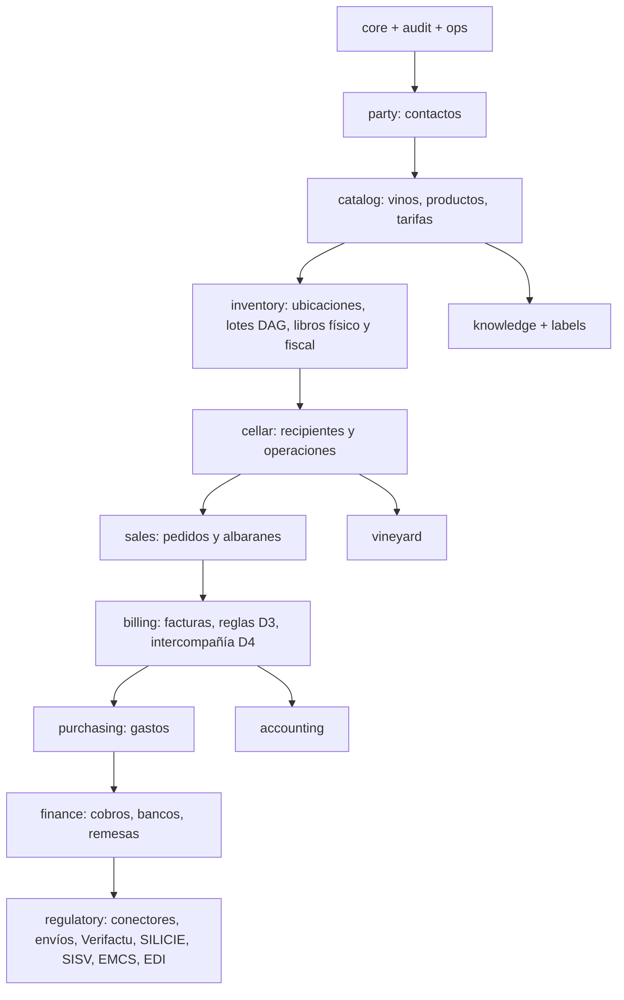
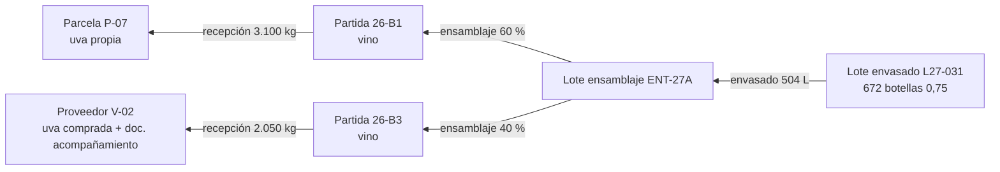
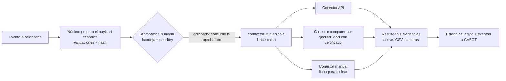

# 02 · Modelo de dominio

> Versión 1 · 31-10-2026; nota de la versión 2 (31-10-2026): en producción los datos viven en la **Knowledge Base de Timbal (DuckDB)**, no en PostgreSQL (ADR 002 v2). El modelo no cambia; los disparadores, funciones, bloqueos y roles que se citan aquí los implementa el núcleo con el mismo código de error (tabla de equivalencias de ADR 002).
> Fuente de verdad del modelo lógico: los ficheros SQL de [`02-ddl/`](02-ddl/) (PostgreSQL 16), **validados** contra un PostgreSQL 16 local con [`02-ddl/tests/invariants_test.sql`](02-ddl/tests/invariants_test.sql) (15 baterías, todas en verde el 31-10-2026). Este documento explica el modelo; si hay discrepancia, manda el SQL y se abre una pregunta.
> Decisiones aplicadas: D2 (dos stocks), D3 (entidad facturadora configurable), D4 (tarifa intercompañía validada por el asesor), §12.1 (conector intercambiable), §12.5 (MCP), §12.6 (módulos activables). Base de datos: Knowledge Base de Timbal (ADR 002 v2).

## 1. Convenciones (obligatorias para todo el código)

| Tema | Regla |
|---|---|
| Identificadores | `uuid`. La app genera **UUIDv7** (`api/src/core/ids.ts`, librería `uuidv7`). El `DEFAULT gen_random_uuid()` del SQL es solo red de seguridad. |
| Fechas | Instantes en `timestamptz` (UTC en BD). Fechas de negocio (`issue_date`, `fiscal_date`…) en `date`, calculadas en **Europe/Madrid** (`api/src/core/time.ts::businessDate(instant)`). |
| Dinero | `numeric(14,2)`; precios unitarios `numeric(14,6)`; porcentajes `numeric(5,2)`. En TypeScript **nunca** `number` para dinero: `Decimal` de `decimal.js` con `ROUND_HALF_UP`. |
| Volumen | **Mililitros enteros** (`bigint`); masa en **gramos** (`bigint`). Conversión a litros solo al presentar (3 decimales) o al generar ficheros regulatorios. |
| Cantidades de documento | `numeric(14,3)` (permite servicios fraccionados); el stock de envasado son **unidades enteras**. |
| Textos | UTF-8. Nombres de tabla y columna en inglés; textos de usuario en español con i18n. |
| Borrado | **Nunca** en tablas de negocio (`core.forbid_delete()` → `WC001`). Se descarta, anula o rectifica. |
| Actor | Toda escritura lleva actor: `withWrite(actor, …)` en el núcleo (en el DDL de referencia, `SELECT core.set_actor(tipo, id, en_nombre_de, request_id, motivo)`); sin actor, las tablas auditadas fallan con `WC002`. |
| Errores de negocio | `DomainError` con código `WCnnn` lanzado por las guardas del núcleo (en el DDL de referencia, `RAISE EXCEPTION 'WCnnn: …'`). Catálogo en §20; la API los mapea a HTTP. |

## 2. Mapa de módulos y esquemas

Cada módulo funcional (§12.6) tiene su esquema de PostgreSQL. Las dependencias van **siempre hacia abajo** (un módulo no referencia tablas de un módulo que dependa de él), salvo las claves foráneas "de cierre" que se añaden con `ALTER TABLE` en la migración del módulo superior y que están listadas en §21.



| Módulo (`core.module_state.module_key`) | Esquema(s) | Hito | Se puede desactivar | Depende de |
|---|---|---|---|---|
| (núcleo, siempre activo) | core, audit, ops | M0 | No | — |
| `contacts` | party | M1 | No (lo usan todos) | núcleo |
| `catalog` | catalog | M1 | No | contacts |
| `billing` | billing | M1 | No | catalog |
| `verifactu` | regulatory (verifactu_*) | M1 | **No** desde la fecha legal de cada entidad | billing |
| `mcp` | — (api) | M1 | Sí | núcleo |
| `sales` | sales | M2 | Sí | catalog |
| `inventory` | inventory | M2 | Sí (si se apaga, facturas sin efecto en stock) | catalog |
| `cellar` | cellar | M2 (mínimo) / M4 (completo) | Sí | inventory |
| `silicie` | regulatory (silicie_*) | M2 | Sí | inventory, cellar |
| `purchasing` | purchasing | M2 | Sí | contacts |
| `sisv` | regulatory (sisv_*) | M3 | Sí | cellar |
| `emcs` | regulatory (emcs_*) | M3 | Sí | sales, inventory |
| `edi` | regulatory (edi_*) | M3 | Sí | sales, billing |
| `assistant` | — (workforce) | M3 | Sí | mcp |
| `watchers` | — (workforce) | M3 | Sí | mcp |
| `vineyard` | vineyard | M4 | Sí | cellar |
| `organic` | — (informes sobre vineyard/cellar/purchasing) | M4 | Sí | vineyard |
| `finance` | finance | M6 | Sí | billing, purchasing |
| `accounting` | accounting | M7 | Sí | billing, purchasing, finance |
| `knowledge`, `labels` | knowledge, catalog.label_spec | Posterior | Sí | catalog |

**Qué significa "desactivado"** (lo aplica `api/src/modules/guard.ts`): rutas REST del módulo → `404` con código `WC_MODULE_DISABLED`; herramientas MCP del módulo → no se listan en `tools/list`; pantallas → ocultas en el menú y la ruta muestra "Módulo desactivado"; jobs programados del módulo → no se ejecutan; los datos se conservan. Activar o desactivar un módulo exige aprobación (`ops.approval_policy.kind = 'module_toggle'`) y comprueba dependencias (no se puede apagar `inventory` si `silicie` está activo).

## 3. Núcleo (`core`)

### 3.1 Entidades fiscales (`core.legal_entity`)
Dos filas: `PO` (persona física, `income_tax = 'IRPF'`) y `CVPO` (S.L., `IS`). Los NIF reales se cargan desde variables secretas al inicializar (`WINECORE_SEED_PO_TAX_ID`, `WINECORE_SEED_CVPO_TAX_ID`), **nunca** desde el repo.

### 3.2 Usuarios, roles y clientes de API
- `core.app_user`: personas. El login lo hace Timbal (ADR 008); WineCore solo admite usuarios con fila `active` en esta tabla (lista blanca por email).
- Roles fijos (`core.role`): `owner`, `approver`, `admin`, `cellar`, `field`, `advisor` para personas; `agent` y `mcp_client` para máquinas. Asignación por entidad (`core.user_role.legal_entity_id`, NULL = todas). La matriz rol → permisos está en `07-arquitectura.md` §6 y en código.
- `core.user_credential`: passkeys (WebAuthn) y TOTP para la **verificación reforzada** de aprobaciones (no para el login).
- `core.api_client` + `core.api_token`: cuentas de servicio (miembros de la workforce, CVBOT por MCP, ejecutor local). El token se guarda como SHA-256 y se muestra una sola vez; prefijo `wc_<tipo>_<6 caracteres>` para identificarlo en logs sin exponerlo.

### 3.3 Módulos y ajustes
`core.module_state` (§2) y `core.setting` (clave con puntos, p. ej. `billing.require_lot_on_wine_lines`, `inventory.fiscal_exit_rule`). El catálogo de ajustes con tipo, valor por defecto y efecto está en `07-arquitectura.md` §9.

### 3.4 Series y numeración sin huecos
- `core.number_series`: una fila por (entidad, tipo de documento, código, año). `prefix` es literal (p. ej. `CF27-`) y `padding` el número de dígitos.
- `core.take_number(series_id)` incrementa el contador **dentro de la transacción de emisión**: el bloqueo de fila serializa emisores concurrentes y, si la transacción se deshace, el contador vuelve atrás (probado en `invariants_test.sql` §1). Resultado: numeración correlativa sin huecos ni duplicados.
- Al empezar un año, el job `numbering-rollover` (1 de enero, 00:05 Europe/Madrid) crea las series del año nuevo copiando código y padding de las del año anterior (`is_default = true`). Si no existen al emitir, la emisión falla con `WC010` (nunca se inventa una serie).
- Series por defecto propuestas (Q-015): CVPO `CF`, `CR`, `CS` (simplificadas), `CA` (albaranes), `CP` (presupuestos/proformas), `CO` (pedidos); P.O `PF`, `PR`, `PS`, `PA`, `PP`, `PO`, `PI` (intercompañía), `OB` (operaciones de bodega), `AF` (aforos).

### 3.5 Adjuntos
`core.attachment` guarda metadatos y SHA-256; el contenido va a `core.attachment_content` en la misma Knowledge Base (ADR 002 §4), una sola vez por hash, sin borrado ni sustitución; OneDrive solo para copias de consulta. `core.attachment_link` lo asocia a cualquier fila con un **rol** (PDF de factura, captura de evidencia, acuse oficial…). Los adjuntos no se borran; su retención mínima es 6 años (`retention_until`), salvo datos personales sujetos a supresión (RGPD), que se marcan con `classification = 'personal_data'`.

## 4. Auditoría inmutable (`audit`)

1. **Qué se audita**: toda tabla con trigger `audit.capture()` (listados al final de cada migración): INSERT, UPDATE y, donde exista, DELETE, con la fila antes y después en JSON.
2. **Quién**: `actor_type`, `actor_id`, `on_behalf_of` (cuando un agente actúa en nombre de una persona, p. ej. CVBOT → Pedro) y `request_id` (correlación con la traza de la API y de Timbal), más `reason` (obligatorio en rectificaciones).
3. **Inmutable**: UPDATE/DELETE sobre `audit.audit_log` fallan (`WC003`); además, el rol de BD de la aplicación no tiene permiso UPDATE/DELETE (ADR 002 §4).
4. **Encadenado**: cada fila guarda `prev_hash` y `hash = sha256(prev_hash | campos)`, serializado con un *advisory lock*. `audit.verify_chain()` devuelve la primera fila rota. El job diario `audit-verify` (03:00) lo ejecuta y, si encuentra rotura, crea una alarma crítica y un evento `ops.audit.chain_broken`.
5. **Eventos sin cambio de fila** (login, aprobación vista, exportación, descarga de PDF): `audit.log_event(tabla, id, payload)`.

## 5. Operaciones transversales (`ops`)

### 5.1 Aprobaciones humanas (regla dura 0.3)
- `ops.approval_policy` define, por tipo de acción y entidad: nº de aprobaciones (1 por defecto), roles o usuarios permitidos, si exige **verificación reforzada** (passkey/TOTP en los últimos 5 minutos) y validez.
- `ops.approval_request` congela el **hash SHA-256 del contenido exacto** que se aprobará (`payload_sha256`), un resumen legible y los detalles (qué, a quién, cuántos registros, importes).
- `ops.approval_decision` solo se acepta si el hash coincide con el de la solicitud (`WC040`), si está pendiente (`WC042`) y no ha caducado (`WC043`); la decisión es inmutable (`WC041`).
- **Consumo único**: la acción aprobada (envío, emisión en lote) marca la solicitud como `consumed` dentro de la misma transacción en que reclama su ejecución. No se confía en el *approval gate* de Timbal para evitar dobles ejecuciones (Timbal no implementa `claim_approval` en su proveedor de plataforma; ver ADR 009).
- Qué requiere aprobación: ver tabla en `03-maquinas-estado.md` §12.

### 5.2 Eventos (outbox)
Toda transacción que cambia algo relevante inserta un evento en `ops.outbox_event` en la **misma** transacción. El job `outbox-dispatch` (cada 15 s) los publica a sus consumidores (workflows de Timbal, agentes vigilantes y el notificador de CVBOT) y marca `published_at`. Entrega al menos una vez: los consumidores son idempotentes por `id` de evento.

| Evento | Cuándo | Consumidores |
|---|---|---|
| `billing.invoice.issued` | Factura emitida | `regulatorio-verifactu` (si no se envió en línea), notificador |
| `billing.verifactu.rejected` / `billing.verifactu.send_failed` | Respuesta AEAT incorrecta / fallo técnico tras reintentos | notificador (CVBOT), panel |
| `billing.invoice.overdue` | Vigilante de cobros detecta vencida | notificador |
| `sales.order.received` | Pedido creado desde EDI, web o MCP | notificador |
| `sales.delivery_note.issued` | Albarán emitido | `regulatorio-emcs` (si requiere e-DA), conciliación |
| `inventory.reconciliation.differences` | Cuadre con diferencias | notificador |
| `regulatory.submission.pending_approval` | Envío listo para aprobar | notificador (con enlace a la bandeja) |
| `regulatory.submission.accepted` / `.rejected` / `.needs_human` | Resultado del conector | notificador, panel |
| `regulatory.obligation.due_soon` / `.overdue` | Calendario (7 y 1 días antes / vencida) | notificador |
| `ops.approval.requested` / `.decided` | Aprobación | notificador |
| `purchasing.supplier_invoice.captured` | Gasto capturado por OCR | notificador |
| `cellar.fermentation.alert` | Lectura fuera de rango o fermentación parada | notificador |
| `ops.audit.chain_broken` | Verificación diaria falla | alarma crítica |

El **payload** lleva identificadores y un resumen sin datos personales innecesarios (p. ej. número de factura e importe, no el email del cliente).

### 5.3 Idempotencia y confirmaciones MCP
- Toda escritura por API o MCP admite `Idempotency-Key`; `ops.idempotency_key` guarda el hash de la petición y la respuesta 7 días (repetir la misma clave con otro cuerpo → `409 WC_IDEMPOTENCY_MISMATCH`).
- Las herramientas MCP de escritura funcionan en dos pasos (`13-mcp.md` §3): `*_prepare` devuelve una vista previa y un token de confirmación (`ops.mcp_confirmation`, caducidad ≤ 15 min, de un solo uso, ligado al hash de los argumentos); `*_commit` lo consume.

## 6. Contactos (`party`)

- **Un maestro único** compartido por P.O y CVPO; las condiciones y cuentas contables por entidad van en `party.contact_entity_terms`.
- **Normalización del NIF** (`api/src/core/party/taxId.ts::normalizeTaxId`): mayúsculas; quitar espacios, puntos y guiones; quitar el prefijo `ES` si quedan 9 caracteres; clasificar en `nif` (8 dígitos + letra), `nie` (X/Y/Z + 7 dígitos + letra), `nif` de entidad (letra + 7 dígitos + dígito/letra), `vat_eu` (2 letras de país UE + resto) o `foreign_id`. Validar la letra de control de NIF/NIE y el dígito de control de CIF; si falla, el contacto se guarda con `tax_id_type = 'none'` y un aviso de calidad.
- **Unicidad**: un NIF solo puede estar en un contacto vivo (índice `contact_tax_id_uq`).
- **Duplicados**: reglas en orden `same_tax_id` → `same_email` → `same_name_postal_code` (nombre normalizado sin tildes, signos ni formas societarias + CP). La fusión (`party.contact_merge`) conserva el superviviente, guarda qué valor se quedó por campo y repunta los documentos.
- Datos personales: personas físicas (`kind = 'person'`) y personas de contacto son datos personales (RGPD): acceso por rol y exportables/suprimibles bajo petición (procedimiento en `07-arquitectura.md` §11).

## 7. Catálogo (`catalog`)

- **Vino** (`catalog.wine`) = la referencia comercial (p. ej. "Entredicho"). **Formato** (`catalog.format`) = envase (0,25 / 0,5 / 0,75 / 1,5 L, BIB). **Producto** (`catalog.product`) = lo que se vende y se cuenta: para vino, la combinación vino + añada + formato (índice único). Los productos de vino exigen lote en documentos (`requires_lot`).
- **Tarifas** (`final`, `distributor`, `shop`): versiones con vigencia `[valid_from, valid_to)`; nunca solapadas entre versiones activas (restricción `EXCLUDE`); una versión activa no se edita (`WC050`): se crea otra. El precio aplicable a una línea es el de la versión activa en la fecha del documento con el mayor `min_qty ≤ cantidad`.
- **Tarifa intercompañía (D4)**: `catalog.intercompany_tariff` = tarifa base (distribuidor) + descuento + vigencia + referencia a la validación del asesor. **WineCore no calcula ni discute el precio**: `unit_price = round(precio_base × (1 − descuento/100), 6)`. Controles: (a) sin tarifa activa para la fecha → no se puede cerrar la liquidación (`WC_IC_NO_TARIFF`); (b) si el precio queda **por debajo del coste estándar** vigente, la línea se marca `below_cost` y el cierre exige aprobación expresa; (c) sin coste estándar → aviso "coste desconocido" (Q-017).
- **Coste estándar** (`catalog.standard_cost`): por producto y fecha de vigencia; lo aporta Pedro (M2). El cálculo de costes por partida es posterior.
- **Materiales de envasado** (`catalog.format_material`): por formato, qué materiales lleva (corcho, cápsula de lacre, etiqueta…) por botella, por caja (caja de 6) y por palé (palé de 112 cajas). Son productos `packaging_material` con stock en unidades.

## 8. Base de inventario y trazabilidad (`inventory`)

### 8.1 Almacén fiscal y ubicaciones
- `inventory.tax_warehouse`: la fábrica de vino de P.O con su CAE (dato en BD, nunca en git) y actividad `V1`. En preproducción se usa el CAE de pruebas de la AEAT (`is_test = true`) cargado desde una variable secreta.
- `inventory.location`: ubicaciones físicas y virtuales. Semillas (Q-021 confirmará atributos):

| Código | Tipo | En perímetro fiscal | Controla |
|---|---|---|---|
| `BOD` | cellar | Sí (CAE de P.O) | P.O |
| `TIENDA` | cellar_shop | Por confirmar (Q-021) | P.O |
| `TFRP` | third_party_warehouse | No (supuesto S2) | P.O/CVPO según stock |
| `ECOVITIS` | third_party_warehouse | No | P.O |
| `GRUPAMAR` | forwarder | No | — |
| `VLC` | own_warehouse | No | CVPO |
| `TRANSITO` | in_transit (virtual) | — | — |
| `CLIENTE` | customer_virtual (virtual) | — | — |

### 8.2 Lotes y genealogía (DAG)
- **Lote** = identidad de un contenido. Nace en la recepción de uva (`grape`), sigue con el mismo código al pasar a mosto y vino (la "partida" que acompaña todo el proceso, reunión [00:48:33]) y se crea uno **nuevo** en cada ensamblaje (`blend`) y en cada envasado (`bottled`, el lote que va en la etiqueta).
- **Arista** `inventory.lot_edge(hijo ← padre, volumen o masa aportados, operación)`. Un trigger impide ciclos (`WC030`).
- Consultas: `inventory.lot_ancestors(lote)` (botella → parcela, para inspección) y `inventory.lot_descendants(lote)` (retirada de producto). La respuesta de trazabilidad completa la compone `api/src/core/traceability/traceLot.ts` uniendo ancestros con operaciones, análisis, adiciones, recepciones (parcela, proveedor y documento de acompañamiento) y documentos de salida.



## 9. Bodega (`cellar`)

### 9.1 Recipientes
`cellar.vessel`: depósitos de almacenamiento (`tank_storage`), vinificadores con camisa de frío (`tank_fermenter`, obligatoria la camisa), barricas, damajuanas. Código propio (`INOX-01`… `INOX-B7`, `BAR-001`, `DAM-001`) y **código SISV** (`sisv_code`, p. ej. `D1`) como atributo (Q-020). `qr_token` para etiquetar el depósito y abrir su ficha desde el móvil.

### 9.2 Operaciones
Una **operación** es un hecho de bodega con líneas de **entrada**, **salida** y **merma**. Se crea en borrador, se confirma (toma número de la serie `cellar_operation`) y, una vez confirmada, solo se corrige con otra operación que la **rectifica** (`rectifies_operation_id`, motivo obligatorio) y que anula sus movimientos con movimientos `reversal`.

| `op_type` | Entradas | Salidas | Merma | Conservación al confirmar (`WC020`) | Efecto en libro físico | Libro SISV (sisv.md) | SILICIE (silicie.md) |
|---|---|---|---|---|---|---|---|
| `reception` | — | lote de uva (g) | — | solo salidas | `cellar_in` uva en `BOD` | Entrada de uva | No (la uva no es producto objeto) |
| `bulk_reception` | — | lote de vino/mosto (mL) en recipiente | — | solo salidas | `cellar_in` | Entrada de producto | Sí (entrada con documento) |
| `crushing_pressing` | uva (g) | mosto (mL) en recipientes | opcional (g) | uva > 0 y mosto > 0 | `cellar_out` uva, `cellar_in` mosto | Elaboración | Según silicie.md |
| `fermentation_end` | mosto (mL) | vino (mL) mismo lote | lías (mL) | entra = sale + merma | `cellar_out` mosto, `cellar_in` vino, `loss` | Elaboración | Según silicie.md (producción) |
| `racking` (trasiego) | lote en recipiente A | mismo lote en B (uno o varios) | lías | entra = sale + merma | `cellar_out`/`cellar_in`/`loss` | Trasiegos | **No** entre depósitos del mismo mayor. **Sí** si cruza depósito ↔ barrica de madera no revestida: `ledger_change_out`/`ledger_change_in` (A17/A16) y la merma como A30 (SILICIE 2.0, silicie.md §5) |
| `blend` (ensamblaje) | varios lotes | lote nuevo | sí | entra = sale + merma | ídem + aristas DAG | Ensamblaje/elaboración | No (salvo cambio de clase) |
| `filtration` | lote | mismo lote | sí | entra = sale + merma | ídem | Prácticas enológicas | No |
| `addition` | — | — | — | sin líneas de volumen; filas en `cellar.addition` | ninguno | Prácticas enológicas (productos) | No |
| `stabilization`, `cleaning` | — | — | — | sin volumen | ninguno | Registro de proceso / higiene | No |
| `sampling` | lote | — | (muestra) | solo merma/entrada | `loss` | Salida de muestras | Según silicie.md |
| `bottling` (envasado) | lote a granel (mL) | lote envasado nuevo: N unidades de un producto | sí (mL) | entra = N × volumen nominal + merma | `cellar_out` granel; `cellar_in` envasado (`packaged_unlabeled` o `packaged_labeled`) | Envasado + Vinos envasados | **Sí** (envasado con merma) |
| `labeling` | N unidades sin etiquetar | N′ etiquetadas | roturas (ud) | entra = sale + roturas (unidades) | `cellar_out`/`cellar_in` + `loss` | Vinos envasados | Solo roturas |
| `loss` | lote (mL o ud) | — | sí | solo merma | `loss` | Mermas | Sí |
| `destruction` | lote | — | sí | solo merma; motivo y aprobación | `loss` | Mermas/destrucción | Sí ("mermas de almacenamiento") |

Las operaciones generan sus movimientos de stock **en la misma transacción** de la confirmación (`api/src/core/cellar/confirmOperation.ts`): cada línea `input` → movimiento negativo; `output` → positivo; `loss` → movimiento `loss` con `loss_kind`. Mermas `incident` y destrucciones exigen aprobación (`cellar_loss`).

### 9.3 Analíticas, fermentación, catas y adiciones
- `cellar.analysis` + `cellar.analysis_result` con parámetros de catálogo (`cellar.analysis_parameter`: densidad, grado, acidez total y volátil, pH, SO2 libre/total, glucosa+fructosa, málico, láctico…). El "pack FML" del laboratorio se registra como `kind = 'fml_pack'` con el PDF adjunto.
- `cellar.fermentation_reading`: densidad y temperatura dos veces al día; la ficha del lote dibuja la cinética (densidad y temperatura frente al tiempo). Alerta si la densidad no baja ≥ 0,002 en 48 h antes de llegar a 0,995 o si la temperatura sale de [10, 30] °C (umbrales en ajustes `cellar.alerts.*`).
- `cellar.addition`: producto (SO2, ácido tartárico), cantidad, dosis (g/hL, mg/L) y factura de compra (prueba ecológica). Alimenta la lista de ingredientes de la etiqueta y el cuaderno ecológico.
- **Consumo de materiales al envasar**: el envasado calcula los materiales con la lista del formato (por botella, por caja y por palé o fracción), los guarda en `cellar.material_consumption` y los descuenta del stock en la misma operación; si falta stock de algún material, avisa antes de confirmar.

## 10. Libros de movimientos: físico y fiscal (D2)

### 10.1 Por qué dos libros
D2: el stock **físico** se mueve con el albarán (y con las operaciones de bodega); el stock **fiscal** se mueve con la factura. Son dos realidades que deben poder explicarse una con la otra en cualquier momento (inspección), así que se guardan en **dos libros** independientes, solo de inserción, con referencia cruzada a sus documentos.

| | Libro físico `inventory.stock_move` | Libro fiscal `inventory.fiscal_move` |
|---|---|---|
| Qué representa | Dónde está cada cosa ahora: ubicación, recipiente, propietario, lote, producto, estado | Existencias contables del establecimiento con CAE (fábrica de P.O) a efectos de II.EE. y SILICIE |
| Unidad | mL (granel), unidades (envasado), g (uva) | mL (+ unidades en envasado) y grado |
| Lo mueven | Operaciones de bodega, albaranes, traspasos, cambios de propietario, aforos | Producción/envasado/mermas (operaciones), salidas (factura por defecto, D2), devoluciones, regularizaciones |
| Clave del saldo | (ubicación, recipiente, propietario, lote, producto, estado) | (establecimiento, mayor `bulk` / `bulk_wood` / `packaged`, referencia SILICIE en `excise_product_key`) |
| Invariantes | Saldo ≥ 0 (`WC024`); capacidad (`WC025`); un lote por recipiente (`WC026`); unidades × volumen nominal = volumen (`WC023`) | Saldo ≥ 0 (`WC027`); el cambio de mayor cuadra (`WC028`) |
| Corrección | Movimiento `reversal` (nunca UPDATE: `WC022`) | Movimiento `reversal`; solo se permite enlazar el asiento SILICIE una vez |
| Cierre | `period_lock('physical')` | `period_lock('fiscal')` al presentar SILICIE (`WC021`) |

### 10.2 Regla de fecha fiscal (configurable; Q-010)
Ajuste `inventory.fiscal_exit_rule` (JSON) con valor por defecto (D2):

```json
{
  "domestic_sale":   "invoice",
  "intercompany":    "invoice",
  "consignment":     "invoice",
  "export_with_ead": "ead_dispatch",
  "intra_eu_with_ead": "ead_dispatch",
  "loss_and_destruction": "operation",
  "packaging":       "operation"
}
```

- `invoice`: el movimiento fiscal de salida se crea al **emitir la factura de P.O** que cubre la mercancía (incluida la factura intercompañía P.O → CVPO), con `fiscal_date = issue_date` y `physical_date` = fecha del albarán.
- `delivery_note`: se crearía al emitir el albarán (alternativa si el asesor lo indica, Q-010). Cambiar la regla **no** reescribe el pasado: aplica desde la fecha de cambio y lo registra la auditoría.
- `ead_dispatch`: fecha de expedición del e-DA (salidas con ARC).
- Las facturas de **CVPO** no generan movimientos fiscales (CVPO no tiene CAE).

### 10.3 Qué genera cada documento

| Documento / hecho | Libro físico | Libro fiscal |
|---|---|---|
| Operación de bodega confirmada | Sus líneas (§9.2) | Si `silicie_relevant`: según la tabla de silicie.md |
| Albarán de venta emitido (`kind = sale`) | `delivery_out` desde `from_location` (propietario = quien vende; si el stock es de P.O y vende CVPO, antes `ownership_out/in`, §12.6) | Nada (con la regla por defecto) |
| Albarán de consigna/traspaso | `delivery_out` en origen + `transfer_in` en destino | Nada |
| Factura de P.O emitida (incl. intercompañía) | Nada | Salida `exit_domestic` / `exit_export` / `exit_intra_eu` / `exit_canary` por las líneas de vino cuya mercancía salió del perímetro fiscal, con la fecha de la factura |
| Factura de P.O sin albarán previo (venta directa en bodega) | `delivery_out` implícito (se crea un albarán automático `kind = sale` en la misma transacción) | Salida con la fecha de la factura |
| Rectificativa de P.O por devolución | `return_in` (si vuelve la mercancía) | `return_in` |
| e-DA expedido | — | Si la regla es `ead_dispatch`, salida con la fecha de expedición y justificante = ARC |
| Aforo aprobado y contabilizado | `count_adjust_in/out` por diferencia | `regularization_in/out` por diferencia en el perímetro fiscal, con motivo |
| Aforo de arranque (`kind = opening`) | `opening` | `opening` |

### 10.4 Invariante de conservación (propiedad que prueban los tests)
Para cada lote y recipiente, y para todo instante *t*:

\[ \text{existencias}(t) = \sum \text{entradas}(\le t) - \sum \text{salidas}(\le t) - \sum \text{mermas}(\le t) \ge 0 \]

y para cada operación conservativa: \( \sum \text{entradas} = \sum \text{salidas} + \sum \text{mermas} \) (exacto, en mL o unidades). La BD comprueba el estado final al confirmar; la app comprueba además que ningún movimiento **con fecha pasada** deja un saldo negativo en una fecha intermedia (`api/src/core/inventory/assertRunningBalance.ts`). Los tests de propiedades (`11-tests.md` §5) generan secuencias aleatorias de operaciones válidas e inválidas y comprueban que siempre se cumple.

### 10.5 Aforo (inventario físico)
`inventory.inventory_count` + líneas: esperado (calculado del libro a `counted_at`) frente a contado (método: varilla, caudalímetro, nivel, recuento de unidades…), con foto opcional y motivo de la diferencia. Estados: borrador → contando → revisión → aprobado (firma de una persona con verificación reforzada) → contabilizado (genera regularizaciones). El aforo de arranque (Q-013) crea los saldos iniciales (`opening`) de ambos libros.

### 10.6 Conciliación físico ↔ fiscal (informe de diferencias)
`api/src/core/inventory/reconcilePhysicalFiscal.ts` (y la herramienta MCP `inventory_reconcile_physical_fiscal`) compara, para el perímetro fiscal y un rango de fechas, las salidas físicas (albaranes) con las salidas fiscales (facturas de P.O):
- **Albaranes sin facturar**: salieron físicamente pero aún no fiscalmente (caso del operador logístico en consigna). Columna "días desde la salida".
- **Facturas sin salida física**: facturado pero no ha salido (anticipos, mercancía retenida).
- **Diferencias de cantidad** por lote y producto.
El resultado se guarda en `regulatory.reconciliation_run/diff` (`kind = 'physical_vs_fiscal'`) y, si hay diferencias, emite `inventory.reconciliation.differences`.

## 11. Comercial (`sales`)

- **Canales** (`sales.channel`): directo, distribuidor, restauración, El Corte Inglés (EDI), web, ferias, tienda de la bodega, exportación, institucional, intercompañía.
- **Presupuesto/proforma** → **pedido** → **albarán** → **factura**. El presupuesto es opcional; el albarán es el documento logístico obligatorio salvo venta directa en mostrador (que crea uno implícito).
- **Pedido**: al confirmarse, el motor de reglas D3 fija `legal_entity_id` y guarda `billing_rule_id` + la traza (`billing_rule_trace`: reglas evaluadas y cuál ganó). Fuentes: manual, EDI, web, MCP, importación. `external_ref` único por fuente (evita pedidos EDI o web duplicados).
- **Albarán**: al emitirse genera los movimientos físicos (§10.3). Emitido = no editable (`WC060`); si no ha salido, se anula con motivo (y se revierten sus movimientos); si ya salió, la corrección es una devolución. `invoicing_status` se actualiza al facturar sus líneas.
- **Incidencias de transporte**: roturas, pérdidas, rechazos, con plazo de reclamación y fotos.

## 12. Facturación (`billing`)

### 12.1 Códigos de impuesto
`billing.tax_code` traduce cada tratamiento fiscal a los campos de Verifactu (impuesto, clave de régimen, calificación o exención) y a las menciones legales en español e inglés. Semillas: `IVA21`, `IVA21_RE` (recargo 5,2 %), `IVA21_ALQ` (arrendamiento con retención 19 %), `EXP_E2` (exportación, Reino Unido y Canarias), `INTRA_E5` (entrega intracomunitaria, exige NIF-IVA validado en VIES), `NS_LOC`. Los valores de las listas oficiales se verifican en `04-regulatorio/verifactu.md`.

### 12.2 Motor de reglas de entidad facturadora (D3)
- Conjuntos de reglas versionados (`billing.billing_rule_set`, uno activo) con reglas de ámbito **cliente**, **canal** o **por defecto**. Precedencia: cliente > canal > defecto. Función determinista `billing.resolve_issuing_entity(cliente, canal)` (probada en SQL).
- Activar un conjunto nuevo exige aprobación (`billing_rules_activation`). Los documentos ya creados conservan la regla y versión que los decidió; un cambio de reglas nunca reasigna documentos existentes.
- Reglas iniciales propuestas: Q-025.

### 12.3 Cálculo de una factura (exacto; `api/src/core/billing/computeInvoice.ts`)
1. Base de línea: `line_base = round_half_up(quantity × unit_price × (1 − discount_pct/100), 2)`.
2. Agrupar líneas por `tax_code`. Para cada grupo: `base = Σ line_base`; `quota = round_half_up(base × rate/100, 2)`; `surcharge_quota = round_half_up(base × surcharge_rate/100, 2)`; `withholding = round_half_up(base × withholding_rate/100, 2)`.
3. Totales: `subtotal = Σ base`; `tax_total = Σ quota`; `surcharge_total = Σ surcharge_quota`; `withholding_total = Σ withholding`; `total = subtotal + tax_total + surcharge_total − withholding_total` (importe a cobrar).
4. Importes de Verifactu (`CuotaTotal`, `ImporteTotal`) según las reglas de `04-regulatorio/verifactu.md` §5 (no confundir con el "a cobrar" si hay retención).
5. Vencimientos: un plazo con `due_date = issue_date + payment_terms_days` (del cliente o del documento).
6. Validaciones para emitir (fallan con código y mensaje en español): cliente con NIF si `F1` (`WC_INV_TAX_ID_REQUIRED`); NIF-IVA validado si hay `INTRA_E5`; lote informado en líneas de vino (`WC_INV_LOT_REQUIRED`); total ≠ 0; serie activa del año de `issue_date`; `issue_date` no anterior a la última factura emitida en la serie (correlatividad temporal, `WC_INV_DATE_ORDER`); al menos una línea; para rectificativas, referencia a la(s) factura(s) rectificada(s) y motivo.

### 12.4 Emisión (transacción única)
`api/src/core/billing/issueInvoice.ts`: bloquea la factura → valida → `take_number` → fija `issue_date`, `issued_at`, `customer_snapshot` → calcula y guarda desglose (`invoice_tax`) y vencimientos → **genera el registro Verifactu** (alta, encadenado; `regulatory.verifactu_record`) si la entidad tiene instalación activa en esa fecha → efectos de stock y fiscales (§10.3) si los módulos están activos → evento `billing.invoice.issued` → commit. El PDF (con QR) se genera después a partir de los datos congelados y se guarda como adjunto (`pdf_attachment_id`, una sola vez).

### 12.5 Rectificativas y anulaciones
- **Rectificativa** (R1–R5, por sustitución `S` o por diferencias `I`): factura nueva en la serie de rectificativas, con `billing.invoice_rectification` apuntando a la(s) original(es) (también a facturas de Holded, por número y fecha).
- **Anulación** (`status = 'voided'`): solo para facturas emitidas por error que **no debieron expedirse**; genera el registro Verifactu de anulación. No libera el número.
- Borradores: se descartan (`discarded`); nunca se borran.

### 12.6 Intercompañía P.O → CVPO (D4)
1. **Cambio de propietario**: cuando CVPO emite un albarán de venta desde una ubicación donde el stock es de P.O, la misma transacción inserta `ownership_out` (P.O) + `ownership_in` (CVPO) en esa ubicación y después la salida (`delivery_out`, propietario CVPO). Lo mismo al traspasar stock de P.O a un almacén de CVPO.
2. **Línea de liquidación**: por cada cambio de propietario, una `intercompany_settlement_line` en la liquidación abierta del periodo (mensual por defecto, Q-016) con precio de la tarifa intercompañía vigente en la fecha y coste estándar.
3. **Cierre del periodo** (job `intercompany-close`, día 1 a las 06:00): cierra la liquidación del mes anterior, comprueba tarifa y costes, y crea la **factura intercompañía en borrador** (serie `PI`, recapitulativa con `operation_date` = último día del periodo) agrupando por producto y lote, y pide aprobación (`intercompany_invoice_issue`). La fecha de expedición es la del día en que se emite y debe ser **anterior al día 16** del mes siguiente (RD 1619/2012, arts. 11 y 13); el vigilante avisa desde el día 12.
4. **Emisión**: al aprobar, se emite la factura de P.O (Verifactu de P.O cuando proceda), se crea la **factura recibida espejo** en CVPO (`purchasing.supplier_invoice`, `source = 'intercompany'`, aprobada en la misma acción) y se generan las salidas fiscales de la fábrica con la fecha de la factura (D2).
- **Exportación**: la factura a un cliente fuera de la UE lleva el EORI de la entidad (`core.legal_entity.eori`) y el del cliente (`party.contact.eori`) si lo tiene, Incoterm, código NC por línea, país de origen, pesos y bultos. Los documentos que pide cada país (factura comercial, lista de bultos, certificado de origen…) se configuran en el ajuste `billing.export_documents_by_country`; WineCore genera los que salen de la factura y muestra la lista de los demás.
- **Envío automático** (decisión de Pedro, 31-10-2026): al emitir, el evento `billing.invoice.issued` encola el envío del PDF al correo de facturación del cliente; cada intento queda en `billing.invoice_delivery` (destinatarios, resultado, rebote, reenvío) y la factura guarda el último envío (`sent_at`, `sent_channel`). Un fallo o rebote avisa en el panel y a CVBOT.

## 13. Compras y gastos (`purchasing`)
Facturas recibidas por foto, PDF o reenvío. El agente `ocr-gastos` crea un registro `captured` con la extracción y su confianza; administración lo **valida** (proveedor, número, fechas, líneas, IVA deducible, cuenta de gasto); Pedro lo **aprueba**. Duplicados: mismo proveedor + número en la misma entidad → `duplicate`. Categorías con cuenta por defecto y marca de relevancia ecológica.

## 14. Finanzas (`finance`)
Cobros y pagos (`finance.payment`) con imputaciones parciales a facturas (`payment_allocation`) que actualizan automáticamente lo cobrado y el estado (`WC100` si se imputa de más). Extractos bancarios importados (Norma 43, CAMT.053 o CSV) con deduplicación por línea y sugerencias de conciliación. Remesas SEPA: WineCore genera el fichero (pain.008/pain.001) tras aprobación; **una persona** lo sube al banco (WineCore no guarda claves bancarias).

## 15. Viñedo (`vineyard`, M4)
Parcelas con referencia SIGPAC completa y Registro Vitícola, variedades, **tratamientos** (fecha, operario, producto, dosis, método, factura) para la certificación ecológica, labores, **controles de maduración** (voz, foto y previsión meteorológica) y vendimia, enlazada con la recepción en bodega.

## 16. Contabilidad (`accounting`, M7)
Plan de cuentas por entidad, ejercicios, asientos por partida doble que deben cuadrar (`WC110`) e inmutables (`WC111`), generados desde documentos con reglas de contabilización; saldos de apertura del asesor (R6). Alcance pendiente de Q-022.

## 17. Conocimiento y etiquetas (posterior)
`knowledge.tasting_note` (notas de cata años después, vinculadas a vino, añada o lote) y `catalog.label_spec` (denominación, grado, volumen, alérgenos, ingredientes, nutrición, e-etiqueta, código del organismo de control ecológico), versionadas y aprobadas.

## 18. Regulatorio (`regulatory`)

### 18.1 Conector intercambiable (§12.1)

- El **qué** (payload canónico, validaciones, calendario) vive en el núcleo y es igual para cualquier conector.
- El **cómo** lo decide `regulatory.connector` (modo `api`, `computer_use`, `file_upload` o `manual`; entorno de pruebas o producción; ejecutor).
- **Un solo envío a la vez**: índice único parcial sobre `connector_run` (`submit` en curso) y reclamación dentro de la cola del escritor único + `lease_until` (en el DDL de referencia, `SELECT … FOR UPDATE SKIP LOCKED`). Si el ejecutor muere, el *lease* caduca y el intento pasa a `expired`; reintentar crea un intento nuevo **solo** tras comprobar en el portal que el anterior no llegó (acción `check_status`).
- **Evidencias**: XML/fichero enviado, respuesta, acuse/CSV y capturas de pantalla (computer use) como adjuntos con rol `evidence_*` / `official_receipt`, conservados ≥ 6 años.

### 18.2 Verifactu
Instalación por entidad y entorno, registros de alta y anulación **encadenados** por instalación (`chain_seq`, `previous_hash`; el trigger exige que la cadena solo crezca por el final y que el registro no cambie salvo su estado de envío: `WC130`), control de flujo (`next_send_not_before`) y registro de eventos. Detalle campo a campo y huella en `04-regulatorio/verifactu.md`.

### 18.3 SILICIE, SISV, EMCS y EDI
- **SILICIE**: ejercicios por CAE y año; asientos con correlativo interno, campos oficiales en `fields` (esquema JSON en `04-regulatorio/silicie.md`), enlace con los movimientos fiscales que los originan y número de asiento de la AEAT.
- **SISV**: anotaciones por libro derivadas de operaciones y documentos; estado hasta `signed` (libro firmado y remitido).
- **EMCS**: e-DA (suspensivo) o e-DAS (impuesto pagado) con LRN, ARC, destino, partidas y recepción.
- **EDI**: mensajes entrantes (pedido, confirmación de pago, texto) y salientes (factura), con captura o fichero original y vínculo a pedido/factura.
- **Calendario** (`regulatory.obligation`) y **cuadres** (`reconciliation_run/diff`: SISV ↔ SILICIE, físico ↔ fiscal, WineCore ↔ AEAT).

## 19. Catálogo de invariantes

| ID | Invariante | Dónde se garantiza | Test |
|---|---|---|---|
| I-01 | Nada de negocio se borra | Trigger `forbid_delete` | SQL §6, §8, §9 |
| I-02 | Toda escritura tiene actor | `audit.capture` | SQL §2 |
| I-03 | Auditoría inmutable y encadenada | Triggers + `verify_chain` | SQL §3, §15 |
| I-04 | Numeración correlativa sin huecos por serie | `take_number` en la transacción | SQL §1 |
| I-05 | Conservación de volumen por operación | Constraint trigger diferido | SQL §6; propiedades |
| I-06 | Saldos físicos ≥ 0, capacidad, un lote por recipiente | Constraint trigger diferido | SQL §4, §5 |
| I-07 | Saldo fiscal ≥ 0 | Constraint trigger diferido | Propiedades |
| I-08 | Ningún saldo negativo en fechas intermedias | App (`assertRunningBalance`) | Unit + propiedades |
| I-09 | Genealogía acíclica | Trigger | SQL §7 |
| I-10 | Libros solo de inserción; periodos cerrados intocables | Triggers | SQL §8 |
| I-11 | Factura emitida inmutable (salvo cobro, envío, PDF y enlace Verifactu una vez) | Trigger | SQL §9 |
| I-12 | No se cobra más del total | Trigger | SQL §10 |
| I-13 | Aprobación ligada al hash del contenido y de un solo uso | Triggers + consumo en app | SQL §11 |
| I-14 | Cadena Verifactu solo crece por el final; registros inmutables | Trigger | SQL §12 |
| I-15 | Un único intento de envío en curso por envío | Índice único parcial | SQL §13 |
| I-16 | Entidad facturadora determinista (cliente > canal > defecto) | Función SQL + app | SQL §14 |
| I-17 | Físico − fiscal = albaranes sin facturar − facturas sin salida | Informe de conciliación | Integración |
| I-18 | SISV y SILICIE coinciden en salidas y envasados del periodo | Cuadre `sisv_vs_silicie` | Integración + golden |

## 20. Códigos de error de negocio

| Código | Significado | HTTP |
|---|---|---|
| WC001 | Borrado prohibido | 409 |
| WC002 | Falta contexto de actor | 500 (error de programación) |
| WC003 | Auditoría inmutable | 409 |
| WC010 / WC011 | Serie inexistente o inactiva / rango agotado | 409 |
| WC020 | Conservación de volumen/unidades incumplida | 422 |
| WC021 | Periodo cerrado | 409 |
| WC022 | Movimiento inmutable | 409 |
| WC023 | Unidades y volumen incoherentes | 422 |
| WC024 / WC025 / WC026 / WC027 | Saldo negativo / capacidad / varios lotes / saldo fiscal negativo | 422 |
| WC028 | Cambio de mayor fiscal (depósito ↔ barrica) que no cuadra | 422 |
| WC030 | Ciclo en la genealogía | 422 |
| WC031 / WC032 | Operación de bodega no editable | 409 |
| WC040–WC043 | Aprobación: hash distinto / inmutable / no pendiente / caducada | 409 |
| WC050 | Versión de tarifa no editable | 409 |
| WC060 | Albarán no editable | 409 |
| WC070 | Reglas de facturación no editables | 409 |
| WC080 | Factura emitida no editable | 409 |
| WC090 | Factura recibida aprobada no editable | 409 |
| WC100 / WC101 | Exceso de cobro / documento no cobrable | 422 |
| WC110 / WC111 | Asiento descuadrado / inmutable | 422 / 409 |
| WC120 / WC121 | Envío congelado / cerrado | 409 |
| WC122 | Identificación de un mayor de SILICIE modificada (se crea otro y se traspasa) | 409 |
| WC130 | Encadenamiento Verifactu incorrecto o registro inmutable | 409 |
| WC131 | Hora de generación del registro Verifactu anterior a la del registro anterior | 409 |
| `WC_MODULE_DISABLED` | Módulo desactivado | 404 |
| `WC_FORBIDDEN` | Sin permiso | 403 |
| `WC_STEP_UP_REQUIRED` | Falta verificación reforzada reciente | 401 |
| `WC_VALIDATION` | Validación de entrada (detalle por campo) | 422 |
| `WC_IDEMPOTENCY_MISMATCH` | Misma clave, distinta petición | 409 |
| `WC_INV_*`, `WC_IC_*`, `WC_REG_*` | Validaciones de facturación, intercompañía y regulatorio (listadas en cada tarea) | 422 |

## 21. Migraciones iniciales

Se aplican en orden con `api/db/migrate.ts` (tabla `public.schema_migrations(version, applied_at, checksum)`; cada fichero se aplica en una transacción; un checksum distinto de uno ya aplicado detiene el despliegue). Las migraciones nunca se editan después de aplicarse en `staging`: se añade otra.

| Fichero | Contenido | Necesaria en |
|---|---|---|
| `0001_core.sql` | Esquemas, extensiones, actor, entidades, usuarios, roles, módulos, ajustes, series, adjuntos, auditoría | M0 |
| `0002_ops.sql` | Aprobaciones, outbox, idempotencia, confirmaciones MCP, jobs | M0 |
| `0003_party.sql` | Contactos | M1 |
| `0004_catalog.sql` | Vinos, formatos, productos, tarifas, intercompañía, coste | M1 |
| `0005_inventory_base.sql` | Almacén fiscal, ubicaciones, lotes, genealogía | M1 (lotes en líneas) |
| `0006_cellar.sql` | Recipientes, operaciones, analíticas | M1 (tablas) / uso en M2 |
| `0007_ledgers.sql` | Libros físico y fiscal, aforos | M1 (tablas) / uso en M2 |
| `0008_sales.sql` | Canales, presupuestos, pedidos, albaranes | M1 |
| `0009_billing.sql` | Impuestos, reglas D3, facturas, intercompañía | M1 |
| `0010_purchasing.sql` | Gastos | M1 (tablas) |
| `0011_finance.sql` | Cobros, bancos, remesas | M1 (cobros básicos) |
| `0012_regulatory.sql` | Conectores, envíos, Verifactu, SILICIE, SISV, EMCS, EDI, calendario, cuadres | M1 |
| `0013_vineyard.sql` | Viñedo | M1 (tablas) / uso en M4 |
| `0014_accounting.sql` | Contabilidad | M1 (tablas) / uso en M7 |
| `0015_knowledge_labels.sql` | Notas de cata y etiquetas | M1 (tablas) / uso posterior |

Todas se aplican desde M0/M1 (el esquema completo existe desde el principio y los módulos se activan después): así no hay migraciones transversales a mitad de proyecto (criterio de escalado §7.3.4).

**Claves foráneas de cierre** (añadidas con `ALTER TABLE` en la migración del módulo superior): `party.contact.default_price_list_id` (0004), `inventory.lot.created_by_operation_id` y `lot_edge.operation_id` (0006), `party.contact.default_channel` (0008), `sales.sales_order.billing_rule_*`, `catalog.product.default_tax_code`, `*_line.tax_code` (0009), `cellar.addition.supplier_invoice_id`, `billing.intercompany_settlement.purchase_invoice_id` (0010), `billing.invoice.verifactu_record_id`, `inventory.fiscal_move.silicie_entry_id`, `sales.delivery_note.emcs_document_id`, `sales.sales_order.edi_message_id` (0012).

## 22. Datos de referencia y semillas

- Incluidos en las migraciones: roles, canales, códigos de impuesto, categorías de gasto, parámetros analíticos.
- Semilla de arranque (`api/db/seed.ts`, idempotente, ejecutada una vez por entorno): las dos entidades (NIF desde secretos), series del año en curso, ubicaciones de §8.1, módulos (`contacts`, `catalog`, `billing`, `verifactu`, `mcp` activos en M1), política de aprobaciones por defecto (`03-maquinas-estado.md` §12), conjunto de reglas D3 inicial (Q-025) en borrador.
- **Staging y dev usan solo datos sintéticos** generados por `api/db/synthetic.ts` (`11-tests.md` §7); nunca copias de producción.
