# 03 · Máquinas de estado

> Versión 1 · 31-10-2026. Cada máquina se implementa en `api/src/core/<módulo>/<entidad>.state.ts` como una tabla de transiciones **declarativa** (`{ from, event, to, guard, effects, permission }`) y una única función `transition(entity, event, ctx)` que: comprueba permiso → evalúa guardas → aplica efectos en la misma transacción → escribe auditoría (`reason` cuando se exige) → inserta eventos de outbox. Cualquier transición no listada aquí es **ilegal** (`409 WC_ILLEGAL_TRANSITION`).
> Convenciones de las tablas: **Guarda** = condición que debe cumplirse; **Efectos** = lo que ocurre en la misma transacción; **Permiso** = clave de la matriz de `07-arquitectura.md` §6. "Aprobación" remite a §12.

## 1. Lote (`inventory.lot`)

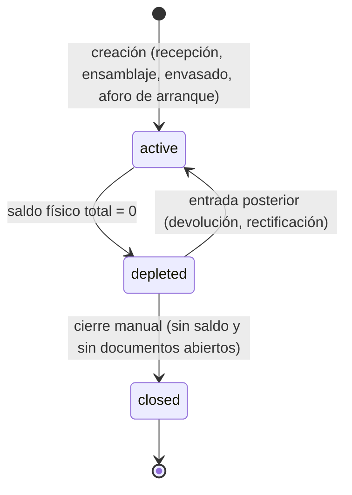

| Desde | Evento | Hacia | Guarda | Efectos | Permiso |
|---|---|---|---|---|---|
| — | `create` | active | Código único por productor; `kind` coherente con la operación de origen | Fila de lote; aristas DAG si hay padres | `cellar.operate` |
| active | `stock_reached_zero` (automático al confirmar movimientos) | depleted | Σ saldo físico del lote (todas las ubicaciones) = 0 | Ninguno | sistema |
| depleted | `stock_reentered` (automático) | active | Σ saldo > 0 | Ninguno | sistema |
| depleted | `close` | closed | Sin saldo físico ni fiscal; sin documentos en borrador que lo usen | Auditoría con motivo | `cellar.manage` |

## 2. Recipiente y operación de bodega

### 2.1 Recipiente (`cellar.vessel`)
El estado de **contenido** se deriva del libro físico (vacío / con lote X y volumen V); el estado **administrativo** es `status`.

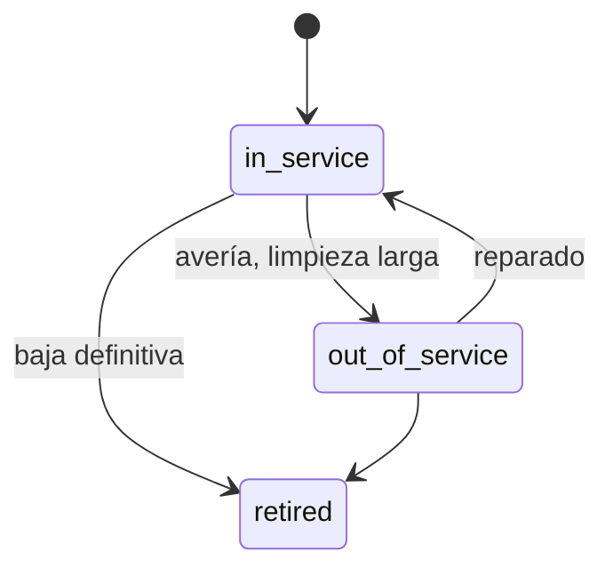

| Desde | Evento | Hacia | Guarda | Efectos | Permiso |
|---|---|---|---|---|---|
| in_service | `take_out_of_service` | out_of_service | Recipiente vacío (saldo 0) | Motivo en auditoría | `cellar.manage` |
| out_of_service | `return_to_service` | in_service | — | — | `cellar.manage` |
| in_service, out_of_service | `retire` | retired | Vacío; sin operaciones en borrador | — | `owner` |

Reglas derivadas del contenido: no se puede llenar un recipiente `out_of_service` o `retired` (`WC_VESSEL_NOT_IN_SERVICE`); un recipiente con otro lote solo puede recibir vino mediante `blend` (`WC026`).

### 2.2 Operación de bodega (`cellar.operation`)

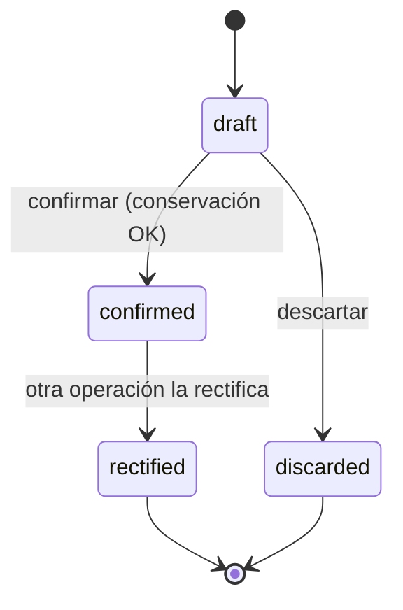

| Desde | Evento | Hacia | Guarda | Efectos | Permiso |
|---|---|---|---|---|---|
| — | `create` | draft | Módulo `cellar` activo; tipo válido | — | `cellar.operate` |
| draft | `update_lines` | draft | — | Reemplaza líneas | `cellar.operate` |
| draft | `confirm` | confirmed | Conservación (`WC020`); recipientes en servicio; saldos suficientes a la fecha (`assertRunningBalance`); periodo físico abierto; si `destruction` o merma `incident`: aprobación `cellar_loss` consumida | `take_number('cellar_operation')`; movimientos físicos; lote nuevo y aristas (blend/bottling); movimientos fiscales si `silicie_relevant`; anotaciones SISV pendientes (`sisv_entry`); evento `cellar.operation.confirmed` | `cellar.operate` |
| draft | `discard` | discarded | — | Motivo | `cellar.operate` |
| confirmed | `rectify` (al confirmar la operación rectificadora) | rectified | Motivo obligatorio; periodo abierto para la fecha original, o si está cerrado, la rectificación va con fecha actual y marca de regularización | Movimientos `reversal` de la original + movimientos de la nueva; anotaciones SISV/SILICIE de anulación y nuevas | `cellar.manage` |

## 3. Pedido (`sales.sales_order`)

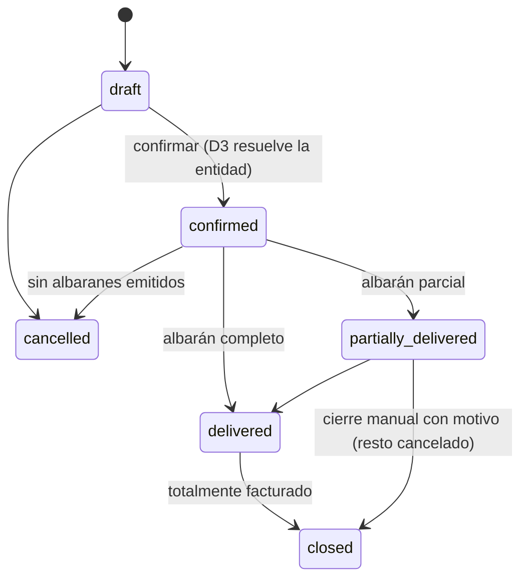

| Desde | Evento | Hacia | Guarda | Efectos | Permiso |
|---|---|---|---|---|---|
| — | `create` (manual, EDI, web, MCP) | draft | Cliente existente; `external_ref` único por fuente | — | `sales.write` |
| draft | `confirm` | confirmed | Al menos una línea; precios ≥ 0; regla D3 resuelta | `legal_entity_id`, `billing_rule_*` y traza; número de la serie de pedidos; evento `sales.order.confirmed` | `sales.write` |
| draft, confirmed | `cancel` | cancelled | Sin albaranes emitidos | Motivo | `sales.write` |
| confirmed, partially_delivered | `delivery_issued` (automático) | partially_delivered / delivered | Σ cantidad en albaranes emitidos por línea | — | sistema |
| delivered | `fully_invoiced` (automático) | closed | `invoicing_status = invoiced` | — | sistema |
| partially_delivered | `close_remaining` | closed | Motivo | Líneas pendientes canceladas | `sales.manage` |

`invoicing_status` (`not_invoiced` → `partially_invoiced` → `invoiced`) se recalcula al emitir facturas que referencian sus líneas.

## 4. Albarán (`sales.delivery_note`)

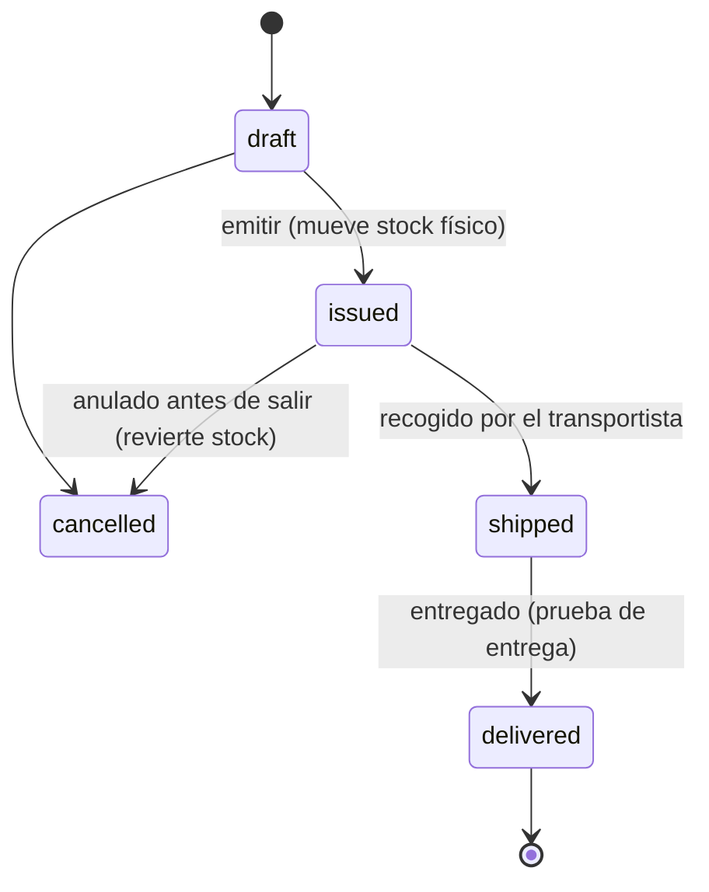

| Desde | Evento | Hacia | Guarda | Efectos | Permiso |
|---|---|---|---|---|---|
| — | `create` | draft | Ubicación de origen activa | — | `sales.write` |
| draft | `issue` | issued | Líneas con producto y **lote** (vino); saldo físico suficiente en origen y fecha; si vende CVPO stock de P.O → intercompañía (§12.6 del modelo) | `take_number('delivery_note')`; movimientos físicos (`delivery_out`, `transfer_in`, `ownership_*`); líneas de liquidación intercompañía; si destino requiere e-DA → e-DA en borrador; evento `sales.delivery_note.issued` | `sales.write` |
| draft | `cancel` | cancelled | Motivo | — | `sales.write` |
| issued | `cancel` | cancelled | No `shipped`; sin factura que lo use; e-DA (si existe) en borrador o anulado | Movimientos `reversal`; anula líneas de liquidación del periodo abierto | `sales.manage` |
| issued | `mark_shipped` | shipped | — | `shipped_at`, transportista, seguimiento | `sales.write` |
| shipped | `mark_delivered` | delivered | — | `delivered_at`, prueba de entrega opcional | `sales.write` |
| issued/shipped/delivered | `invoice_lines` (automático) | (igual) | — | `invoicing_status` | sistema |
| issued/shipped/delivered | `mark_not_invoiceable` | (igual) | Motivo (p. ej. muestras, valoración sin venta) | `invoicing_status = not_invoiceable` | `sales.manage` |

Devoluciones: albarán nuevo `kind = 'return'` (con `to_location`) y, si había factura, rectificativa.

## 5. Factura emitida (`billing.invoice`)

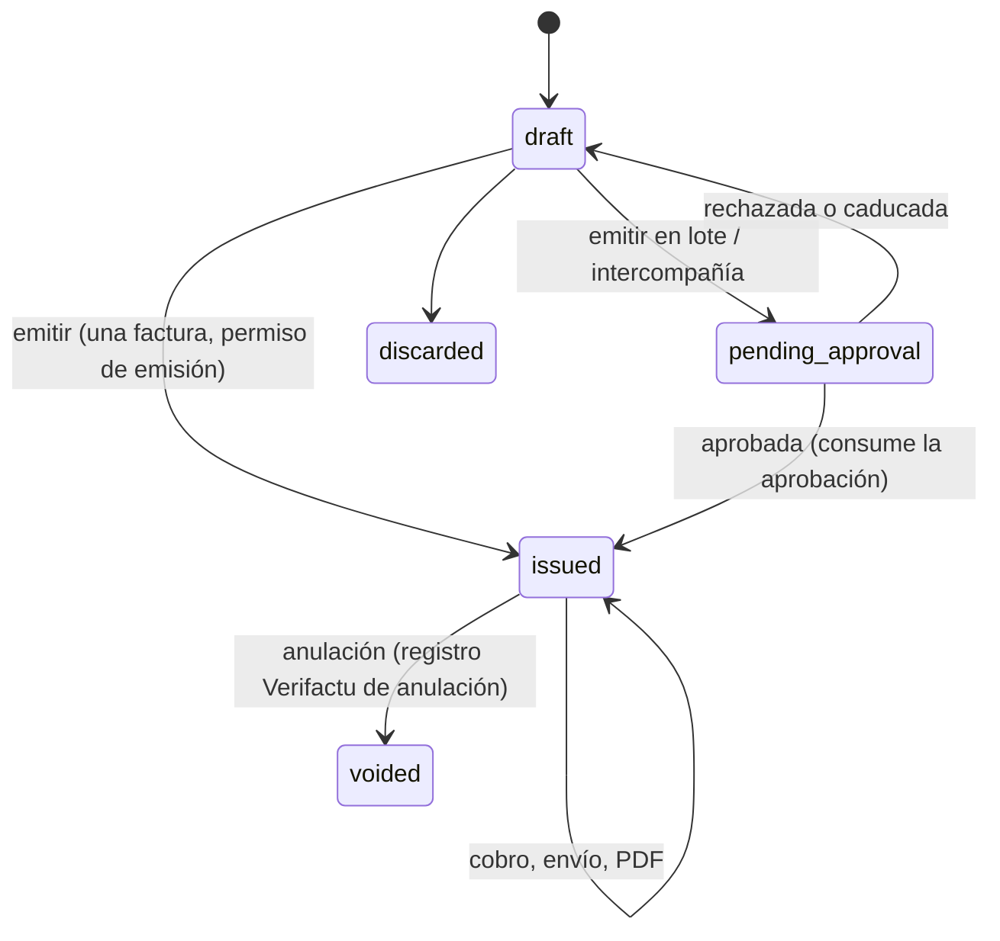

Estado de cobro independiente (`payment_status`): `unpaid` → `partially_paid` → `paid`; `uncollectible` por decisión (con motivo y, más adelante, rectificativa R3 si procede). "Vencida" es derivado (`billing.v_receivable.is_overdue`).

| Desde | Evento | Hacia | Guarda | Efectos | Permiso |
|---|---|---|---|---|---|
| — | `create` | draft | Entidad con serie activa; cliente (salvo F2) | Regla D3 si viene de pedido; precios de tarifa vigente | `billing.write` |
| draft | `update` | draft | — | Recalcula vista previa | `billing.write` |
| draft | `issue` | issued | Validaciones de `02-modelo-dominio.md` §12.3; no es lote ni intercompañía (si lo es, requiere aprobación) | Número, fecha, congelado de cliente, desglose, vencimientos, **registro Verifactu de alta** (si aplica), efectos de stock/fiscales, evento `billing.invoice.issued` (dispara el envío Verifactu) | `billing.issue` |
| draft | `request_issue` (lote o intercompañía) | pending_approval | Ídem validaciones | Solicitud de aprobación con hash del contenido (cliente, líneas, totales) | `billing.write` |
| pending_approval | `approval_granted` | issued | Hash de la factura = hash aprobado | Igual que `issue` + consume la aprobación | sistema (tras aprobación) |
| pending_approval | `approval_rejected` / `approval_expired` | draft | — | Motivo | sistema |
| draft | `discard` | discarded | — | Motivo | `billing.write` |
| issued | `void` | voided | Solo si **no debió expedirse** (motivo de una lista: duplicada, entidad equivocada, cliente equivocado sin entrega); aprobación `invoice_batch_issue` de un aprobador | Registro Verifactu de anulación; si había efectos de stock/fiscales → `reversal` | `billing.void` |
| issued | `register_payment` (por imputación) | issued | Ver §6 | `amount_paid`, `payment_status` | `finance.write` |
| issued | `mark_sent` | issued | — | `sent_at`, `sent_by`, `sent_channel` | `billing.write` |

**Rectificativa**: es otra factura (`invoice_type` R1–R5) que recorre esta misma máquina; al emitirse, la original **no cambia de estado** (la relación queda en `invoice_rectification`) y la UI muestra la original como "rectificada" (derivado).

## 6. Cobro y pago (`finance.payment`)

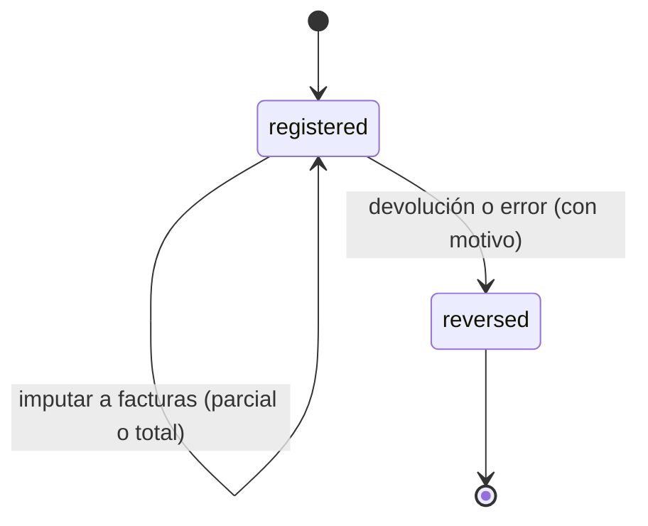

| Desde | Evento | Hacia | Guarda | Efectos | Permiso |
|---|---|---|---|---|---|
| — | `register` (manual, extracto, Stripe, remesa, aviso EDI) | registered | Importe > 0; contraparte | Evento `finance.payment.registered` | `finance.write` |
| registered | `allocate` | registered | Σ imputaciones ≤ importe; documento emitido/aprobado; no excede pendiente (`WC100`) | Actualiza cobrado y estado del documento | `finance.write` |
| registered | `reverse` | reversed | Motivo | Pago inverso; recalcula documentos afectados | `finance.manage` |

Línea de extracto (`bank_statement_line`): `unmatched` → `suggested` (motor de conciliación) → `matched` (una persona confirma, o automático si la confianza es 1,0: importe exacto + referencia con número de factura) | `ignored` (motivo).

## 7. Factura recibida / gasto (`purchasing.supplier_invoice`)

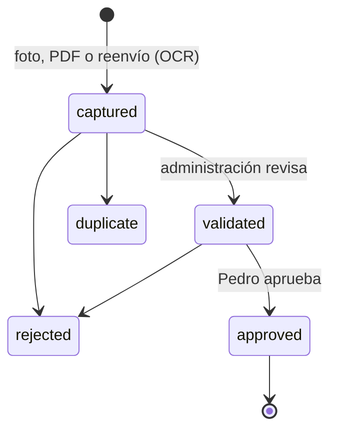

| Desde | Evento | Hacia | Guarda | Efectos | Permiso |
|---|---|---|---|---|---|
| — | `capture` | captured | Adjunto | OCR (`ocr-gastos`), sugerencia de proveedor y categoría; evento `purchasing.supplier_invoice.captured` | `purchasing.write` o agente `ocr-gastos` |
| captured | `validate` | validated | Proveedor, número, fechas, totales cuadran (Σ líneas + IVA − retención = total ± 0,01) | — | `purchasing.write` |
| captured | `mark_duplicate` | duplicate | Existe otra con mismo proveedor + número | Enlace al original | `purchasing.write` |
| captured, validated | `reject` | rejected | Motivo | — | `purchasing.write` |
| validated | `approve` | approved | Rol `owner` o `approver` | Queda pagable; asiento (M7) | `purchasing.approve` |

## 8. Registro Verifactu (`regulatory.verifactu_record`)

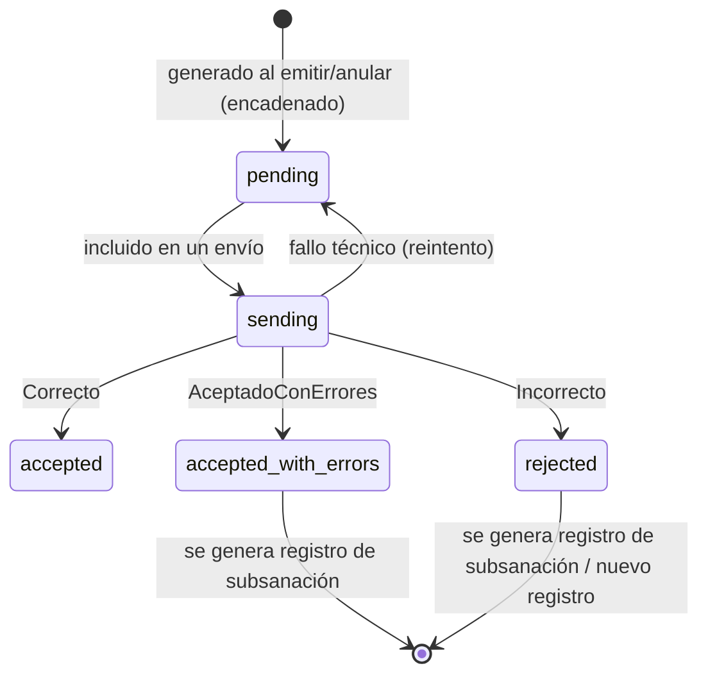

| Desde | Evento | Hacia | Guarda | Efectos | Permiso |
|---|---|---|---|---|---|
| — | `generate` (en la transacción de emisión/anulación) | pending | Instalación activa; encadenamiento correcto (`WC130`) | Huella, XML canónico, URL del QR | sistema |
| pending | `batch_send` | sending | `now() ≥ next_send_not_before`; ≤ máximo de registros por envío (verifactu.md) | Envío (`regulatory.submission` flow `verifactu`) | sistema (job `verifactu-sender`) |
| sending | `aeat_response` | accepted / accepted_with_errors / rejected | Respuesta parseada | CSV, códigos de error, `next_send_not_before` | sistema |
| sending | `technical_failure` | pending | Timeout, 5xx, red | Reintento con espera exponencial (30 s, 2 min, 10 min, 1 h, después cada hora); a la 3.ª fallida → evento `billing.verifactu.send_failed` | sistema |
| accepted_with_errors / rejected | `correct` | (nuevo registro) | Corrección de datos por una persona (rectificativa o subsanación según verifactu.md) | Nuevo registro encadenado con `Subsanacion`/`RechazoPrevio` | `billing.issue` |

La **aprobación humana** del envío es la de la **emisión** de la factura (**SUPUESTO**: recomendación de Q-003, pendiente de Pedro): no hay segunda aprobación. El envío es automático e inmediato por exigencia normativa (ver `04-regulatorio/verifactu.md`).

## 9. Mensaje EDI (`regulatory.edi_message`) y pedido de El Corte Inglés

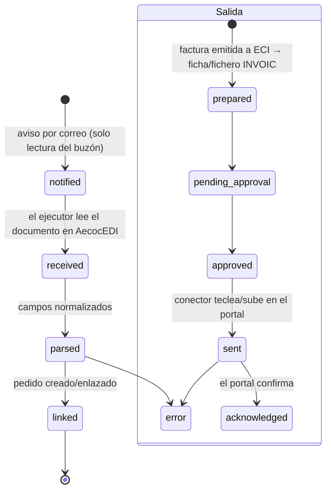

| Desde | Evento | Hacia | Guarda | Efectos | Permiso |
|---|---|---|---|---|---|
| — | `notification_seen` (vigilante del buzón, solo lectura) | notified | Asunto/remitente del portal | Evento a CVBOT "nuevo pedido EDI" | agente `vigilante-buzon` |
| notified | `read_from_portal` | received | Conector `edi` (modo lectura) | Captura y texto guardados como adjunto | ejecutor |
| received | `parse` | parsed | Campos obligatorios (nº de pedido, fecha, GLN/tienda, líneas con GTIN y cantidad) | `parsed` | sistema |
| parsed | `create_order` | linked | Productos encontrados por GTIN; cliente ECI | Pedido `source = 'edi'`, `external_ref` = nº de pedido | `sales.write` o sistema |
| — (salida) | `prepare_invoice` | prepared | Factura emitida a ECI | Ficha/fichero con los campos de `aecoc-edi.md` | sistema |
| prepared | `request_approval` | pending_approval | — | Aprobación `edi_submission` | sistema |
| approved | `submit` | sent | Aprobación consumida | `connector_run` | ejecutor |
| sent | `confirm` | acknowledged | Evidencia de aceptación | `official_receipt` | ejecutor |

## 10. e-DA (EMCS) (`regulatory.emcs_document`)

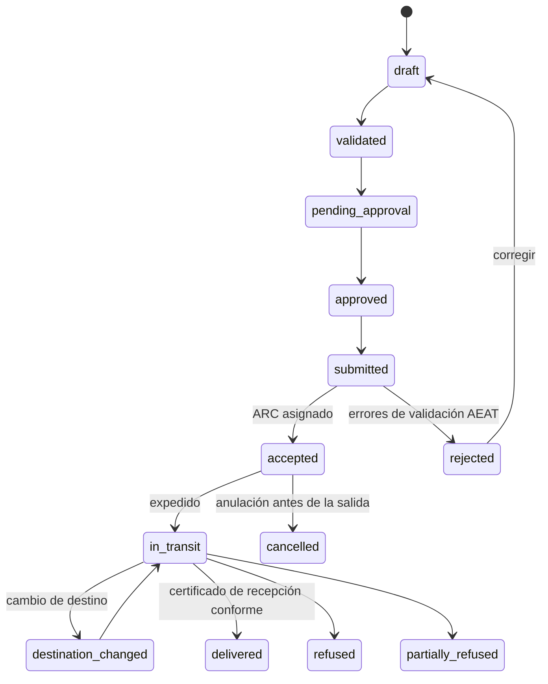

| Desde | Evento | Hacia | Guarda | Efectos | Permiso |
|---|---|---|---|---|---|
| — | `create` (desde albarán) | draft | Destino que requiere e-DA (emcs.md) | LRN único | `regulatory.prepare` |
| draft | `validate` | validated | Campos obligatorios de emcs.md; destinatario con número de impuestos especiales válido | — | `regulatory.prepare` |
| validated | `request_approval` | pending_approval | — | Aprobación `emcs_submission` (hash) | `regulatory.prepare` |
| pending_approval | `approve` | approved | Aprobador con verificación reforzada | — | `regulatory.approve` |
| approved | `submit` | submitted | Aprobación consumida | `connector_run` | ejecutor |
| submitted | `accepted` | accepted | ARC recibido | ARC en el albarán y en SISV/SILICIE | ejecutor |
| submitted | `rejected` | rejected | Errores | Detalle | ejecutor |
| accepted | `dispatch` | in_transit | Fecha de expedición | Si la regla fiscal es `ead_dispatch`: salida fiscal | `regulatory.prepare` |
| accepted | `cancel` | cancelled | Antes de la expedición; aprobación | — | `regulatory.approve` |
| in_transit | `change_destination` | destination_changed → in_transit | Aprobación | — | `regulatory.approve` |
| in_transit | `receipt` | delivered / refused / partially_refused | Certificado de recepción leído | Si rechazo: devolución (albarán `return`) | ejecutor |

## 11. Envío regulatorio genérico (`regulatory.submission`) e intento de conector (`regulatory.connector_run`)

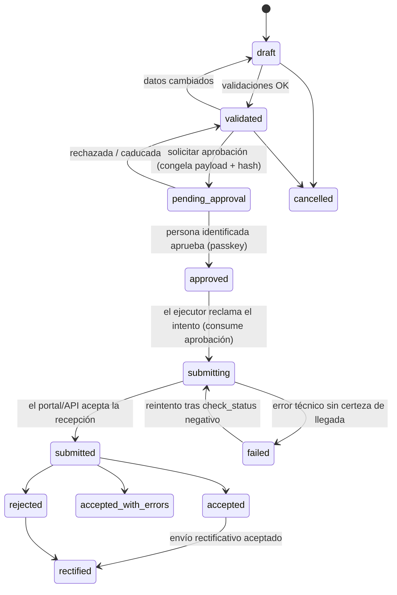

| Desde | Evento | Hacia | Guarda | Efectos | Permiso |
|---|---|---|---|---|---|
| — | `prepare` (calendario, evento o manual) | draft | Módulo activo; periodo | Payload canónico, hash | `regulatory.prepare` |
| draft | `validate` | validated | Sin errores de validación (lista por flujo en `04-regulatorio/*.md`) | — | `regulatory.prepare` |
| validated | `request_approval` | pending_approval | Payload congelado (`WC120` desde aquí) | `ops.approval_request` + evento `regulatory.submission.pending_approval` (aviso a CVBOT con enlace) | `regulatory.prepare` |
| pending_approval | `approve` | approved | Política `regulatory_submission` (o `emcs_submission`/`edi_submission`); verificación reforzada; hash coincide | — | `regulatory.approve` |
| pending_approval | `reject` / `expire` | validated | — | Motivo | `regulatory.approve` / sistema |
| approved | `claim` | submitting | Aprobación no consumida; ningún intento `submit` en curso (índice único) | Aprobación → `consumed`; `connector_run` `claimed` con `lease_until = now() + 15 min` | ejecutor |
| submitting | `receipt` | submitted | Evidencia de recepción (acuse, nº, captura) | Adjuntos de evidencia | ejecutor |
| submitting | `error` | failed | Sin certeza de llegada | `connector_run.failed`; evento `.needs_human` si es la 2.ª vez | ejecutor |
| failed | `retry` | submitting | Antes, `check_status` confirma que **no** llegó; máximo 3 intentos | Nuevo `connector_run` | ejecutor o `regulatory.prepare` |
| submitted | `result` | accepted / accepted_with_errors / rejected | — | `external_ref`, `submission_item.result`, estado de las anotaciones (SILICIE `accepted`/`rejected`…), periodo fiscal cerrado si procede | ejecutor |
| accepted / rejected | `rectify` | rectified | Existe un envío nuevo con `rectifies_submission_id` aceptado | — | sistema |

`connector_run`: `queued` → `claimed` → `running` → `succeeded` | `failed` | `needs_human` | `expired` (lease vencido). Un intento `expired` o `failed` nunca se reintenta solo: primero `check_status`.

## 12. Aprobaciones (`ops.approval_request`)

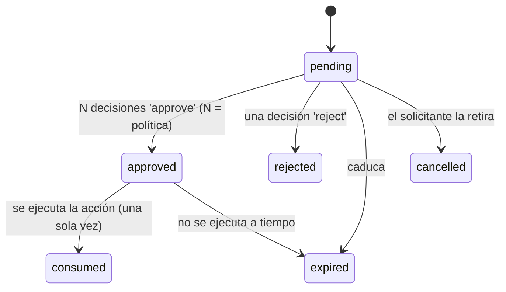

**Qué requiere aprobación** (semillas de `ops.approval_policy`; editables en Ajustes por `owner`):

| `kind` | Acción | Aprobaciones | Roles | Verificación reforzada | Validez |
|---|---|---|---|---|---|
| `invoice_batch_issue` | Emitir varias facturas a la vez; anular una emitida | 1 | owner, approver | Sí | 24 h |
| `intercompany_invoice_issue` | Factura intercompañía del periodo | 1 | owner, approver | Sí | 7 días |
| `regulatory_submission` | SILICIE, SISV, modelos | 1 | owner, approver (de la entidad) | Sí | 24 h |
| `emcs_submission` | e-DA, anulación, cambio de destino | 1 | owner, approver (P.O) | Sí | 24 h |
| `edi_submission` | Factura u otro mensaje a AecocEDI | 1 | owner, approver | Sí | 24 h |
| `organic_report` | Informe a la certificadora | 1 | owner | Sí | 7 días |
| `third_party_message` | Correo de factura o recordatorio a un cliente | 1 | owner, approver, admin | No | 24 h |
| `cellar_loss` | Merma por incidencia, destrucción | 1 | owner, approver | Sí | 7 días |
| `inventory_adjustment` | Contabilizar un aforo con diferencias | 1 | owner | Sí | 7 días |
| `billing_rules_activation`, `tariff_activation` | Activar reglas D3 / tarifas / tarifa intercompañía | 1 | owner | Sí | 7 días |
| `module_toggle` | Activar o desactivar un módulo | 1 | owner | Sí | 24 h |

Las aprobaciones **solo** se deciden en la web de WineCore (bandeja `/aprobaciones`) con verificación reforzada (**SUPUESTO**: recomendación de Q-005, pendiente de Pedro). Las herramientas MCP pueden **listar** aprobaciones pendientes y devolver el **enlace**, nunca aprobar.

## 13. Aforo (`inventory.inventory_count`)

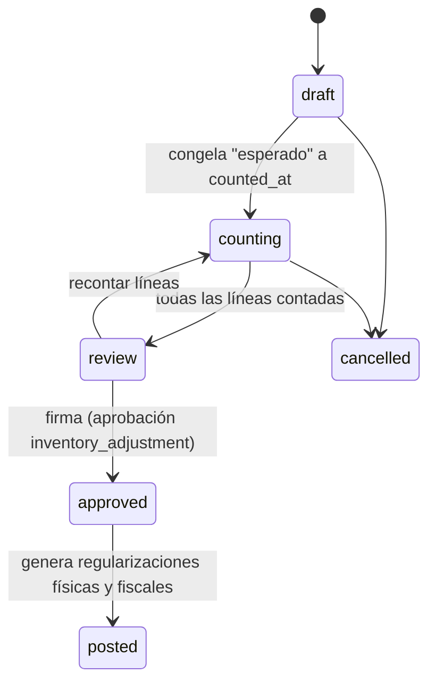

| Desde | Evento | Hacia | Guarda | Efectos | Permiso |
|---|---|---|---|---|---|
| draft | `start` | counting | Ubicaciones elegidas | Líneas con esperado = saldo del libro a `counted_at` | `inventory.count` |
| counting | `record_line` | counting | Cantidad ≥ 0; método | — | `inventory.count` |
| counting | `submit_for_review` | review | Todas las líneas con contado | Diferencias calculadas | `inventory.count` |
| review | `approve` | approved | Diferencias con motivo; aprobación `inventory_adjustment` (firma) | `signed_by`, `signed_at` | `owner` |
| approved | `post` | posted | Periodos abiertos | `count_adjust_*` y `regularization_*` (o `opening` si `kind = opening`) | sistema |
