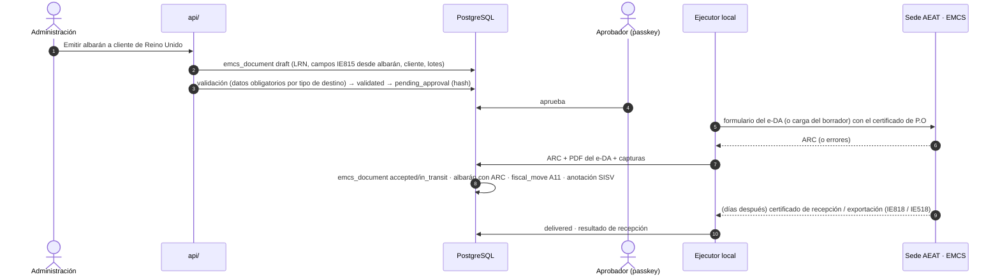

# 04 · EMCS (e-DA para exportación y envíos fuera de la fábrica en régimen suspensivo)

> Versión 1 · 31-10-2026 · Fuentes oficiales consultadas el 31-10-2026 (§11). Marcas: **HECHO** · **SUPUESTO** · **PENDIENTE**.
> Decisión de conector: ADR 009 (*computer use* sobre el formulario del e-DA en la sede con el certificado de P.O en el ejecutor local; servicio web IE815 más adelante si compensa). Hito: **M3**. Historias: US-EMCS-01…04, US-SISV-03.
> Tablas: `regulatory.emcs_document`, `regulatory.emcs_item`, `regulatory.submission` (`02-ddl/0012`); máquina de estados en `03-maquinas-estado.md` §10.

## 1. Qué es y qué nos aplica

| Hecho | Estado | Fuente |
|---|---|---|
| EMCS es el sistema de la UE (y su versión interna española) para expedir el **documento administrativo electrónico (e-DA)** que ampara la circulación de productos con impuestos especiales en **régimen suspensivo**; al validarlo, la AEAT asigna el **ARC** | HECHO | RD 1165/1995 (RIE), arts. 21 y ss.; sede AEAT "EMCS" (intracomunitario e interno) |
| Desde el **13-02-2023** (fase 4) también se documentan en EMCS las circulaciones intracomunitarias **con impuesto pagado** (e-DAS, "movimientos garantizados"; tipos de destino 9, 10 y 11) | HECHO | Directiva (UE) 2020/262, arts. 33–35 · tabla ADI1T032 (fechas de inicio 13-02-2023) |
| Tipos de destino del e-DA intracomunitario (IE815): 1 depósito fiscal · 2 destinatario registrado · 3 destinatario registrado ocasional · 4 entrega directa · 5 destinatario exento · **6 exportación** · 8 destino desconocido · 9/10 destinatario certificado (habitual/ocasional) · 11 retorno al expedidor | HECHO | Tabla ADI1T032 · IE815 fase 4 v1.0 (29-12-2022) |
| e-DA **interno** (dentro de España), tipos de destino: 1 establecimiento con CAE · 2 destinatario interior sin CAE · **3 exportación** | HECHO | Sede AEAT, "Cómo cumplimentar el e-DA interno" |
| Plazo máximo del transporte por modo: carretera y ferrocarril 35 días, marítimo 45, aéreo 20, postal 30 | HECHO | Tabla ADI1T067 |
| El e-DA de vino lleva **datos complementarios vitivinícolas**: categoría (1 sin DOP/IGP · 2 varietal sin DOP/IGP · 3 con DOP o IGP · 4 importado · 5 otro), **zona vitícola**, operaciones enológicas (0 ninguna · 1 enriquecido · 2 acidificado · 3 desacidificado · 4 edulcorado · 9 trozos de roble · 12 otras…) | HECHO | Tablas ADI1T038, ADI1T040, ADI1T041 |
| Jaén está en la zona vitícola **C III b** (código EMCS **6**): en España, todo lo que no es C I (A Coruña, Asturias, Cantabria, Guipúzcoa, Vizcaya) ni C II | HECHO | Reg. (UE) 1308/2013, anexo VII, apéndice 1 (consolidado 08-11-2024) |
| Códigos de producto EMCS del vino: categoría fiscal **W** (vino y bebidas fermentadas); vino tranquilo **W200** | HECHO (categoría, tabla ADI1T066) · SUPUESTO muy probable (W200: la tabla ADI1T036 descargada estaba paginada; se confirma en el entorno de pruebas) | Tablas ADI1T066 y ADI1T036 |
| Los Estados **pueden** dispensar a los **pequeños productores de vino** (< 1.000 hl de media) de las obligaciones de circulación; entonces usan el documento del Reg. 2018/273. No hemos encontrado esa dispensa en el RIE | HECHO (directiva) · PENDIENTE (aplicación en España) | Directiva (UE) 2020/262, art. 48 · RIE consolidado (búsqueda sin resultados) |
| Reino Unido es **exportación** (no UE); Canarias está fuera del territorio armonizado de II.EE. y de IVA | HECHO | `00-triaje.md` · Q-019 |
| Hoy, el e-DA lo teclea una persona en la sede con el certificado de P.O; el ARC se anota en el albarán y en SISV | HECHO interno | Traspaso de la administradora |

## 2. Qué documento usa cada venta

| Venta | Documento | Tipo de destino | Régimen / notas | SILICIE |
|---|---|---|---|---|
| Exportación (Reino Unido, Suiza, EE. UU.…) saliendo por una aduana **española** | e-DA **interno** | 3 exportación + aduana de salida | Suspensivo; se ultima con la salida de la UE | A11 · J01 (ARC) |
| Exportación saliendo por una aduana de **otro Estado** de la UE | e-DA **intracomunitario** (IE815) | 6 exportación + aduana de exportación | Suspensivo | A11 · J01 |
| Venta B2B a la UE a un depósito fiscal o destinatario registrado | e-DA intracomunitario | 1, 2 o 3 | Suspensivo; el destinatario paga en destino | A10 · J01 |
| Venta a la UE con impuesto pagado (destinatario certificado) | e-DAS | 9 o 10 | Impuesto de destino; requiere garantía (Q-019) | A10 · J01 |
| Venta a Canarias | Según Q-019 (e-DA interno u otro documento) | — | PENDIENTE (asesor) | A09 |
| Venta nacional con impuesto devengado (tipo cero) | **No** e-DA: documento de acompañamiento vitivinícola / albarán (RIE art. 68.1) | — | — | A08 (silicie.md §5) |
| Envío a otra fábrica o depósito fiscal en España | e-DA interno | 1 + CAE del destino | Suspensivo | A08 · J01 |

**Regla en WineCore**: el albarán de salida (`sales.delivery_note`) calcula el documento necesario a partir del país y tipo del cliente, su número de impuestos especiales y la aduana de salida. Si hace falta e-DA, el albarán **no** puede marcarse "expedido" sin ARC (validación `WC_REG_EAD_REQUIRED` en `api/src/core/sales/dispatch.ts`, ver US-EMCS-01).

## 3. Flujo

## 4. Campo a campo (IE815, grupos principales)

Obligatoriedad según el tipo de destino (IE815 fase 4). Origen en WineCore:

| Grupo / campo | Uso | Origen |
|---|---|---|
| Identificación del declarante (`NifDeclarante`, `NombreDeclarante`) | Obligatorio | `core.legal_entity` de P.O |
| `Attributes` · tipo de envío / documento | Obligatorio | `emcs_document.kind` (`e_ad`, `e_sad`) |
| Expedidor: CAE / número de impuestos especiales, nombre, dirección | Obligatorio | `inventory.tax_warehouse.cae` y dirección de la fábrica |
| Lugar de expedición | Obligatorio | `inventory.tax_warehouse` |
| Destinatario: número de impuestos especiales (si lo tiene), nombre, dirección, idioma | Según destino (no en 6 exportación sin número) | `party.contact` + `emcs_document.consignee_excise_number` |
| Lugar de entrega | Destinos 1–4, 9, 10 | `emcs_document.delivery_place` (de la dirección de entrega del albarán) |
| Aduana de exportación | Destino 6 / interno 3 | `emcs_document.export_office_code` (Q-019: oficina habitual) |
| Organizador del transporte (1 expedidor · 2 destinatario · 3 propietario · 4 otro) | Obligatorio | Del Incoterm del pedido (`sales.sales_order.incoterm`): EXW/FCA → 2; DAP/DDP → 1 |
| Transportista | Opcional (obligatorio si lo organiza otro) | `sales.delivery_note.carrier_contact_id` |
| Modo de transporte (3 carretera…) y unidades de transporte | Obligatorio | Se elige al preparar el e-DA (por defecto 3 carretera; matrícula o contenedor en `emcs_document.fields`) |
| Fecha y hora de expedición | Obligatorio | `emcs_document.dispatch_date` (no anterior a hoy) |
| Duración del transporte | Obligatorio | Por modo y destino (máximos de ADI1T067) |
| Documento comercial (factura o albarán) | Obligatorio | Nº de factura proforma o de albarán (`delivery_note.number`) |
| Garantía (tipo de garante) | Según destino | Ajuste `emcs.guarantee_type` (Q-019) |
| Partidas: nº de partida, código de producto (`W200`), código NC (8), cantidad (L a 20 °C), grado, peso bruto y neto, densidad (opcional) | Obligatorio | `emcs_item` (de las líneas del albarán: `catalog.product.nc_code`, `volume_ml/1000`, `abv_pct` del lote); pesos = unidades × `catalog.format.unit_gross_weight_g` / `unit_net_weight_g` |
| Embalajes (`Package`): tipo (lista ADI1T017), número, precintos | Obligatorio | Cajas o palés del albarán (`sales.handling_unit`); tipo por defecto "caja de cartón" (código PENDIENTE de la lista) |
| **Datos complementarios del vino**: categoría · zona vitícola · tercer país de origen · operaciones enológicas · otra información | Obligatorio en vino | Categoría desde `catalog.wine.category` (`wine` → 1, `pgi_wine`/`pdo_wine` → 3); zona = **6** (C III b, ajuste por establecimiento); operaciones enológicas derivadas de `cellar.addition` en la **ascendencia del lote** (ácido tartárico como acidificante → 2; madera de roble en trozos → 9; si no, 0) |
| Firma / certificado | — | Certificado de P.O en el ejecutor local |

El LRN (número de referencia local) es único por expedidor: `emcs_document.lrn` = `EA-<año>-<secuencia>` (serie propia, sin huecos).

## 5. Mensajes posteriores

| Mensaje | Cuándo | Efecto en WineCore |
|---|---|---|
| Anulación (IE810) | Antes de la salida física | `cancelled`; el albarán vuelve a "pendiente de documento"; SILICIE no cambia (aún no hubo salida) |
| Cambio de destino (IE813) | Durante el transporte | `destination_changed`; nuevos datos del destinatario; aviso a SISV |
| Notificación de recepción (IE818) | Al recibir el destinatario | `delivered` o `refused`/`partially_refused`; si hay rechazo, incidencia de transporte y decisión (retorno tipo 11, otro destino) |
| Exportación confirmada (salida de la UE) | Al salir | `delivered` (exportación ultimada); evidencia para la exención de IVA (`EXP_E2`) |

## 6. Aprobación, evidencias y reintentos

- Aprobación ligada al hash del contenido (`approval_policy` `emcs_submission`), antes de cada e-DA, anulación o cambio de destino (regla dura 0.3).
- Evidencias (6 años + el corriente): borrador aprobado, capturas, PDF del e-DA con ARC, mensajes de recepción y exportación.
- Un solo intento de envío en curso; si el portal falla tras pulsar "Enviar" sin ARC visible, `needs_human` y consulta por LRN antes de repetir (evita e-DA duplicados).

## 7. Paquete para el transitario (US-EMCS-04)

ZIP con: factura (o proforma) en inglés, e-DA con ARC, lista de bultos (SSCC si existen), Incoterm, datos de contacto y, para Reino Unido, los datos que pida el transitario para la importación (PENDIENTE: lista con el transitario habitual, Pedro, 15-02-2027).

## 8. Casos límite

1. Pedido mixto con vino y productos sin II.EE. (merchandising): solo las líneas de vino van al e-DA.
2. Varios lotes del mismo producto en un envío: una partida por producto y grado; los lotes van en "otra información" o en el albarán.
3. Rechazo parcial en destino: el vino rechazado vuelve con un e-DA de retorno o se destina a otro cliente; nunca entra en la fábrica si ya se devengó el impuesto (silicie.md §11).
4. Venta a la UE a un particular: no es e-DA sino venta a distancia con impuesto de destino (fuera del MVP; Q-018/Q-019).
5. Exportación anulada después de facturar: rectificativa de la factura y anulación del e-DA si no salió.

## 9. Golden files

`api/test/golden/emcs/`: exportación a Reino Unido por aduana española (e-DA interno destino 3), exportación por otro Estado (IE815 destino 6), envío a depósito fiscal de la UE (destino 1), anulación, cambio de destino y recepción con faltas. Cada caso: albarán sintético → campos canónicos → ficha que teclea el ejecutor (o XML IE815 si se usa el servicio web).

## 10. Pendientes

| Tema | Dueño | Fecha |
|---|---|---|
| Qué documento usa hoy cada venta fuera de España (UE, Reino Unido, Canarias) y quién lo expide | Pedro + administradora (Q-019) | 15-01-2027 |
| ¿Aplica España la dispensa de pequeños productores de vino (art. 48 de la Directiva 2020/262)? | Asesor | 15-01-2027 |
| Aduana de salida habitual y transitario | Pedro | 15-02-2027 |
| Confirmar el código de producto `W200` y el tipo de embalaje en el entorno de pruebas | Equipo (M3) | Antes del primer e-DA |

## 11. Fuentes (consultadas el 31-10-2026)

RD 1165/1995 (RIE) consolidado, arts. 21 y 68 · Ley 38/1992, art. 15.5 · Directiva (UE) 2020/262 (BOE/DOUE), arts. 33–35 y 48 · Sede AEAT "Cómo cumplimentar el e-DA interno" · Servicios web EMCS fase 4: IE815 v1.0 (29-12-2022), IE810, IE813, IE818 · Tablas EMCS ADI1T017, ADI1T029, ADI1T032, ADI1T036, ADI1T038, ADI1T040, ADI1T041, ADI1T052, ADI1T066, ADI1T067, ADI1T070 · Reg. (UE) 1308/2013, anexo VII, apéndice 1 (consolidado 08-11-2024).
