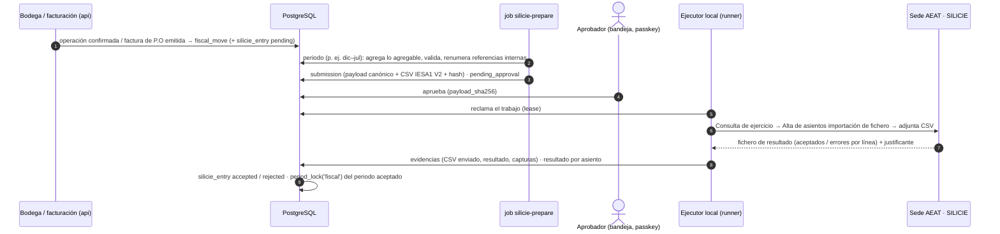

# 04 · SILICIE (contabilidad de Impuestos Especiales del vino)

> Versión 1 · 31-10-2026 · Fuentes oficiales consultadas el 31-10-2026 (§14). Marcas: **HECHO** (fuente) · **SUPUESTO** · **PENDIENTE** (dueño y fecha).
> Decisión de conector: ADR 009 (*computer use* sobre "Alta de asientos – importación de fichero" con el CSV que genera WineCore; servicio web más adelante si compensa). Hito: **M2**. Historias: US-SIL-01…06, US-INV-03/04, US-BOD-02/04/06.
> Tablas: `inventory.fiscal_move`, `regulatory.silicie_ledger`, `regulatory.silicie_exercise`, `regulatory.silicie_entry`, `regulatory.submission` (`02-ddl/0007` y `0012`).

## 1. Qué es y qué nos aplica

| Hecho | Estado | Fuente |
|---|---|---|
| SILICIE es el suministro electrónico de los asientos de la contabilidad de II.EE. a la sede de la AEAT. Lo lleva el titular del establecimiento con CAE: la **fábrica de P.O** (CVPO no tiene CAE y no presenta SILICIE) | HECHO (norma) · HECHO interno (CAE de P.O) | Orden HAC/998/2019 · traspaso de la administradora |
| Desde el **01-01-2025** rige **SILICIE 2.0** (Orden HAC/1505/2024): referencia de producto obligatoria, la descripción agrupa existencias, todo asiento lleva justificante, en vino envasado son obligatorios capacidad y número de envases | HECHO | Orden HAC/1505/2024 · seminario web de la AEAT "pequeñas bodegas", 21-07-2025 |
| Elaboradores de vino (clave V1) con **≤ 100.000 L/año** (todos sus establecimientos) que llevan la contabilidad con su propio programa: plazo hasta el **último día hábil de diciembre** (movimientos de agosto a noviembre) y hasta el **último día hábil de agosto** (de diciembre a julio). Prevalece sobre el plazo general de 24 h hábiles (art. 5.1) | HECHO | Orden HAC/998/2019, DA 1.ª.3 · seminario AEAT 21-07-2025, diapositivas 55–56 |
| El asiento de **apertura** (A01, fecha 1 de enero) pertenece a enero: plazo hasta el último día hábil de agosto | HECHO | Seminario AEAT 21-07-2025, diapositiva 56 |
| Hay que **comunicar la apertura** del ejercicio antes de suministrar asientos, y el **cierre** dentro de los dos meses siguientes al final del mes en que vence el plazo de los asientos de diciembre (para nosotros, fin de octubre del año siguiente). Si no, la AEAT lo cierra de oficio | HECHO | Orden HAC/998/2019, art. 4 bis |
| Se pueden agregar en **un asiento mensual** (fecha: último día del mes) la elaboración de vino y mosto, las entradas de materias primas y las **salidas con impuesto devengado por ventas al por menor**. Justificante J13 | HECHO | Orden HAC/998/2019, DA 1.ª.1 (redacción de la Orden HAC/1505/2024) |
| El vino en **crianza en barrica** (madera no revestida) y el vino a granel en **depósitos** van en **mayores distintos**; los pasos entre ellos **no** se agregan | HECHO | Seminario AEAT 21-07-2025, diapositiva 32 y pregunta 6.ª; Orden HAC/998/2019, art. 3.3 |
| Cambiar cualquier dato de identificación de un producto se anota con **A17 / A16** (salida / entrada por cambio de código) | HECHO | FAQ AEAT "Asientos contables: datos del producto" |
| Errores: se **anula** el asiento (motivo: 1 error numérico, 2 duplicado, 3 otro) y se suministra uno nuevo con otro número de referencia interno y el **número de asiento previo** | HECHO | Seminario AEAT 21-07-2025, preguntas 5.ª y 7.ª · tabla MOAN |
| Mermas: **A30** (almacenamiento, resta existencias) o **A32** (fabricación, sin signo, informativo); ambas con el tipo de pérdida (VB01–VB06) | HECHO | Seminario AEAT 21-07-2025, preguntas 9.ª y diapositiva 98 |
| **No** pueden volver a entrar en la fábrica productos por los que ya se devengó el impuesto (salvo los supuestos tasados) | HECHO | Ley 38/1992, art. 15.5, citado en el seminario (diapositiva 86); afecta a devoluciones (Q-030) |
| Para el vino, los documentos de acompañamiento vitivinícolas (Reg. Delegado (UE) 2018/273) valen como **albarán de circulación** | HECHO | RD 1165/1995 (RIE), art. 68.1 |
| El tipo del impuesto sobre el vino es **cero**: no hay cuota, pero sí contabilidad y control de existencias | HECHO | Ley 38/1992, art. 30 |
| Producción anual de la bodega < 100.000 L | HECHO interno | `00-triaje.md` (menos de 1.000 hl) |

## 2. Calendario

| Qué | Periodo | Vence | Notas |
|---|---|---|---|
| **Cierre del ejercicio 2025** | — | **Ya**: el plazo de dos meses tras agosto de 2026 acaba el 31-10-2026 (sábado) y se traslada al primer día hábil siguiente (Ley 39/2015, art. 30.5) | Lo lleva hoy la administradora con Bacosoft. Si no se comunica, la AEAT lo cierra de oficio. Aviso a Pedro en `PROGRESS.md` |
| Asientos de agosto–noviembre de 2026 | ago–nov 2026 | **31-12-2026** (jueves) | Proceso actual (Bacosoft); fuera de WineCore |
| Comunicación de apertura de 2027 | — | Antes del primer asiento de 2027 | La prepara WineCore (US-SIL-06); la presenta el ejecutor con aprobación |
| Apertura 2027 (A01 a 01-01-2027) + diciembre de 2026 + enero–julio de 2027 | dic 2026 – jul 2027 | **31-08-2027** (martes) | Primer envío desde WineCore. **Diciembre de 2026** sale del proceso actual: hay que decidir quién lo prepara (Q-013) |
| Agosto–noviembre de 2027 | ago–nov 2027 | **31-12-2027** (viernes) | — |
| Cierre del ejercicio 2026 | — | **02-11-2027** (el 31-10 es domingo y el 1-11 festivo) | Lo comunica quien llevó 2026 (proceso actual) |
| Cierre del ejercicio 2027 | — | 31-10-2028 (martes) | WineCore |

WineCore genera los asientos **al día** y avisa a 30, 7 y 1 días de cada vencimiento (vigilante `regulatory-deadlines`).

## 3. Flujo

## 4. Conector

- **Hoy (§12.1)**: *computer use* del ejecutor local sobre el formulario web "Alta de asientos – importación de fichero" de la sede, con el certificado de P.O en el llavero del equipo (ADR 009). El portal devuelve un **fichero de resultado** por línea (ejemplo oficial `FiecheroResultadoEjemploV2.csv`), que el ejecutor sube como evidencia y WineCore interpreta.
- **Después** (si compensa): servicio web IESA1 V2 (misma información en XML). El conector es intercambiable (`api/src/core/regulatory/connector.ts`); el contenido canónico (`submission.payload`) no cambia.
- Anulaciones: fichero `IESX4` (plantillas `PlantillaAnulacionIESX4CSVEnt.csv`) con el número de asiento y el motivo.

## 5. Qué genera cada hecho

"Mayor" es el `regulatory.silicie_ledger` del producto (§6). Todo asiento lleva justificante (SILICIE 2.0).

| Hecho en WineCore | Movimiento fiscal | Tipo de movimiento | Régimen fiscal | Operación / pérdida | Justificante | Agregación |
|---|---|---|---|---|---|---|
| Aforo de arranque o de 1 de enero (`inventory_count kind = opening`) | `opening` | **A01** Apertura | 2 suspensivo (vino); 1 no sujeto (uva, mosto) | — | J12 recuento/inventario (nº de aforo) | Una por mayor |
| Recepción de uva propia o comprada (`reception`) | — (la uva no es producto objeto; se anota desde la operación) | A02 Entrada interior | 1 no sujeto | — | J11 otros (parte de vendimia / documento de acompañamiento de la uva) — SUPUESTO | **Mensual** (DA 1.ª) |
| Prensado/encubado (`crushing_pressing`): uva que entra en elaboración | — | **A14** Autoconsumo/empleado (uva, KGM) | 1 | V01 elaboración de vino | J09 parte de fabricación | **Mensual** |
| Fin de fermentación (`fermentation_end`): vino obtenido | `production` | **A15** Fabricado/obtenido (LTR, grado, alcohol puro) | 2 | V01 (mismo número de operación que el A14) | J09 | **Mensual** |
| Diferencia de elaboración (uva → vino) | — | **A32** Diferencias en menos fabricación (sin signo) | 2 | V01 · pérdida VB01 | J09 | Mensual |
| Compra de vino o mosto a granel con e-DA (`bulk_reception`) | `bulk_receipt` | A02 Entrada interior | 2 | — | J01 e-DA (ARC) | No |
| Trasiego entre depósitos del mismo mayor | — | **Ninguno** | — | — | — | — |
| Trasiego **depósito → barrica** (o barrica → depósito) | `ledger_change_out` + `ledger_change_in` (`WC028`) | **A17** + **A16** (cambio de código: de `GRANEL-*` a `CRIANZA-*` o al revés) | 2 | — | J09 (nº de la operación de bodega) | **No** (la norma lo prohíbe) |
| Merma de trasiego o evaporación en almacenamiento | `loss` | **A30** Diferencias en menos almacenamiento | 2 | VB02 granel en curso · VB03 en madera · VB04/VB05 terminado | J09 o J12 | No |
| Envasado (`bottling`): granel que entra | `packaging_out_bulk` | **A14** | 2 | **V05** embotellado/envasado | J09 | No (operación a operación) |
| Envasado: vino envasado obtenido | `packaging_in_packaged` | **A15** con tipo de envase, capacidad y nº de envases (obligatorios en 2.0) | 2 | V05 | J09 | No |
| Merma de envasado | — | **A32** | 2 | V05 · VB06 | J09 | No |
| Roturas de envasado (`labeling`, `loss` de unidades) | `loss` | A30 | 2 | VB04 | J09 | No |
| Destrucción (`destruction`, con aprobación) | `destruction` | **A28** Destrucción | 2 | — | J07 autorización / J08 diligencia (PENDIENTE: confirmar si exige aviso previo a la oficina gestora; asesor, 15-01-2027) | No |
| Venta nacional a empresa (factura de P.O, regla D2) | `exit_domestic` | **A08** Salida interior | 4 impuesto devengado (tipo cero) — SUPUESTO a confirmar (Q-010) | — | J03 albarán de circulación (nº de albarán) si la regla es `delivery_note`; con la regla `invoice` (D2), J11 con el nº de factura — **ver Q-010** | No |
| Venta al por menor (tienda de la bodega, web a consumidor) | `exit_domestic` | A08 | 4 | — | J13 | **Mensual** (DA 1.ª) |
| Exportación (Reino Unido, resto fuera de la UE) con e-DA | `exit_export` | **A11** Salida exportación | 2 suspensivo | — | **J01** e-DA (ARC) | No |
| Envío a la UE en régimen suspensivo con e-DA | `exit_intra_eu` | **A10** Salida UE | 2 | — | J01 | No |
| Envío a Canarias | `exit_canary` | **A09** Salida Canarias | Según documento (Q-019) | — | J01 o el que fije el asesor | No |
| Factura intercompañía P.O → CVPO (cambio de propietario dentro del perímetro) | `exit_domestic` con la regla `invoice` | A08 | 4 | — | J11 nº de factura | No |
| Aforo periódico aprobado: diferencia en menos / en más | `regularization_out` / `regularization_in` | **A30** / **A31** (diferencias de almacenamiento) | 2 | VB02–VB05 | J12 (nº de aforo) | No |
| Corrección de una medición sin aforo (p. ej. calibración) | `regularization_*` | A35 / A36 (observaciones obligatorias) | 2 | — | J11 | No |
| Ajuste de movimientos de ejercicios anteriores | `regularization_*` | A42 / A43 (observaciones obligatorias) | 2 | — | J11 | No |
| Devolución de un cliente | `return_in` **solo** si entra en una zona fuera de fábrica o en un supuesto tasado (A24–A26 reintroducción) | Según Q-030 | — | — | — | — |

**Reglas que esta tabla cambia respecto a la operativa actual** (contradicciones para Pedro y el asesor):
1. "Trasiegos fuera de SILICIE" solo es cierto **entre depósitos**. Desde SILICIE 2.0, los pasos **depósito ↔ barrica** se anotan uno a uno (A17/A16) y sus mermas como A30. WineCore lo hace automáticamente cuando una operación de trasiego cruza recipientes de distinto mayor (`cellar.vessel.kind = 'barrel'` y `material = 'oak'` → mayor `bulk_wood`).
2. "Envasados con merma": correcto, pero la merma de envasado es **A32** (informativo) y la de almacenamiento **A30**; no son intercambiables.
3. "Corte por fecha de factura" (D2): la norma sitúa el devengo en la **salida** de fábrica; WineCore guarda ambas fechas y la regla es configurable (Q-010).

## 6. Mayores e identificación de productos

Cada producto o materia prima se identifica **siempre igual** (epígrafe, código de epígrafe, NC, clave, descripción, referencia). WineCore lo garantiza con `regulatory.silicie_ledger` (inmutable, `WC122`) y la clave foránea compuesta desde `inventory.fiscal_move` (mayor y clase deben coincidir).

| Mayor (propuesta) | Clase | Epígrafe / código | NC | Clave | Descripción (9.7) | Referencia (9.8) |
|---|---|---|---|---|---|---|
| Uva | `raw_grape` | — | 0806 | V01 | Uva fresca de vinificación | `UVA` |
| Mosto | `raw_must` | — | 2204 o 2009 (PENDIENTE asesor) | V02 | Mosto de uva | `MOSTO` |
| Vino a granel en depósito, por color | `bulk` | 1 / V0 | 2204 29 (8 dígitos: PENDIENTE asesor) | — | Vino tinto a granel en depósito | `GRANEL-TINTO` (ídem `-BLANCO`, `-ROSADO`) |
| Vino en crianza en barrica, por color | `bulk_wood` | 1 / V0 | 2204 29 | — | Vino tinto en crianza en barrica | `CRIANZA-TINTO` |
| Vino envasado, por vino y formato | `packaged` | 1 / V0 | 2204 21 (≤ 2 L) · 2204 22 (BIB de más de 2 L y hasta 10 L) | — | p. ej. "Vino tinto <marca> botella 0,75 L" | `B075-<VINO>` |
| Orujos y lías | `byproduct` | — | 2307 / 2308 | (tabla de claves) | Lías de vino / Orujo de uva | `LIAS`, `ORUJO` (régimen 1 no sujeto) |

- Granularidad: un mayor por **color y estado** para el granel (no por lote) y uno por **vino y formato** para el envasado. Los lotes se ven en WineCore, no en SILICIE.
- Los códigos NC a 8 dígitos dependen de la categoría (con o sin DOP/IGP, color, envase): los fija el asesor al validar el catálogo (`validated_by`). **PENDIENTE**: Pedro + asesor, 15-12-2026.
- El grado y el alcohol puro salen de la última analítica del lote (`cellar.analysis_result`, parámetro grado) o del grado declarado del producto envasado (`catalog.product.alcohol_pct`).

## 7. Campo a campo (CSV "Alta de asientos", grupo Alcohol y bebidas alcohólicas, IESA1 V2)

Fichero CSV separado por `;`, primera línea con los nombres de campo, codificación ISO-8859-1 (como las plantillas oficiales), fechas `DD-MM-YYYY`, decimales con punto (SUPUESTO: confirmar con la batería de §12). Fuente: `IESA1V2CSVEnt.xlsx` (especificación oficial, 07-10-2024).

| # | Campo | Oblig. | Formato | Origen en WineCore |
|---|---|---|---|---|
| 1 | Número Referencia Interno | Único | AN 20 | `silicie_entry.local_seq` con prefijo de ejercicio (`2027-000123`) |
| 2 | Número Asiento Previo | Si corrige | AN 35 | `aeat_entry_number` del asiento anulado (`annuls_entry_id`) |
| 3 | Número Asiento Previo Reintroducción | Si A24–A26 | AN 35 | Asiento de salida original |
| 4 | Fecha Movimiento | Sí | DD-MM-YYYY | `fiscal_move.fiscal_date` (o último día del mes si es agregado) |
| 5 | Fecha Registro Contable | No | DD-MM-YYYY | Fecha de creación del asiento en WineCore |
| 6 | Tipo Movimiento | Sí | Lista TIMO | §5 |
| 7 | Información adicional Diferencia en Menos | Si A30/A32 | Lista (VB01–VB06, AA1) | Derivado: elaboración → VB01; envasado → VB06; almacenamiento según el mayor (granel en curso VB02, en madera VB03, terminado VB04, terminado en madera VB05) |
| 8 | Régimen Fiscal | Sí | Lista REFI (1–6) | §5 |
| 9 | Tipo de Operación | Si A14/A15/A32 | Lista (V01…V09) | `cellar.operation.op_type` → V01 elaboración, V05 envasado |
| 10 | Número Operación | Si 9 | AN 30 | `cellar.operation.number` (o el de la operación mensual agregada `ELAB-2027-09`) |
| 11 | Descripción Unidad de Fabricación | No | AN 35 | Nombre del establecimiento |
| 12 | Código Unidad de Fabricación | No | AN 20 | — |
| 13 | Número de operación fabricación anterior | No | AN 30 | Operación de origen en procesos encadenados |
| 14 | Tipo Justificante | Sí | Lista TIJ2 (J01–J13) | §5 |
| 15 | Número Justificante | Sí | AN 30 | ARC, nº de albarán, nº de factura, nº de parte o nº de aforo (`fiscal_move.justification_ref`) |
| 16 | Tipo Documento Identificativo | En entradas/salidas | Lista (1 NIF/NIE, 2 NIF-IVA UE, 3 otros, 4 aduana) | `party.contact` del destinatario u origen |
| 17 | Número Documento Identificativo | Ídem | AN 15 | `party.contact.tax_id` |
| 18 | Razón Social | Ídem | AN 125 | `party.contact.legal_name` |
| 19 | CAE/Número SEED | Si el otro es establecimiento | AN 13 | `fiscal_move.counterparty_excise_number` |
| 20–22 | Repercusión (tipo, número, razón social) | No | — | No se usa (tipo cero) |
| 23 | Epígrafe | Vino | Lista | `silicie_ledger.epigrafe` (`1`) |
| 24 | Código Epígrafe | Vino | Lista | `silicie_ledger.epigrafe_code` (`V0`) |
| 25 | Código NC | Sí | AN 8 | `silicie_ledger.nc_code` |
| 26 | Clave | Materias primas | Lista CLPR | `silicie_ledger.product_key` (`V01`, `V02`) |
| 27 | Cantidad | Sí | N(16,3) | `abs(volume_ml)/1000` en LTR, o kg de uva (`mass_g/1000`) |
| 28 | Unidad de Medida | Sí | Lista (LTR, KGM…) | Según clase |
| 29 | Descripción de Producto | Sí | AN 100 | `silicie_ledger.description` |
| 30 | Referencia Producto | Sí | AN 20 | `silicie_ledger.reference` |
| 31 | Densidad | No | N(8,6) | Última analítica (si existe) |
| 32 | Grado Alcohólico | Vino | N(6,3) | `fiscal_move.abv_pct` |
| 33 | Cantidad de Alcohol Puro | Vino | N(16,3) | `cantidad × grado / 100` (redondeo a 3 decimales, HALF_UP) |
| 34–37 | Extracto, kg extracto, grado Plato, grado acético | No | — | No aplican al vino |
| 38 | Tipo de Envase | Envasado | Lista TIEN (VF01, VF02, VF03) | `silicie_ledger.container_type` (botella y BIB: `VF03`) |
| 39 | Capacidad de Envase | Envasado (2.0) | N(7,3) | `silicie_ledger.container_capacity_l` (0,750) |
| 40 | Número de Envases | Envasado (2.0) | N(6) | `abs(fiscal_move.units)` |
| 41 | Indicador de Marcas Fiscales | No | AN 1 | No aplica al vino |
| 42 | Observaciones | Si A35/A36/A42/A43 | AN 350 | `fiscal_move.reason` |

## 8. Aprobación humana

Cada envío (dos al año + correcciones + comunicaciones de apertura y cierre) es una `regulatory.submission` (`flow = 'silicie'`) que **no** puede ejecutarse sin aprobación ligada al hash del contenido (`approval_policy` `regulatory_submission`, regla dura 0.3). La bandeja muestra: periodo, nº de asientos por tipo, totales de litros por mayor, diferencias con el cuadre SISV ↔ SILICIE (§10) y el CSV.

## 9. Evidencias, reintentos y errores

- Evidencias (documentos de la Knowledge Base sin borrado, 6 años + el corriente): CSV enviado (hash = el aprobado), fichero de resultado, capturas antes y después de "Enviar", justificante PDF si el portal lo da.
- Reintentos: un único envío en curso por submission (`connector_run_single_submit_uq`). Si el portal falla **antes** de enviar, se reintenta con espera (5 min, 30 min, 2 h) hasta 3 veces; si falla **después** de pulsar "Enviar" sin resultado claro, el estado pasa a `needs_human`: nunca se reenvía sin consultar antes los asientos del ejercicio (riesgo de duplicados).
- Rechazos por línea: el asiento queda `rejected` con el error; se corrige en WineCore y entra en el siguiente envío. Un asiento aceptado erróneo se corrige con **anulación + alta** (§1).

## 10. Cuadre SISV ↔ SILICIE (US-SIL-05)

Mensual y antes de cada envío, por mayor: entradas, elaboración, envasado, salidas y mermas deben coincidir en litros con las anotaciones SISV del mismo periodo (`regulatory.reconciliation_run`, tipo `sisv_vs_silicie`). Diferencias admitidas: ninguna en salidas y envasados; en elaboración, las debidas a la agregación mensual de SILICIE (se comparan totales del mes). Cada diferencia se explica con un enlace al hecho que la causa.

## 11. Casos límite

1. **Diciembre de 2026** (antes de WineCore) y apertura de 2027: el aforo del 31-12-2026 (Q-013) alimenta el A01 de 2027 y el saldo de apertura de los libros.
2. **Vino que vuelve de un cliente**: no puede entrar en la fábrica si ya se devengó el impuesto (Ley 38/1992, art. 15.5) → zona fuera de fábrica o supuesto tasado (Q-030).
3. **Factura de P.O emitida en enero por mercancía que salió en diciembre** (D2): con la regla `invoice`, el movimiento cae en enero; el cuadre con SISV lo muestra como diferencia temporal explicada (Q-010).
4. **Botellas sin etiquetar en otra nave**: mismo mayor que las etiquetadas si el producto es el mismo; el estado de etiquetado no cambia SILICIE.
5. **Ensamblaje de lotes de distinto color** (p. ej. rosado): cambio de mayor A17/A16 entre los mayores de granel implicados.
6. **Lotes de la cosecha en fermentación a fin de mes**: no están en ningún mayor de vino hasta el A15 (como en el ejemplo oficial); el aforo de inspección los muestra aparte como "producto en curso".
7. **Error descubierto tras el cierre del ejercicio**: A42/A43 en el ejercicio abierto, con observaciones.

## 12. Golden files y pruebas (datos sintéticos)

`api/test/golden/silicie/`: apertura (uva, mosto, granel, crianza, envasado), elaboración mensual agregada (A14 + A15 + A32), trasiego depósito → barrica con merma (A17 + A16 + A30), envasado de 600 botellas con merma (A14 + A15 con envases + A32), venta nacional (A08), exportación con ARC (A11), venta al por menor mensual (A08 J13), destrucción (A28), anulación y realta (IESX4 + A08 con asiento previo). Cada caso: hechos de entrada → CSV byte a byte (ISO-8859-1). Antes de la primera presentación real, la batería se carga en el **entorno de pruebas de SILICIE 2.0** de la sede con el CAE de pruebas (`tax_warehouse.is_test`), y el fichero de resultado debe dar 0 errores.

## 13. Pendientes

| Tema | Dueño | Fecha |
|---|---|---|
| Fecha fiscal de la salida (factura o albarán) y justificante de las ventas nacionales (J03/J11) | Pedro + asesor (Q-010) | 15-12-2026 |
| Códigos NC a 8 dígitos y mayores propuestos (§6) | Pedro + asesor | 15-12-2026 |
| Quién prepara diciembre de 2026 y la comunicación de cierre de 2026 | Pedro + administradora (Q-013) | 01-12-2026 |
| Destrucciones: aviso previo a la oficina gestora | Asesor | 15-01-2027 |
| Envíos a Canarias y a la UE con impuesto pagado (régimen y justificante) | Pedro + asesor (Q-019) | 15-01-2027 |
| Devoluciones y zona fuera de fábrica | Pedro + asesor (Q-030) | 15-01-2027 |

## 14. Fuentes (consultadas el 31-10-2026)

Ley 38/1992 (II.EE.) y RD 1165/1995 (RIE), BOE consolidados · Orden HAC/998/2019 consolidada (https://www.boe.es/buscar/act.php?id=BOE-A-2019-14247) · Orden HAC/1505/2024 · Sede AEAT, SILICIE: plazos de suministro, descripción de tipos de movimientos, identificación de productos, apertura y cierre, preguntas frecuentes (elaborador de vino; datos del producto; corrección de errores) · Tablas oficiales TIMO, TIJ2, REFI, CLPR, COEP, TIEN, MOAN · Especificación de importación de fichero IESA1 V2 y guía rápida (07-10-2024) · Seminario web "SILICIE 2.0: pequeñas bodegas de vino" (21-07-2025) · Ley 39/2015, art. 30.
