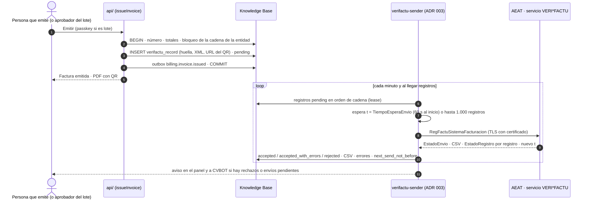

# 04 · Verifactu (sistemas informáticos de facturación)

> Versión 1 · 31-10-2026 · Fuentes oficiales consultadas el 31-10-2026 (lista en §17). Marcas: **HECHO** (fuente) · **SUPUESTO** · **PENDIENTE** (dueño y fecha).
> Decisiones: ADR 004 (Verifactu propio por servicio web y plan B con Holded), ADR 003 (certificado y su custodia). Hitos: **M1** (gate de preproducción el **01-12-2026**, producción de CVPO el 01-01-2027) y **M5** (P.O antes del 01-07-2027).
> Historias: US-VFT-01…06, US-FACT-02…06 y 08. Máquina de estados: `03-maquinas-estado.md` §8. Tablas: `regulatory.verifactu_installation`, `regulatory.verifactu_record`, `regulatory.verifactu_event` (`02-ddl/0012_regulatory.sql`).

## 1. Qué es y qué nos aplica

| Hecho | Estado | Fuente |
|---|---|---|
| Todo sistema que expida facturas de empresarios debe generar, por cada factura, un **registro de facturación** encadenado con huella SHA-256, y cumplir integridad, conservación, accesibilidad, legibilidad, trazabilidad e inalterabilidad | HECHO | RD 1007/2023, arts. 8–12 · https://www.boe.es/buscar/act.php?id=BOE-A-2023-24840 |
| Hay dos modalidades: **VERI*FACTU** (cada registro se remite a la AEAT de forma automática e inmediata; no hace falta firma ni registro de eventos) y **NO VERI*FACTU** (sin envío; firma XAdES de cada registro y registro de eventos) | HECHO | RD 1007/2023, art. 16.2–16.3 · Orden HAC/1177/2024, arts. 9 y 14 |
| Quien elige VERI*FACTU debe mantenerlo **al menos hasta el 31 de diciembre del año** en que hizo el primer envío efectivo | HECHO | RD 1007/2023, art. 16.5 · Orden HAC/1177/2024, art. 17.2 |
| Plazos en vigor: contribuyentes del **Impuesto sobre Sociedades** (CVPO) **antes del 01-01-2027**; resto de obligados (P.O, persona física con actividad) **antes del 01-07-2027** | HECHO | RD 1007/2023, disposición final 4.ª, en la redacción del RDL 15/2025 (BOE-A-2025-24446) |
| El 05-10-2026 Hacienda anunció una **previsión** de aplazar las obligaciones pendientes hasta **octubre de 2028** para alinearlas con la factura electrónica B2B. **No está en el BOE**: revisados los sumarios del BOE del 01-09-2026 al 31-10-2026, solo aparece la Orden HAC/1028/2026 | HECHO (nota de prensa) · NO VIGENTE | Nota de prensa del Ministerio de Hacienda, 05-10-2026 · sumarios https://www.boe.es/datosabiertos/api/boe/sumario/ |
| **Planificamos con las fechas del BOE.** Si se publica el aplazamiento, M1 sigue igual (la operativa ya es VERI*FACTU) y solo cambia la urgencia del gate | Decisión | ADR 004 |
| Un mismo sistema puede llevar la facturación de varios obligados (CVPO y P.O), con **una cadena independiente por obligado** y posibilidad de VERI*FACTU independiente | HECHO | FAQ AEAT "facturación múltiple" y "trazabilidad" (actualizadas a 21-10-2026) |
| En cada cadena se encadenan **altas y anulaciones juntas**, en el orden en que se generan | HECHO | FAQ AEAT "trazabilidad" |
| Software de **desarrollo propio** y uso propio: lo certifica, mediante declaración responsable, quien lo produce | HECHO | FAQ AEAT "certificación de los sistemas informáticos" |
| Producir o tener un sistema que no cumpla: 150.000 € por ejercicio y tipo de sistema (productor) y 50.000 € por ejercicio (tenencia de sistema no certificado o alterado) | HECHO | Ley 58/2003, art. 201 bis |
| Holded ya está adaptado a Verifactu (plan B) | HECHO | https://help.holded.com/es/articles/11406283-como-funciona-verifactu-en-holded |

## 2. Base legal, documentación técnica y fechas

| Norma o documento | Qué fija | Fecha / versión | Fuente |
|---|---|---|---|
| RD 1007/2023 (Reglamento de requisitos de los sistemas informáticos de facturación, RRSIF) | Ámbito, registro de alta y anulación, huella, declaración responsable, VERI*FACTU, QR | Consolidado con RDL 15/2025 | https://www.boe.es/buscar/act.php?id=BOE-A-2023-24840 |
| RDL 15/2025, disposición final 1.ª | Fechas 01-01-2027 y 01-07-2027 | BOE 03-12-2025 | https://www.boe.es/buscar/doc.php?id=BOE-A-2025-24446 |
| Orden HAC/1177/2024 | Especificaciones técnicas: integridad (art. 6), trazabilidad (7), eventos (9), alta (10), anulación (11), huella (13), firma (14), declaración responsable (15), remisión y control de flujo (16), inicio y renuncia (17), representación gráfica y QR (20–21) | BOE 28-10-2024 | https://www.boe.es/buscar/act.php?id=BOE-A-2024-22138 |
| RD 1619/2012 (Reglamento de facturación) | Contenido de la factura (art. 6), plazo de expedición (art. 11: antes del día 16 del mes siguiente si el destinatario es empresario), recapitulativas (art. 13), rectificativas (art. 15) | Consolidado | https://www.boe.es/buscar/act.php?id=BOE-A-2012-14696 |
| Diseño de registros (`DsRegistroVeriFactu.xlsx`) | Campos, formatos y listas L1–L17 | v1.0 (28-10-2024) | Portal de desarrolladores de la AEAT, sede → VERI*FACTU → Información técnica |
| Descripción de los servicios web | Endpoints, mensajes, respuestas, control de flujo | v1.0.3 | `Veri-Factu_Descripcion_SWeb.pdf` (sede AEAT) |
| Validaciones y errores | Reglas de aceptación y rechazo | v1.2.2 | `Validaciones_Errores_Veri-Factu.pdf` (sede AEAT) |
| Especificación de la huella | Cadena de entrada y ejemplos | v0.1.2 (27-08-2024) | `Veri-Factu_especificaciones_huella_hash_registros.pdf` |
| Especificación del QR | URL, codificación, tamaño y ubicación | sede AEAT | `DetalleEspecificacTecnCodigoQRfactura.pdf` |
| FAQ para desarrolladores | `ImporteTotal`, F3, rectificativas | 04-12-2025 | `FAQs-Desarrolladores.pdf` |
| FAQ generales de la AEAT | Ámbito, multi-obligado, declaración responsable | actualizadas a 21-10-2026 | Sede AEAT → Sistemas Informáticos de Facturación y VERI*FACTU → Preguntas frecuentes |
| RD 238/2026 y Orden HAC/1028/2026 (factura electrónica B2B) | Relación con Verifactu (§15) | BOE 26-03-2026 y 05-10-2026 | https://www.boe.es/eli/es/rd/2026/03/25/238 · https://www.boe.es/eli/es/o/2026/10/02/hac1028/con |

**Riesgo de vigencia**: los documentos técnicos de la AEAT cambian (las validaciones van por la v1.2.2). El conector fija la versión de los esquemas (`IDVersion` = `1.0`) y una tarea periódica compara los ficheros publicados con los guardados en `api/src/core/regulatory/verifactu/schemas/` (TASK-REG-010). Cualquier cambio abre una incidencia antes de desplegar.

## 3. Decisión de modalidad y aprobación

- **Modalidad** (**SUPUESTO**: recomendación de Q-002, sin respuesta de Pedro a 31-10-2026): **VERI*FACTU por servicio web** (ADR 004). WineCore se declara "solo VERI*FACTU" (`TipoUsoPosibleSoloVerifactu = S`), así que **no implementa** firma XAdES ni registro de eventos en la versión 1. *Computer use* no aplica: Verifactu no es un portal.
- **Aprobación humana** (regla dura 0.3; **SUPUESTO**: recomendación de Q-003, sin respuesta de Pedro): la aprobación de la **emisión** (por quien emite, o en la bandeja para lotes e intercompañía) **es** la aprobación del envío del registro. El envío es automático porque la norma exige que sea inmediato. No hay segunda aprobación.
- **Hasta M4** (roadmap v2, Q-033, SUPUESTO): CVPO factura en Holded con Verifactu desde el 01-01-2027. Por el art. 16.5 del RRSIF, VERI*FACTU se mantiene al menos hasta el 31-12-2027; el paso a WineCore en M4 (también VERI*FACTU) **no es una renuncia**, pero el asesor debe confirmarlo (PENDIENTE, Pedro + asesor, 15-12-2026). Lo mismo vale para P.O si su Holded ya envía registros en 2027 (Q-033). El plan B (Q-008) es volver a Holded con otra serie si WineCore falla después de M4.

## 4. Flujo

## 5. Registro de alta, campo a campo

Formato y obligatoriedad según el diseño de registros v1.0 (pestaña "2) D. Registro Facturación Alta"). "Origen" es la columna de WineCore de la que sale el dato; el XML canónico se guarda en `verifactu_record.record_xml`.

| Campo (ruta) | Formato | Uso en WineCore | Origen |
|---|---|---|---|
| `IDVersion` | L15 | Siempre `1.0` | Constante del conector |
| `IDFactura/IDEmisorFactura` | NIF (9) | Obligatorio | `core.legal_entity.tax_id` → `verifactu_record.issuer_tax_id` |
| `IDFactura/NumSerieFactura` | Alfanumérico (60) | Obligatorio. Solo ASCII 32–126, sin `"` `'` `<` `>` `=` (validación 1 de la AEAT) | `billing.invoice.number` (formato de serie en `core.number_series`, comprobado al crear la serie) |
| `IDFactura/FechaExpedicionFactura` | dd-mm-aaaa | Obligatorio. No puede ser futura ni anterior al 28-10-2024 | `billing.invoice.issue_date` |
| `RefExterna` | Alfanumérico (60) | Se informa con el id interno para conciliar | `billing.invoice.id` |
| `NombreRazonEmisor` | Alfanumérico (120) | Obligatorio | `core.legal_entity.legal_name` |
| `Subsanacion` | L4 (S/N) | Solo en subsanaciones (§9) | `verifactu_record.is_correction` |
| `RechazoPrevio` | L17 (N/S/X) | Solo tras un rechazo (§9) | `verifactu_record.rejected_previous` |
| `TipoFactura` | L2 | `F1` completa; `R1`–`R4` rectificativas; `F2`/`F3`/`R5` solo si se aprueba factura simplificada para la tienda (Q-018) | `billing.invoice.invoice_type` |
| `TipoRectificativa` | L3 (S/I) | Obligatorio en `R*` | `billing.invoice.rectification_kind` |
| `FacturasRectificadas/IDFacturaRectificada` (1–1000) | NIF, serie y número, fecha | Obligatorio en `R*`. Puede apuntar a una factura de Holded por número y fecha | `billing.invoice_rectification` → factura original o referencia `legacy` |
| `FacturasSustituidas/IDFacturaSustituida` (1–1000) | ídem | Solo en `F3` | `billing.invoice_rectification` (tipo sustitución) |
| `ImporteRectificacion/BaseRectificada`, `CuotaRectificada`, `CuotaRecargoRectificado` | Decimal (12,2) | Solo si `TipoRectificativa = S` | `billing.invoice_rectification.base_rectified`, `tax_rectified`, `surcharge_rectified` |
| `FechaOperacion` | dd-mm-aaaa | Solo si difiere de la expedición. Nunca posterior a la expedición (validación de la AEAT) | `billing.invoice.operation_date` |
| `DescripcionOperacion` | Alfanumérico (500) | Obligatorio | `billing.invoice.description` (por defecto "Venta de vino") |
| `FacturaSimplificadaArt7273`, `FacturaSinIdentifDestinatarioArt61d`, `Cupon` | L4/L5 | No se informan (equivale a N) | — |
| `Macrodato` | L14 | No se informa (N). Guardia propia: una factura con total ≥ 1.000.000 € se bloquea para revisión | Regla de `issueInvoice` |
| `EmitidaPorTerceroODestinatario`, `Tercero` | L6 | No aplica: emite el propio obligado | — |
| `Destinatarios/IDDestinatario/NombreRazon` | Alfanumérico (120) | Obligatorio salvo `F2`/`R5` | `billing.invoice.customer_snapshot.name` |
| `…/NIF` | NIF (9) | Cliente con NIF español (incluido Canarias) | `customer_snapshot.tax_id` (normalizado con `normalizeTaxId`) |
| `…/IDOtro/CodigoPais`, `IDType`, `ID` | ISO 3166-1, L7, (20) | Cliente extranjero. UE: `IDType 02` (NIF-IVA validado en VIES, obligatorio en `E5`). Fuera de la UE (Reino Unido incluido): `04` documento oficial del país (SUPUESTO, se valida en la batería de preproducción, caso VF-05) | `customer_snapshot.country`, `tax_id_type`, `tax_id` |
| `Desglose/DetalleDesglose` (1–12) | — | Una línea por tratamiento fiscal y tipo (§6) | `billing.invoice_tax` |
| `CuotaTotal` | Decimal (12,2) | Σ `CuotaRepercutida` + Σ `CuotaRecargoEquivalencia` | `invoice.tax_total + invoice.surcharge_total` → `verifactu_record.total_tax` |
| `ImporteTotal` | Decimal (12,2) | Σ (`BaseImponibleOimporteNoSujeto` + `CuotaRepercutida` + `CuotaRecargoEquivalencia`). **No resta la retención de IRPF** (FAQ para desarrolladores, 04-12-2025) | `invoice.subtotal + invoice.tax_total + invoice.surcharge_total` → `verifactu_record.total_amount`. **No es** `invoice.total`, que es el importe a cobrar |
| `Encadenamiento/PrimerRegistro` | `S` | Solo en el primer registro de la cadena | `verifactu_record.chain_seq = 1` |
| `Encadenamiento/RegistroAnterior/IDEmisorFactura`, `NumSerieFactura`, `FechaExpedicionFactura`, `Huella` | — | Datos de la factura del registro anterior (de alta o de anulación) y su huella completa | `previous_record_id` → registro anterior; `previous_hash` |
| `SistemaInformatico/*` | — | Ver §8 | `regulatory.verifactu_installation` |
| `FechaHoraHusoGenRegistro` | `AAAA-MM-DDThh:mm:ss±hh:mm` | Hora de Madrid con su desfase (+01:00 o +02:00), al segundo. Nunca anterior a la del registro anterior ni posterior a la hora actual | `verifactu_record.generated_at` (`clock_timestamp()` dentro de la transacción de emisión) |
| `NumRegistroAcuerdoFacturacion`, `IdAcuerdoSistemaInformatico` | — | No aplica (sin autorizaciones especiales) | — |
| `TipoHuella` | L12 | `01` (SHA-256) | `verifactu_record.hash_type` |
| `Huella` | Hex (64), mayúsculas | §7 | `verifactu_record.hash` |
| `Signature` | XAdES | **No** se informa (VERI*FACTU) | — |

**Cabecera del envío** (pestaña "1) DR Remisión"):

| Campo | Uso | Origen |
|---|---|---|
| `ObligadoEmision/NombreRazon`, `NIF` | Entidad cuyos registros se envían (un envío por entidad) | `core.legal_entity` |
| `Representante` | No se informa: los registros los genera el propio sistema del obligado | — |
| `RemisionVoluntaria/FechaFinVeriFactu` | Solo si algún día se renuncia (art. 17.3 de la orden). No previsto | `verifactu_installation` (acción de Ajustes con aprobación) |
| `RemisionVoluntaria/Incidencia` | `S` si el envío incluye registros retrasados por una incidencia técnica (algún intento fallido o generados hace más de 5 minutos) | Calculado por el emisor a partir de `connector_run` |
| `RemisionRequerimiento` | Solo para responder a un requerimiento (fuera del MVP) | — |

## 6. Tratamientos fiscales → desglose

Semillas de `billing.tax_code` (`0009_billing.sql`) contrastadas con las listas L1, L8A, L9 y L10 del diseño de registros y con las validaciones v1.2.2:

| `tax_code` | Uso | `Impuesto` | `ClaveRegimen` | `CalificacionOperacion` / `OperacionExenta` | `TipoImpositivo` | Recargo | Notas de validación |
|---|---|---|---|---|---|---|---|
| `IVA21` | Venta nacional | 01 | 01 | S1 | 21 | — | — |
| `IVA21_RE` | Cliente en recargo de equivalencia | 01 | 18 | S1 | 21 | 5,2 | Con tipo 21 solo se admite recargo 5,2 (validación 15.3) |
| `IVA21_ALQ` | Arrendamiento de local con retención del 19 % | 01 | 11 | S1 | 21 | — | La retención **no** va al registro ni a `ImporteTotal` |
| `EXP_E2` | Exportación (Reino Unido, resto fuera de la UE, Canarias) | 01 | 02 | E2 | — | — | Con clave 02 solo puede ir `OperacionExenta` (validación 15.6.1) |
| `INTRA_E5` | Entrega intracomunitaria | 01 | 01 | E5 | — | — | Destinatario con `IDOtro` (validación 15.5.1); con clave 01 no puede ir E2/E3 |
| `NS_LOC` | No sujeta por reglas de localización (servicios a clientes extranjeros, caso raro) | 01 | 01 | N2 | — | — | Revisar con el asesor antes de usarla (PENDIENTE, Pedro + asesor, 15-01-2027) |

Con `OperacionExenta` no se informan tipo, cuota ni recargo. Las cuotas se redondean **por tipo** (ROUND_HALF_UP a 2 decimales) como en `computeInvoice` (`02-modelo-dominio.md` §billing); la AEAT admite ±10,00 € de diferencia en `ImporteTotal` como aviso, pero nuestras pruebas exigen diferencia **cero**.

## 7. Huella o *hash* (Orden HAC/1177/2024, art. 13)

1. Cadena de entrada `nombre=valor` unida por `&`, en este orden:
   - **Alta**: `IDEmisorFactura`, `NumSerieFactura`, `FechaExpedicionFactura`, `TipoFactura`, `CuotaTotal`, `ImporteTotal`, `Huella` (del registro anterior), `FechaHoraHusoGenRegistro`.
   - **Anulación**: `IDEmisorFacturaAnulada`, `NumSerieFacturaAnulada`, `FechaExpedicionFacturaAnulada`, `Huella` (anterior), `FechaHoraHusoGenRegistro`.
2. Valores **idénticos a los del XML**, sin espacios al principio ni al final. Si falta un campo (p. ej., `Huella` en el primer registro) se pone `Huella=` sin valor.
3. Codificación UTF-8 → SHA-256 → hexadecimal en **mayúsculas** (64 caracteres).
4. WineCore genera el XML **a partir de los mismos valores** que entran en la huella (una sola función de serialización), para que no puedan divergir.

**Vectores oficiales** (especificación v0.1.2, §6; comprobados el 31-10-2026 con SHA-256). Son la prueba unitaria `api/test/unit/verifactu/hash.test.ts`:

| Caso | Cadena de entrada | Huella esperada |
|---|---|---|
| Primer alta | `IDEmisorFactura=89890001K&NumSerieFactura=12345678/G33&FechaExpedicionFactura=01-01-2024&TipoFactura=F1&CuotaTotal=12.35&ImporteTotal=123.45&Huella=&FechaHoraHusoGenRegistro=2024-01-01T19:20:30+01:00` | `3C464DAF61ACB827C65FDA19F352A4E3BDC2C640E9E9FC4CC058073F38F12F60` |
| Segunda alta | `IDEmisorFactura=89890001K&NumSerieFactura=12345679/G34&FechaExpedicionFactura=01-01-2024&TipoFactura=F1&CuotaTotal=12.35&ImporteTotal=123.45&Huella=3C464DAF61ACB827C65FDA19F352A4E3BDC2C640E9E9FC4CC058073F38F12F60&FechaHoraHusoGenRegistro=2024-01-01T19:20:35+01:00` | `F7B94CFD8924EDFF273501B01EE5153E4CE8F259766F88CF6ACB8935802A2B97` |
| Anulación | `IDEmisorFacturaAnulada=89890001K&NumSerieFacturaAnulada=12345679/G34&FechaExpedicionFacturaAnulada=01-01-2024&Huella=F7B94CFD8924EDFF273501B01EE5153E4CE8F259766F88CF6ACB8935802A2B97&FechaHoraHusoGenRegistro=2024-01-01T19:20:40+01:00` | `177547C0D57AC74748561D054A9CEC14B4C4EA23D1BEFD6F2E69E3A388F90C68` |

(El NIF `89890001K` es el ficticio de los ejemplos de la AEAT.)

**Encadenamiento y concurrencia**: una cadena por par (sistema, obligado) = una por `verifactu_installation` (`UNIQUE (legal_entity_id, environment)`). La emisión pasa por la cola del escritor único (ADR 002), que calcula `chain_seq`, el registro anterior y su huella sin escrituras concurrentes; la guarda `WC130` del núcleo impide insertar fuera del final de la cadena o modificar un registro salvo su estado de envío. Si la AEAT detecta una huella que no cuadra, marca el registro "Aceptado con errores" (especificación de la huella, §7): es un fallo grave que dispara alerta y revisión (§11).

## 8. Instalación y sistema informático

| Campo `SistemaInformatico` | Valor | Origen |
|---|---|---|
| `NombreRazon`, `NIF` (productor) | Quien firme la declaración responsable (Q-007) | `verifactu_installation.producer_name`, `producer_tax_id` |
| `NombreSistemaInformatico` | `WineCore` (≤ 30) | `system_name` |
| `IdSistemaInformatico` | `WC` (2 caracteres) | `system_id` |
| `Version` | Versión del **módulo de facturación** (`billing-x.y.z`), no la del despliegue completo; cambia solo cuando cambia código que afecta a facturas o registros | `system_version` (fijado en el despliegue) |
| `NumeroInstalacion` | `WC-<entidad>-<entorno>` (p. ej., `WC-CVPO-PROD`) | `installation_number` |
| `TipoUsoPosibleSoloVerifactu` | `S` | `only_verifactu` |
| `TipoUsoPosibleMultiOT` | `S` (CVPO y P.O) | `multi_taxpayer` |
| `IndicadorMultiplesOT` | `S` mientras haya dos entidades activas | `multiple_taxpayers` |

**Declaración responsable** (RRSIF art. 13; Orden HAC/1177/2024 art. 15): documento titulado "DECLARACIÓN RESPONSABLE DEL SISTEMA INFORMÁTICO DE FACTURACIÓN" con, en este orden: nombre del sistema; código `WC`; versión completa; componentes de hardware y software y funciones; si es solo VERI*FACTU (sí); si permite varios obligados (sí); tipos de firma (no aplica); nombre, NIF y dirección del productor; manifestación de cumplimiento del art. 29.2.j) LGT, del RRSIF y de la orden; fecha y lugar. Debe estar **dentro del sistema** (Ajustes → Verifactu, US-VFT-05) y entregarse a cada usuario. **Una por versión**: el pipeline de despliegue no publica una `Version` nueva sin su declaración firmada en `docs/legal/declaraciones/` (TASK-REG-010). Si se usan componentes de terceros que formen parte del sistema de facturación, cada uno aporta la suya (art. 15.4): el asesor debe confirmar si la plataforma de alojamiento cuenta como componente (PENDIENTE, Q-007, Pedro + asesor, 15-12-2026).

## 9. Correcciones: qué mecanismo usar

| Situación | Mecanismo | Registro que se genera | Quién |
|---|---|---|---|
| La factura **no debió expedirse** (duplicada, cliente equivocado antes de entregarla) | Anulación (US-FACT-05) | Registro de **anulación** (`SinRegistroPrevio` y `RechazoPrevio` vacíos o N). El número **no** se reutiliza | Aprobador |
| Error en importes, tipos o datos fiscales de una factura ya entregada; devolución; descuento posterior | **Rectificativa** `R1`–`R4` por diferencias (`I`) o por sustitución (`S`) (RD 1619/2012 art. 15; US-FACT-04) | Nuevo registro de **alta** de la rectificativa | Quien emite |
| El registro se envió con un dato del **registro** mal (no de la factura), p. ej. clave de régimen; la AEAT lo aceptó con errores | **Subsanación** (US-VFT-04) | Alta con `Subsanacion = S` (y `RechazoPrevio` vacío) | Quien emite, tras revisar |
| La AEAT **rechazó** el alta inicial (estado Incorrecto) | Alta por rechazo | Alta con `Subsanacion = S` y `RechazoPrevio = X` | Quien emite, tras corregir |
| La AEAT rechazó una subsanación | Alta por rechazo de subsanación | `Subsanacion = S`, `RechazoPrevio = S` | ídem |
| La AEAT rechazó una anulación | Anulación por rechazo | `RechazoPrevio = S` | Aprobador |
| La AEAT responde "duplicado" | No se genera nada: se compara `EstadoRegistroDuplicado` y los datos; si coinciden, el registro se marca aceptado (idempotencia); si no, alerta | — | Sistema y revisión |

Fuente: pestañas "A) Cuadro Operativa Alta" y "B) Cuadro Operativa Anulación" del diseño de registros. Toda corrección genera un **registro nuevo encadenado**; nunca se modifica uno existente (`WC130`). Una corrección de datos de la factura que exija rectificativa no puede hacerse con una subsanación (la interfaz solo ofrece subsanación cuando el error es del registro, no de la factura).

## 10. Envío por servicio web

| Elemento | Valor | Fuente |
|---|---|---|
| Servicio (producción, certificado de persona o representante) | `https://www1.agenciatributaria.gob.es/wlpl/TIKE-CONT/ws/SistemaFacturacion/VerifactuSOAP` | WSDL v1.0 |
| Servicio (producción, certificado de sello) | `https://www10.agenciatributaria.gob.es/wlpl/TIKE-CONT/ws/SistemaFacturacion/VerifactuSOAP` | WSDL v1.0 |
| Servicio (pruebas) | `https://prewww1.aeat.es/…/VerifactuSOAP` · sello: `https://prewww10.aeat.es/…/VerifactuSOAP` | WSDL v1.0 |
| WSDL y esquemas | `…/static_files/common/internet/dep/aplicaciones/es/aeat/tikeV1.0/cont/ws/SistemaFacturacion.wsdl`, `SuministroLR.xsd`, `SuministroInformacion.xsd`, `RespuestaSuministro.xsd`, `ConsultaLR.xsd` (en `www2.agenciatributaria.gob.es` y `prewww2.aeat.es`) | Descripción de servicios v1.0.3, anexos I y II |
| Operaciones | `RegFactuSistemaFacturacion` (alta y anulación) y `ConsultaFactuSistemaFacturacion` (consulta) | ídem |
| Autenticación | Certificado electrónico válido en la sede de la AEAT; puede enviar el obligado o un tercero con apoderamiento o colaboración social | Orden HAC/1177/2024, art. 5 |
| Tamaño máximo | 1.000 registros por envío | Diseño de registros, `RegistroFactura (1-1000)` |
| Control de flujo | Esperar `t` segundos (60 al inicio; la respuesta trae el nuevo valor en `TiempoEsperaEnvio`) **o** a tener 1.000 registros, lo primero que ocurra | Orden HAC/1177/2024, art. 16.2 |
| Respuesta global | `Correcto` · `ParcialmenteCorrecto` · `Incorrecto`; CSV si al menos un registro es correcto | Lista L18; art. 16.5 |
| Respuesta por registro | `Correcto` · `AceptadoConErrores` · `Incorrecto` (+ código y descripción) y, si es duplicado, `EstadoRegistroDuplicado` (`Correcta`, `AceptadaConErrores`, `Anulada`) | Listas L19–L21 |
| Incidencias | Si no se puede enviar, reintentar **al menos cada hora**, respetar el orden de generación, marcar `Incidencia = S` y **mostrar un aviso con cuántos registros faltan** mientras quede alguno | Orden HAC/1177/2024, art. 16.4 |

Implementación: `api/src/core/regulatory/verifactu/` (huella, XML, SOAP, QR y parseo de respuestas; sin certificado) y el emisor (`api/` en el entorno aislado `verifactu` de Timbal, con certificado, según ADR 003; M4). El emisor envía **por entidad**, en orden de `chain_seq`, nunca un registro antes que su anterior, y guarda la petición y la respuesta completas como evidencia.

## 11. Reintentos, errores y avisos

| Situación | Acción automática | Aviso | Acción humana |
|---|---|---|---|
| Fallo técnico (sin respuesta, 5xx, TLS) | `sending → pending`; reintento a los 30 s, 2 min, 10 min, 1 h y después **cada hora** | Banner fijo en el panel y en Facturas: "N registros Verifactu sin enviar desde hh:mm" (art. 16.4). A la 3.ª falla, CVBOT | Revisar certificado, red o estado de la AEAT |
| `Incorrecto` | Ninguno (no se reenvía igual) | Factura con estado "Verifactu: rechazada" y el error en claro; CVBOT | Corregir (§9) |
| `AceptadoConErrores` | Ninguno | Estado "aceptada con errores" | Decidir subsanación (§9) |
| Huella no coincidente según la AEAT | Bloquea nuevas emisiones de esa entidad hasta revisión | Alerta crítica | Investigar (posible fallo del sistema); registro en auditoría |
| Certificado caducado o a < 30 días | — | Aviso diario desde 30 días antes | Renovar (ADR 003) |
| `TiempoEsperaEnvio` cambiado | Se guarda en `next_send_not_before` | — | — |

## 12. QR y representación en la factura (Orden HAC/1177/2024, arts. 20–21)

- **URL de cotejo** (VERI*FACTU): `https://www2.agenciatributaria.gob.es/wlpl/TIKE-CONT/ValidarQR?nif=<NIF>&numserie=<serie+número>&fecha=<dd-mm-aaaa>&importe=<ImporteTotal>`. En pruebas: `https://prewww2.aeat.es/wlpl/TIKE-CONT/ValidarQR?…`. Valores con *URL encoding* UTF-8 (por ejemplo `&` en el número → `%26`); importe con punto decimal, igual que `ImporteTotal`. Origen: `verifactu_record.qr_url`, calculada al generar el registro.
- **Código**: ISO/IEC 18004:2015, corrección de errores nivel **M**, tamaño **30×30 a 40×40 mm**, margen en blanco ≥ 2 mm (recomendado 6 mm).
- **Ubicación**: primera página, arriba (centrado o arriba a la izquierda en vertical), antes del contenido de la factura y como primer QR si hubiera otros.
- **Textos**: encima, "QR tributario:"; debajo, "Factura verificable en la sede electrónica de la AEAT" o "VERI*FACTU", con letra igual o mayor que la del resto de la factura. WineCore usa la frase larga en español y en inglés deja la frase oficial en español (es un texto normativo).
- **Totales en el PDF**: "Importe total de la factura" (el del QR) y, si hay retención, "Total a pagar" por separado (recomendación de la FAQ para desarrolladores).

## 13. Evidencias y conservación

Por cada registro: XML canónico (`record_xml`), petición y respuesta SOAP completas, CSV, fecha y hora, versión del sistema e instalación. Se guardan como documentos de la Knowledge Base, sin borrado ni sustitución (ADR 002 §4), durante **6 años** más el año en curso (art. 30 del Código de Comercio; cubre los 4 años de prescripción de la LGT). El registro de auditoría guarda quién emitió o aprobó y el `payload_sha256` aprobado.

## 14. Casos límite

1. **Emisión con la AEAT caída**: la factura se emite igualmente (la norma permite enviar después con `Incidencia = S`); el banner del art. 16.4 queda visible hasta que se envíe todo.
2. **Cambio de hora** (último domingo de marzo y de octubre): `FechaHoraHusoGenRegistro` lleva el desfase real de ese instante; la prueba P-05 de `11-tests.md` cubre las dos transiciones.
3. **Dos personas emiten a la vez para la misma entidad**: el bloqueo por instalación serializa; la segunda espera milisegundos.
4. **Factura intercompañía mensual** (US-FACT-09): recapitulativa con `FechaOperacion` = último día del mes y **expedida antes del día 16** del mes siguiente (RD 1619/2012 arts. 11 y 13). `FechaExpedicionFactura` es el día real de emisión, nunca uno pasado.
5. **Rectificar una factura de Holded**: `FacturasRectificadas` lleva el NIF, número y fecha de Holded (de `legacy`); la batería de preproducción incluye este caso (VF-10).
6. **Cliente sin NIF en factura completa**: bloqueado en la emisión ("El cliente necesita NIF para una factura completa").
7. **Primera factura del año**: la cadena no se reinicia con la serie nueva; sigue la misma por entidad.
8. **Paso de Holded a WineCore** (plan B): la cadena de WineCore empieza con `PrimerRegistro = S` en su primera factura; las series no se solapan con las de Holded.
9. **Restaurar una copia de la base de datos**: nunca en producción sin procedimiento (riesgo de reutilizar posiciones de la cadena ya enviadas). El procedimiento de restauración (`07-arquitectura.md`) compara la última huella enviada a la AEAT (consulta) con la de la copia antes de reabrir la emisión.
10. **Renuncia a VERI*FACTU**: no prevista; exigiría firma XAdES y registro de eventos (no implementados) y se haría con `FechaFinVeriFactu` antes de fin de año.

## 15. Relación con la factura electrónica B2B

El RD 238/2026 y la Orden HAC/1028/2026 obligan a intercambiar facturas electrónicas estructuradas entre empresas: emisores de más de 8 M€ (ECI) desde el **06-10-2027**; CVPO y P.O desde el **06-10-2028**; P.O informa de estados desde el **06-10-2029** (Q-032). La nota de Hacienda del 05-10-2026 apunta a converger ambos sistemas. Diseño: el registro Verifactu y la futura factura UBL salen del **mismo** `billing.invoice` congelado al emitir; el hito M8 añade la emisión estructurada sin tocar la cadena.

## 16. Batería de preproducción (gate del 01-12-2026, US-VFT-06)

Se ejecuta contra `prewww1`/`prewww10` con un certificado reconocido de pruebas (no hace falta cerrar Q-006, aplazada por Pedro) y datos sintéticos (`api/db/synthetic.ts`). Resultado esperado "Correcto" salvo donde se indica. Golden files en `api/test/golden/verifactu/` (XML enviado, respuesta y huella).

| Caso | Qué prueba | Esperado |
|---|---|---|
| VF-01 | Primer registro de una cadena (`F1`, `IVA21`) | Correcto; `PrimerRegistro = S` |
| VF-02 | Segundo registro encadenado | Correcto; la consulta devuelve la huella anterior correcta |
| VF-03 | `IVA21_RE` (21 % + 5,2 %) | Correcto; `CuotaTotal` incluye el recargo |
| VF-04 | `IVA21_ALQ` con retención del 19 % | Correcto; `ImporteTotal` sin restar la retención |
| VF-05 | Exportación a Reino Unido (`EXP_E2`, `IDOtro` con `IDType 04`) | Correcto (si no, se ajusta el tipo de identificación y se documenta) |
| VF-06 | Entrega intracomunitaria (`INTRA_E5`, `IDType 02`) | Correcto |
| VF-07 | Venta a Canarias (`EXP_E2` con NIF español) | Correcto |
| VF-08 | Rectificativa `R4` por diferencias (devolución parcial, importes negativos) | Correcto |
| VF-09 | Rectificativa `R1` por sustitución con `ImporteRectificacion` | Correcto |
| VF-10 | Rectificativa de una factura de Holded (número y fecha externos) | Correcto (si la AEAT exige que exista, se documenta la alternativa con el asesor) |
| VF-11 | Anulación de una factura emitida por error | Correcto; el alta queda "Anulada" en la consulta |
| VF-12 | Subsanación de un registro aceptado con errores | Correcto |
| VF-13 | Rechazo provocado (dato inválido) y alta por rechazo (`S`/`X`) | 1.º Incorrecto; 2.º Correcto |
| VF-14 | Reenvío del mismo registro | Incorrecto por duplicado con `EstadoRegistroDuplicado = Correcta`; WineCore lo da por aceptado |
| VF-15 | Huella alterada a propósito | AceptadoConErrores; WineCore bloquea la entidad y alerta |
| VF-16 | Envío de 50 registros en un mensaje | Correcto; se respeta `TiempoEsperaEnvio` antes del siguiente |
| VF-17 | Envío diferido tras una caída simulada (`Incidencia = S`) | Correcto; el banner desaparece al terminar |
| VF-18 | Dos entidades (CVPO y P.O) en la misma instalación lógica | Dos cadenas independientes, ambas correctas |
| VF-19 | Factura con dos tratamientos (`IVA21` y `EXP_E2`) en una factura | Correcto (o, si la combinación no tiene sentido fiscal, bloqueo en WineCore) |
| VF-20 | Consulta de los registros enviados del día | Coinciden número, huella y estado con WineCore |
| VF-21 | QR leído con el servicio de cotejo de pruebas | "Factura encontrada" con los mismos datos |
| VF-22 | Primera factura de la serie del año siguiente | Continúa la cadena |

**Criterio del gate**: 22/22 como se espera, cero diferencias de huella, informe firmado por Pedro en la bandeja de aprobaciones y evidencias archivadas. Si no se cumple el 01-12-2026, se activa el plan B (Q-008).

## 17. Pendientes

| Tema | Dueño | Fecha |
|---|---|---|
| Certificado (tipo, titular, apoderamiento de P.O a CVPO para el envío) y custodia | Pedro (Q-006, ADR 003; aplazada: se decide al final) | 15-12-2026 |
| Productor y declaración responsable; componentes de terceros | Pedro + asesor (Q-007) | 15-12-2026 |
| Confirmar que pasar de Holded (VERI*FACTU) a WineCore (VERI*FACTU) no es renuncia | Pedro + asesor (Q-008) | 01-12-2026 |
| Tipo de identificación de clientes de Reino Unido (`IDType`) | Equipo, en la batería (VF-05) | 01-12-2026 |
| Uso de `NS_LOC` | Pedro + asesor | 15-01-2027 |
| Seguir en el BOE el aplazamiento anunciado el 05-10-2026 | Vigilante `boe-watch` (TASK-REG-010) | Semanal |

**Fuentes consultadas el 31-10-2026**: BOE (RD 1007/2023 consolidado, RDL 15/2025, Orden HAC/1177/2024, RD 1619/2012, LGT, RD 238/2026, Orden HAC/1028/2026, sumarios del 01-09 al 31-10-2026); sede de la AEAT (portal de desarrolladores VERI*FACTU: diseño de registros v1.0, descripción de servicios v1.0.3, validaciones v1.2.2, huella v0.1.2, QR, FAQ para desarrolladores de 04-12-2025, FAQ generales actualizadas a 21-10-2026); nota de prensa del Ministerio de Hacienda de 05-10-2026; ayuda de Holded.
