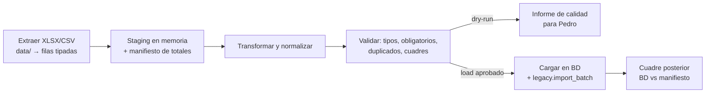

# 06 · Migración de datos

> Versión 1 · 31-10-2026. Fuentes: exports reales de Holded (CVPO y P.O) y Shopify analizados **en local** el 31-10-2026 (estructura, tipos, recuentos y totales; nada de esto se sube a git). Destino: tablas de `02-ddl/` y el esquema de histórico `legacy` (`0016_legacy.sql`).
> Decisiones: R5 (arrancar desde un aforo, no migrar movimientos de SISV/SILICIE), D7 (el histórico contable llega aparte), Q-013 (corte), Q-022 (alcance contable), Q-023 (RGPD Shopify).

## 0. Principios

1. **Los datos reales nunca entran en git ni en staging/dev.** Los scripts de migración se ejecutan en el equipo de un operador autorizado (o en un job protegido) leyendo de `data/` y escribiendo en una base **privada de migración** `winecore_migration` (mismo nivel de seguridad que producción) para los ensayos, y en `winecore_prod` para la carga final.
2. **Idempotencia**: cada fila tiene una clave natural (§2.3). Reejecutar una carga no duplica ni pisa datos ya validados; `legacy.import_batch` registra cada fichero por su SHA-256 (un mismo fichero no se carga dos veces en modo `load`).
3. **Ensayo (*dry-run*) obligatorio**: `--dry-run` ejecuta todo dentro de una transacción que se deshace al final y produce el informe de calidad; solo se carga (`--load`) si el informe del ensayo está aprobado por Pedro.
4. **Holded no es el SIF de WineCore**: sus facturas van a `legacy.*` (archivo de solo lectura), no a `billing.invoice`; no generan registros Verifactu ni consumen series de WineCore.
5. **No se migran stocks ni movimientos regulatorios**: las existencias iniciales salen del **aforo físico** del corte (§12).
6. **Minimización (RGPD)**: solo se migran personas con relación activa o consentimiento (§3.3); el resto queda en el archivo cifrado de `data/` hasta su borrado.

## 1. Inventario de fuentes (31-10-2026)

| Fichero (en `data/`) | Entidad | Filas de datos | Periodo | Destino | Hito |
|---|---|---|---|---|---|
| `holded/cvpo/…Contactos.xlsx` | CVPO | 255 | creados 2022-03 → 2026-10 | `party.*` | M1 |
| `holded/po/…Contactos.xlsx` | P.O | 219 | 2022-03 → 2026-10 | `party.*` | M1 (P.O en M2) |
| `holded/*/inventario/…Productos.xlsx` | CVPO / P.O | 45 / 38 | — | `catalog.*` (curado) + `legacy.holded_product` | M1 |
| `holded/cvpo/ventas/…Ingresos….xlsx` (facturas, cabecera) | CVPO | 1.027 | 2022-01 → 2026-10 | `legacy.holded_invoice` (`sale`) | M7 (abiertas: M1) |
| `holded/po/ventas/…Ingresos….xlsx` | P.O | 478 | 2022-01 → 2026-10 | ídem | M7 (abiertas: M2) |
| `holded/*/ventas/Ventas Exportar items.xlsx` (líneas) | CVPO / P.O | 3.031 / 1.848 | ídem | `legacy.holded_invoice_line` (`sale`) | M7 |
| `holded/cvpo/ventas/…Albaranes….xlsx` + items | CVPO | 1.546 / 5.133 | 2022-02 → 2026-10 | `legacy.holded_delivery_note` + líneas | M7 (revisión de abiertos: M2) |
| `holded/*/ventas/…Presupuestos….xlsx` + items | CVPO / P.O | 9+28 / 11+35 | 2022 → 2026 | `legacy.holded_invoice_line` (`quote`) | M7 |
| `holded/*/compras/…Compras….xlsx` + items | CVPO / P.O | 633+646 / 921+974 | 2021-09 → 2026-10 | `legacy.holded_invoice` (`purchase`) + líneas | M7 (abiertas: M2) |
| `holded/*/contabilidad/cuadro_de_cuentas_20xx.xlsx` | CVPO / P.O | 5 años c/u | 2022 → 2026 | `legacy.holded_trial_balance` | M7 |
| `holded/*/contabilidad/cuenta_de_perdidas_y_ganancias_20xx.xlsx` | CVPO / P.O | 5 años c/u | 2022 → 2026 | `legacy.holded_pnl_line` | M7 |
| `shopify/customers_export.zip` | (web) | 2.305 | — | `party.*` (solo ~212, §3.3) | M7 |
| `shopify/orders_export_1.csv` | (web) | 168 pedidos / 322 líneas | 2022-11 → 2026-09 | `legacy.shopify_order` + líneas | M7 |
| `shopify/products_export_1.csv` | (web) | 53 productos / 95 filas | — | atributos de `catalog.wine`/`product` | M1 |
| `shopify/transactions_export.csv`, `discounts…`, `gift_cards…` | (web) | 55 / 3 / 2 | — | `legacy` (consulta) | M7 |
| PDF de Holded (~2.900, en zips) | ambas | **no recibidos aún** | — | S3 `legacy/` + `legacy.document_file` | M7 |
| Histórico contable D7 (diario y mayor) | ambas | **pendiente** (tarea aparte) | ≤ 2026 | `legacy.accounting_journal_line` | M7 |

**Estructura común de los XLSX de Holded**: una hoja; 3 o 4 filas de cabecera de informe (empresa, título, periodo y una vacía) antes de la fila de nombres de columna; **una última fila con un sello de generación** (solo la primera celda, con el patrón `… - dd/mm/aaaa hh:mm`). El extractor localiza la fila de cabecera **por nombres de columna esperados** (no por posición), descarta la fila del sello y guarda su fecha como `export_generated_at` del lote. Las columnas con el mismo nombre (p. ej. dos `IVA` en P.O, dos `Facturado` en albaranes) se renombran `IVA`, `IVA_2` / `Facturado_importe`, `Facturado_estado` según su orden.

## 2. Proceso

### 2.1 Fases


### 2.2 Comandos (`api/db/migration/`)
```
bun api/db/migration/run.ts --source holded --entity CVPO --dataset contacts --file "data/holded/cvpo/…Contactos.xlsx" --dry-run
bun api/db/migration/run.ts --source holded --entity CVPO --dataset contacts --file "…" --load --approved-report <sha256 del informe>
bun api/db/migration/manifest.ts --input data/ --out data/migration/expected_totals.json      # totales esperados (privado)
bun api/db/migration/verify.ts --manifest data/migration/expected_totals.json                 # cuadre BD vs manifiesto
```
- `--load` exige `--approved-report` con el hash del informe del último ensayo del mismo fichero (evita cargar algo distinto de lo revisado).
- Variables: `DATABASE_URL_MIGRATION` (rol `winecore_migrator`). Actor de BD: `core.set_actor('migration', 'migrador:<operador>', NULL, <id de lote>, NULL)`.

### 2.3 Claves de idempotencia

| Destino | Clave natural |
|---|---|
| `party.contact` | NIF normalizado; si no hay, `legacy_refs.holded_<entidad>` = hash(nombre normalizado + CP) |
| `legacy.holded_invoice` | (entidad, `kind`, número, fecha) |
| `legacy.holded_invoice_line` | (entidad, `kind`, número de documento, fecha, orden en el fichero) |
| `legacy.holded_delivery_note` | (entidad, número, fecha) |
| `legacy.holded_trial_balance` | (entidad, año, cuenta) |
| `legacy.shopify_order` | `Name` (p. ej. `#1001`) |
| `legacy.document_file` | SHA-256 del PDF |

## 3. Contactos

### 3.1 Holded → `party.contact` (+ dirección, persona y condiciones por entidad)

| Columna Holded | Tipo observado | Destino | Regla |
|---|---|---|---|
| `Creado` | fecha | `legacy_refs.holded_created_at` | Solo referencia |
| `Nombre` | texto | `legal_name` | Recortar espacios; ≤ 120 caracteres |
| `ID` | texto (42 % vacío en CVPO, 13 % en P.O) | `tax_id`, `tax_id_type`, `tax_id_country` | `normalizeTaxId` (02-modelo §6). Letra/dígito de control incorrecto → `tax_id = NULL`, `tax_id_type = 'none'` y aviso de calidad `INVALID_TAX_ID` |
| `Email` | texto | `party.contact_person.email` (persona "General") | Minúsculas; validar formato; si inválido → aviso |
| `Teléfono`, `Móvil` | número/texto | `party.contact_person.phone` | Normalizar a E.164 (`+34…` si 9 dígitos españoles) |
| `Dirección`, `Población`, `Código postal`, `Provincia`, `Código país` | texto | `party.contact_address` (`kind = 'both'`, `is_default`) | CP numérico → texto de 5 dígitos con ceros a la izquierda si país ES; `País` se ignora (se usa `Código país`) |
| `Idioma` | Español/Inglés | `language` | `es` / `en` |
| `Moneda` | Euro/U.S. Dollar | `currency` | `EUR` / `USD` |
| `Dto. %` | decimal | `party.contact_entity_terms.discount_pct` | Por entidad del fichero |
| `Cuenta` | entero (8 dígitos) | `contact_entity_terms.customer_account` o `supplier_account` | Según `Tipo`; si no casa con `^43…` / `^4[01]…` → aviso |
| `Referencia`, `Tags`, `Visibilidad Portal` | texto | `legacy_refs` | Solo referencia |
| `Régimen` | siempre "Régimen general" | `vat_regime` | `general`; después se corrige a `equivalence_surcharge` si el contacto tiene facturas con recargo en 2025–2026 (regla H5 del triaje) |
| `F.Pago` | texto (casi vacío) | `payment_method` | "Pago al contado" → `cash`; "Transferencia bancaria" → `transfer` |
| `IBAN`, `Swift`, `Ref. mandato` | vacíos | `iban_enc`, `sepa_mandate_ref` | Cifrar IBAN con `WINECORE_DATA_KEY`; guardar `iban_last4` |
| `Cuenta de ventas`, `Cuenta de compras` | texto (casi vacío) | — | Se ignoran (la cuenta por defecto la fija la categoría) |
| `Tipo` | Cliente/Proveedor/Lead | `is_customer` / `is_supplier` | "Lead" → ninguno (contacto archivado) |
| `Tipo de contacto` | Empresa/Persona | `kind` | `company` / `person` |
| `Acumula en modelo 347` | Sí/No | `include_in_m347` | — |

### 3.2 Deduplicación (P.O + CVPO)
- Datos del 31-10-2026: 255 contactos CVPO (145 con NIF) y 219 P.O (183 con NIF); **30 NIF aparecen en ambas**; NIF duplicados dentro de la misma entidad: 3 (CVPO) y 7 (P.O); 5 NIF con forma inválida.
- Reglas en orden: (1) mismo NIF normalizado → fusión automática propuesta; (2) mismo email; (3) mismo nombre normalizado (sin tildes, signos ni "S.L./S.A./SL") + mismo CP → **propuesta** que Pedro confirma en la pantalla de duplicados.
- Al fusionar: se conserva el registro con más datos; las condiciones por entidad (`contact_entity_terms`) se mantienen **por separado** para P.O y CVPO; `party.contact_merge` guarda qué valor se quedó por campo.
- Informe del ensayo: nº de contactos resultantes, fusiones automáticas, propuestas pendientes, avisos de NIF/email/CP.

### 3.3 Shopify `customers_export.csv` (21 columnas)
- **Selección (Q-023)**: solo filas con `Total Orders` > 0 (133) **o** `Accepts Email Marketing = yes` (114) → ~212 contactos. Las 2.172 cuentas sin pedidos se quedan fuera.
- Mapeo: `First Name` + `Last Name` → `legal_name` (`kind = 'person'`, salvo `Default Address Company` no vacío → `company`); `Email` → persona de contacto; `Default Address *` → dirección; `Phone`/`Default Address Phone` → teléfono; `Accepts Email Marketing` → `marketing_consent` (+ `marketing_consent_source = 'shopify'`); `Customer ID` → `legacy_refs.shopify`; `Total Spent`, `Total Orders`, `Tags`, `Note`, `Tax Exempt`, `Accepts SMS/WhatsApp Marketing` → `legacy_refs` (consulta).
- Coincidencias de email con Holded en el export actual: **0** (no hay fusiones esperadas).

## 4. Productos y catálogo

- **No hay catálogo fiable en Holded**: 45/38 productos, sin coste (todos 0), sin lotes, SKU vacío en el 76–90 %; las líneas de venta usan ~500–700 descripciones libres distintas.
- **Procedimiento (M1)**: el script genera `data/migration/catalog_proposal.csv` (privado) con una propuesta de **vinos** (`catalog.wine`), **formatos** y **productos** (vino + añada + formato) a partir de nombres de Holded, SKU y `Lineitem name` de Shopify; Pedro la corrige y aprueba; se carga la versión aprobada. Metafields de Shopify → atributos: `alcohol` → `catalog.product.alcohol_pct`; `anada` → `vintage`; `ecologico` → `catalog.wine.is_organic`; `sulfitos` → `no_added_sulfites` (si el texto lo indica); `tipo` → `color`; `variedad`/`zona_origen`/`produccion`/`ficha_cata` → `catalog.wine.description` (texto de ficha). `Variant Price` → tarifa `final` (borrador). GTIN: vacíos en ambos orígenes → Q-024.
- `legacy.holded_product` guarda el export tal cual para consulta; **`Stock` no se migra** (§12).
- Las líneas históricas se vinculan a productos (`matched_product_id`) solo si el SKU coincide o si la descripción coincide exactamente con un alias aprobado; el resto queda sin vincular (consulta por texto).

## 5. Facturas emitidas (histórico)

### 5.1 Cabecera (`…Ingresos….xlsx`) → `legacy.holded_invoice` (`kind = 'sale'`)

| Columna | Destino | Regla |
|---|---|---|
| `Fecha` | `issue_date` | Fecha |
| `Num` | `number` | A texto (en 2022 vienen como enteros) |
| `Fecha operación` | `operation_date` | — |
| `Vencimiento` | `due_date` | — |
| `Cliente` | `counterparty_name` + `counterparty_contact_id` | Emparejar con el contacto por nombre exacto en la entidad del fichero; si hay varios o ninguno → sin vincular + aviso |
| `Descripción`, `Tags`, `Cuenta`, `F.Pago`, `Proyecto` | `description`, `tags`, `account_label`, `payment_method`, `raw` | Texto |
| `Subtotal`, `IVA`, `IVA` (2.ª, solo P.O), `Retención`, `Rec. de eq.`, `Total` | `subtotal`, `vat`, `vat_2`, `withholding` (valor absoluto), `surcharge`, `total` | Decimal a 2 |
| `Empleados` | `raw` | Siempre 0 |
| `Cobrado`, `Pendiente` | `paid`, `pending` | Decimal |
| `Estado` | `status_holded` | Pagado, Vencido, Anulado, Pendiente |
| `Fecha de cobro` | `paid_on` | Hay fechas anómalas (hasta 2035): aviso `SUSPICIOUS_DATE` si > fecha del export |
| `FACe` | `face_status` | Siempre "No enviado" |

**Anomalías de numeración** (se marcan en `number_anomaly`, no se corrigen): sufijo `-n` (`suffix`), año de la serie distinto del de la fecha (`year_mismatch`), salto de más de 1 respecto al número anterior de la serie (`gap_before`), número repetido (`duplicate`). Hechos del 31-10-2026: ~30 números con sufijo entre 2025 y 2026, una factura de 2024 con serie de 2025, tres de 2025 con serie de 2026, y la serie de CVPO de 2026 llega a 247 con 108 facturas (incidente del 23-10-2026).

### 5.2 Líneas (`Ventas Exportar items.xlsx`) → `legacy.holded_invoice_line` (`kind = 'sale'`)
`Num factura` → `document_number`; `Fecha` → `document_date`; `Fecha de vencimiento` → `due_date`; `Descripción` → `description`; `Borrador` (Sí/No) → `is_draft`; `Contacto` / `ID Contacto` → `counterparty_name` / `counterparty_tax_id`; `Código postal`, `Población`, `País` → igual; `SKU`, `Item`, `Tags`, `Cuenta`, `Unidades`, `Subtotal`, `Impuestos` (etiqueta del tipo), `Importe Impuestos`, `Total` → igual; `Proyecto` (siempre "-") → `raw`; `line_seq` = orden de aparición dentro del documento.

### 5.3 Partidas abiertas al corte (cobros pendientes)
En la carga del corte se crean `legacy.open_item` (`receivable`) para cada factura con `Pendiente` > 0 y `Estado` ≠ "Anulado" (importe = `Pendiente`). Desde ese momento los cobros se registran en WineCore contra esas partidas (finanzas). El informe del ensayo lista las partidas con antigüedad > 365 días para que Pedro decida si se mantienen o se dan por incobrables (`written_off`, con motivo).

## 6. Albaranes y presupuestos

- Cabecera (19 columnas): `Num`, `Fecha`, `Destino`, `Envío`, `Tags`, `Descripción`, `Canal`, `Almacén`, `F.Pago`, `Unidades`, `IVA`, `Retención`, `Empleados`, `Rec. de eq.`, `Subtotal`, `Total`, `Facturado` (importe), `Etapa` (vacía), `Facturado` (estado) → `legacy.holded_delivery_note` con los mismos nombres en inglés. Líneas: igual que las de venta (`kind = 'delivery_note'`).
- **Revisión de abiertos (M2)**: 851 albaranes de CVPO figuran "Pendiente" y 28 "Parcialmente" (2022–2026). No se migran como abiertos: el informe los agrupa por año, almacén y canal, y Pedro marca en la pantalla de revisión cuáles siguen vivos (`review_decision = 'still_open'`, p. ej. consigna en un operador logístico), cuáles están cerrados y cuáles se ignoran (valoraciones). Los vivos se recrean en WineCore como albaranes nuevos de consigna **solo** si el aforo del corte confirma la mercancía en esa ubicación.
- Presupuestos (cabecera 20/21 columnas, líneas 20): histórico de consulta (`kind = 'quote'`).

## 7. Compras (histórico y pagos pendientes)
- Cabecera (21/22 columnas: `Fecha emisión`, `Num`, `Num interno`, `Fecha contable`, `Vencimiento`, `Proveedor`, `Descripción`, `Tags`, `Cuenta`, `F.Pago`, `Proyecto`, `Subtotal`, `IVA`, `Retención`, `Empleados`, `Rec. de eq.`, [`IVA` 2.ª en P.O], `Total`, `Pagado`, `Pendiente`, `Estado`, `Fecha de pago`) → `legacy.holded_invoice` (`kind = 'purchase'`; `accounting_date` = `Fecha contable`).
- Líneas (21 columnas, como las de venta + `Num interno`) → `legacy.holded_invoice_line` (`kind = 'purchase'`).
- Pagos pendientes al corte → `legacy.open_item` (`payable`). Hecho: muchas compras figuran "Vencido" con importe pendiente (P.O 333, CVPO 169): el informe lo destaca porque probablemente son pagos hechos y no conciliados en Holded; Pedro decide antes de cargar.

## 8. Contabilidad

- `cuadro_de_cuentas_<año>.xlsx` (9 columnas: `Cuenta`, `Nombre`, `Grupo`, `Subgrupo 1–3`, `Debe`, `Haber`, `Saldo`) → `legacy.holded_trial_balance`. Son **balances de sumas y saldos anuales de movimientos** (Debe = Haber en todos los años; sin grupo 1 ni 3). Uso: validación y consulta.
- `cuenta_de_perdidas_y_ganancias_<año>.xlsx` (informe: concepto e importe) → `legacy.holded_pnl_line`.
- **Formato de entrada esperado del histórico contable (D7)**: un CSV por entidad y año, UTF-8, separador `;`, decimales con punto, cabecera exacta:

```
fecha;asiento;linea;cuenta;nombre_cuenta;concepto;debe;haber;documento
2025-01-31;1;1;43000001;Cliente X;Factura F250001;121.00;0.00;F250001
2025-01-31;1;2;70000000;Ventas de mercaderías;Factura F250001;0.00;100.00;F250001
```
Reglas de validación al cargar: fechas dentro del año; cuentas de 3–10 dígitos; cada asiento cuadra (Σ debe = Σ haber); Σ por cuenta y año = `legacy.holded_trial_balance` de ese año (tolerancia 0,00) cuando la cuenta exista en ambos; nº de asiento único por año. El **mayor** no hace falta como entrada (se deriva del diario); si la tarea D7 solo consigue el mayor, se acepta el mismo formato con una línea por apunte.
- **Saldos de apertura del ejercicio de arranque** (R6): los da la asesoría por entidad y cuenta a la fecha de corte, en el mismo CSV (un único asiento de apertura).

## 9. Shopify (pedidos y otros)
- `orders_export_1.csv` (79 columnas; una fila por línea; las columnas de cabecera solo vienen rellenas en la primera línea de cada pedido): agrupar por `Name` → `legacy.shopify_order` (`Id`, `Created at`, `Financial Status`, `Fulfillment Status`, `Source`, `Currency`, `Subtotal`, `Shipping`, `Taxes`, `Discount Amount`, `Total`, `Refunded Amount`, `Payment Method`, `Shipping Country`; el resto a `raw` **sin** nombres, direcciones ni teléfonos de facturación/envío: se guarda solo `customer_contact_id` si el cliente se migró). Líneas: `Lineitem quantity`, `Lineitem name`, `Lineitem price`.
- Hechos: impuestos a 0 en todos los pedidos; 18 pedidos de TPV; 5 envíos a otros países de la UE (Q-018).
- `transactions_export.csv`, `discounts_export_1.csv`, `gift_cards_export_1.csv` → `legacy` (consulta). Si alguna tarjeta regalo tiene saldo vivo, el informe lo destaca (obligación de canje).

## 10. PDF (~2.900) — cuando lleguen
1. Copiar los zips a `data/holded-pdf/` (privado); calcular SHA-256 de cada PDF; subir a S3 `legacy/holded/<entidad>/<año>/<sha256>.pdf` (Object Lock) y crear `core.attachment` (`classification = 'personal_data'`).
2. Extraer el número del nombre del fichero y, si no, del texto del PDF (primera coincidencia de `F\d{6}(-\d+)?|CN\d{6}|A\d{6}` o enteros en 2022 con el año del documento).
3. Emparejar con `legacy.holded_invoice` / `holded_delivery_note` por (entidad, número, año). Resultado en `legacy.document_file` (`matched` / `unmatched` / `ambiguous`). Hecho conocido: faltan ~132 PDF de compras de CVPO y un lote de P.O → aparecerán como facturas sin PDF en el informe.

## 11. Validación por cuadre de totales
- `manifest.ts` calcula **desde los ficheros originales**, por entidad, tipo y año: nº de documentos, Σ subtotal, Σ IVA, Σ total, Σ pendiente; y por fichero de líneas, Σ subtotal y Σ total. Lo guarda en `data/migration/expected_totals.json` (privado).
- `verify.ts` recalcula lo mismo **desde la BD** y exige **igualdad al céntimo** en cada celda; cualquier diferencia bloquea el cierre de la migración.
- Cuadres cruzados (informativos, con explicación obligatoria de la diferencia): Σ subtotal de facturas de venta por año vs `Debe/Haber` de las cuentas 700/705 del cuadro de cuentas de ese año; Σ líneas vs Σ cabeceras por documento (las facturas anuladas y los borradores explican las diferencias).
- Los totales reales **no** se copian a la documentación (repo público); viven en el manifiesto privado.

## 12. Stock inicial y aforo (Q-013, R5)
1. **Antes del corte**: cerrar SILICIE y SISV de 2026 con la asesoría y regularizar los descuadres heredados conocidos (con motivo y aprobación), para que los saldos oficiales de cierre reflejen la realidad.
2. **Aforo físico en la fecha de corte** (propuesta: 31-12-2026) con la pantalla de aforo (`kind = 'opening'`): cada recipiente (volumen medido y lote) y cada ubicación de envasado (unidades por producto, lote y estado: sin etiquetar / etiquetado), incluidas las ubicaciones externas (lo que declare cada operador por escrito).
3. **Comparación** del aforo con: saldos de cierre de SILICIE por clave de producto, libros de SISV y el inventario de los operadores. Las diferencias se explican o se regularizan **antes** de cargar.
4. **Firma** del aforo por el titular de P.O (aprobación `inventory_adjustment` con verificación reforzada) y **contabilización**: movimientos `opening` en el libro físico (por propietario: P.O o CVPO según Q-021) y en el libro fiscal (perímetro de la fábrica), y apertura del ejercicio SILICIE 2027.
5. Los lotes del aforo se crean con `origin = 'opening_count'`; su genealogía previa no se reconstruye (se anota en `notes` lo que se sepa: añada, depósito de origen, lote de etiqueta).

## 13. Plan de corte y vuelta atrás

| Cuándo | Qué | Responsable |
|---|---|---|
| 01-12-2026 | Gate de Verifactu (M1). Si no pasa → plan B (Q-008) y la migración de facturación se aplaza | Pedro |
| 01-12 → 15-12 | Ensayos completos de migración en `winecore_migration` con los exports más recientes; informes aprobados | Agente padre + Pedro |
| 15-12 | Congelar altas de contactos y productos en Holded (se anotan en una lista y se crean en WineCore) | Administración |
| 31-12 | Última factura de 2026 en Holded; export final de Holded (todas las fuentes de §1); aforo físico | Administración + bodega |
| 01-01-2027 | Carga final (contactos, catálogo aprobado, partidas abiertas de CVPO); CVPO factura en WineCore (series de 2027) | Agente padre (con aprobación) |
| 01-01 → 15-01 | Doble control: Holded en solo lectura; comparación diaria de cobros | Pedro |
| M2 (feb-2027) | P.O pasa a WineCore (facturas, albaranes, intercompañía); carga de partidas abiertas de P.O | Agente padre |
| M7 | Histórico completo, PDF, contabilidad D7 | Agente padre |

**Vuelta atrás** (criterios: más de un 5 % de registros Verifactu rechazados en una semana, o un fallo que impida facturar más de 24 h): CVPO pasa a facturar en el plan B (otra serie), las facturas ya emitidas por WineCore siguen siendo válidas (están registradas en la AEAT) y no se tocan; los cobros siguen en WineCore; cuando se resuelva, las facturas del plan B se importan a `legacy`. La carga de datos maestros no se deshace (no hay nada que deshacer en Holded).

## 14. Scripts y tests
- Ficheros: `api/db/migration/{run.ts, manifest.ts, verify.ts, extract/holdedXlsx.ts, extract/shopifyCsv.ts, transform/*.ts, load/*.ts, reports/*.ts}`.
- Tests con **ficheros sintéticos** que reproducen las cabeceras exactas, las filas de informe y el sello final (`api/test/fixtures/synthetic/holded/*.xlsx` generados por `api/test/fixtures/makeHoldedFixtures.ts`): detección de cabecera, columnas duplicadas, sello descartado, NIF inválido, deduplicación, anomalías de numeración, idempotencia (cargar dos veces = mismo resultado), *dry-run* sin escritura y cuadre exacto.
- Cada script es **escalado a Opus** según §7.3.3 (deduplicación, cuadres, aforo).

## 15. RGPD
- `legacy.*` contiene datos personales: mismos permisos que `party.*`; el asesor no ve datos de contacto.
- Retención: 6 años desde la fecha del documento; job anual `legacy-retention` (enero) que seudonimiza nombres y direcciones de personas físicas de documentos con más de 6 años (los NIF de facturas se conservan mientras haya obligación legal).
- Los ficheros de `data/` se guardan cifrados en el almacenamiento privado que elija Pedro y se borran del equipo del operador al terminar la migración.
