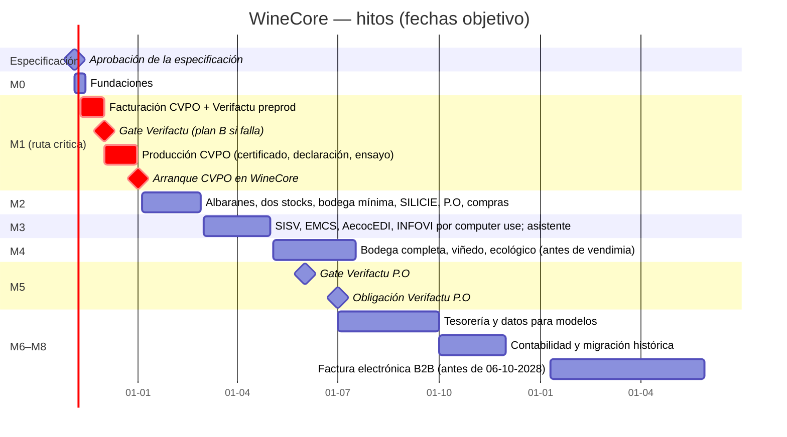

# 09 · Hoja de ruta

> Versión 1 · 31-10-2026. Fechas objetivo; cada hito cierra con QA (`11-tests.md` §13), demo en `staging` y PR a `main` aprobado por Pedro. Paralelismo de Fase 2: máximo 3–4 agentes hijo (§7.1), sin ficheros solapados. La ruta crítica es **Verifactu de CVPO**.

## 1. Vista general

## 2. Hitos

### M0 · Fundaciones — 04-11 → 13-11-2026
- **Entrega**: estructura Timbal (`ui/`, `api/`, `workforce/`) sobre GitHub como fuente de verdad; CI completa (`ci.yml`, `deploy.yml`, `remotes-drift.yml`); BD PostgreSQL (dev, staging, prod) con las 16 migraciones y permisos; acceso con Microsoft + lista blanca; roles; auditoría; series; adjuntos en S3; módulos activables; *outbox* y notificador a CVBOT; esqueleto MCP (`system_whoami`); sistema de diseño y navegación; generador de datos sintéticos; esqueleto de la bandeja de aprobaciones.
- **Depende de**: aprobación de la especificación; Q-004 (GitHub conectado o credencial para el Plan B; entornos `staging` y `dev`); Q-027 (cuenta de AWS); Q-028 (rutas de máquina en Timbal); Q-029 (URL de eventos de CVBOT; si falta, el notificador queda desactivado).
- **Criterio de salida**: un PR de prueba recorre `feat/*` → `dev` → `staging` y despliega la misma SHA; `api/health` devuelve la SHA y las migraciones; login con un usuario de la lista blanca y 403 con otro.

### M1 · Facturación de CVPO con Verifactu en preproducción — 09-11 → 30-11-2026 · **Gate 01-12-2026**
- **Entrega**: contactos (con importación de CVPO y deduplicación), catálogo aprobado, tarifas, reglas de entidad facturadora (D3), pedidos (manual y MCP), facturas completas y rectificativas, IRPF y recargo, PDF ES/EN con QR, emisión en lote con aprobación, anulación, **registros Verifactu encadenados y envío al entorno de pruebas de la AEAT**, estado y subsanación, declaración responsable en Ajustes, passkeys y bandeja de aprobaciones, cobros parciales y partidas abiertas de CVPO, herramientas MCP de M1, avisos a CVBOT.
- **Depende de**: M0; Q-002 y Q-003 (modalidad y aprobación en la emisión); Q-005 (aprobadores); Q-006 (certificado reconocido para preproducción); Q-015 y Q-025 (tienen valor por defecto).
- **Gate del 01-12-2026** (Pedro decide con datos): batería de preproducción de `verifactu.md` al 100 %; 0 fallos de numeración en las propiedades; QA de M1 completo. **Si no pasa → plan B (Q-008)**: CVPO factura en Holded con Verifactu desde el 01-01-2027 y WineCore entra en producción cuando pase.

### M1b · Paso a producción de CVPO — 01-12 → 31-12-2026
- **Entrega**: certificado de producción custodiado (ADR 003), declaración responsable firmada (Q-007), instalación Verifactu de producción, series de 2027 (`CF27-`, `CR27-`), carga final de contactos y partidas abiertas de CVPO, ensayo general (emisión de facturas de prueba en el entorno de pruebas de la AEAT con datos reales en una serie de pruebas que nunca va a producción), formación de administración.
- **Arranque**: **01-01-2027** CVPO factura en WineCore. Holded queda en solo lectura para CVPO (no se da de baja hasta 2 semanas sin incidencias).

### M2 · Albaranes, dos stocks, bodega mínima, SILICIE, P.O y compras — 04-01 → 26-02-2027
- **Entrega**: aforo de arranque firmado (31-12-2026) y saldos iniciales en ambos libros; ubicaciones; depósitos; lotes; trasiego, ensamblaje (sin fórmula), adiciones, envasado, etiquetado de jaulón, mermas, limpiezas, rectificación de operaciones; albaranes de venta/consigna/traspaso/devolución; incidencias; libro físico y fiscal con regla de fecha fiscal configurable; existencias a fecha y PDF de inspección; conciliación físico/fiscal; bloqueo de periodos; **asientos SILICIE generados al día** (presentación aún manual con el fichero de WineCore); informe de libros SISV para teclear a mano hasta M3; P.O factura en WineCore (con VERI*FACTU activado voluntariamente desde el principio); exportación, intracomunitaria y Canarias; intercompañía mensual con factura espejo; gastos con OCR; libros de IVA; revisión de albaranes pendientes de Holded; partidas abiertas de P.O; tarifa intercompañía y costes estándar; correo de facturas con clic (si Q-014).
- **Depende de**: M1; Q-010, Q-013, Q-016, Q-017, Q-020, Q-021.

### M3 · Regulatorio por *computer use* y asistente — 01-03 → 30-04-2027
- **Entrega**: ejecutor local instalado y protocolo; conectores SILICIE (carga de fichero), SISV (importación mensual y envío de libros), EMCS (e-DA, recepción, anulación, cambio de destino), AecocEDI (lectura de pedidos, factura, aviso de pago, ficha para teclear), INFOVI (declaraciones y cosecha); calendario de obligaciones; cuadre SISV ↔ SILICIE semanal; asistente interno; resumen diario; vigilantes; pedidos web por Stripe (si Q-018).
- **Depende de**: M2; Q-009, Q-012, Q-018, Q-019, Q-024, Q-026, Q-030, Q-031.
- **Primeros envíos reales con aprobación**: SISV de marzo (antes del 10-04-2027, si se confirma ese plazo); e-DA desde abril.

### M4 · Bodega completa, viñedo y ecológico — 03-05 → 16-07-2027 (antes de la vendimia)
- **Entrega**: recepción de uva con documento de acompañamiento; prensado/encubado; fin de fermentación; lecturas de fermentación con gráfica y alertas; analíticas y catas; ensamblaje con fórmula (mL → % → L); parcelas SIGPAC, tratamientos, labores, controles de maduración por voz y foto (agente `vendimia-campo`), vendimia; informe para la certificadora; trazabilidad completa botella → parcela.

### M5 · Verifactu de P.O — gate 01-06-2027, obligación 01-07-2027
- P.O ya factura en WineCore desde M2 con VERI*FACTU; M5 verifica producción, certificado de P.O y declaración, y cierra cualquier hallazgo antes del 01-07-2027.

### M6 · Tesorería y datos para modelos — 01-07 → 30-09-2027
- Importación de extractos (Norma 43/CAMT/CSV) y conciliación sugerida; remesas SEPA; previsión de tesorería; exportaciones para 303/390/347/349/115/130 (`modelos-aeat.md`).

### M7 · Contabilidad y migración histórica — 01-10 → 30-11-2027
- Plan de cuentas, asientos automáticos y exportación a la asesoría (según Q-022); histórico completo de Holded y Shopify con cuadre al céntimo; PDF vinculados; diario D7.

### M8 · Factura electrónica B2B — antes del 06-10-2028 (planificación en 2T-2027)
- Recepción de facturas electrónicas (cargos de ECI desde el 06-10-2027 si el asesor lo confirma, Q-032); emisión UBL por la solución pública o plataforma conforme; estados (CVPO desde 2028; P.O desde 2029); decisión AecocEDI (ADR 006 C/D).

### Posterior (sin fecha)
Etiqueta electrónica, conocimiento de añadas, planificador de vendimia, costes por partida, TPV con simplificadas, OSS, integraciones de paquetería, APPCC.

## 3. Calendario regulatorio que condiciona los hitos

| Fecha | Obligación | Quién lo hace | Hito que lo cubre |
|---|---|---|---|
| 20-12-2026 | INFOVI (declaración de noviembre; < 1.000 hl) | Como hoy (manual) | M3 desde agosto de 2027 |
| 10-12 (anual) | Declaración de cosecha (RD 739/2015 art. 3.2) | Como hoy en 2026 | M4 para 2027 |
| 31-12-2026 (último día hábil de diciembre) | SILICIE: movimientos de agosto a noviembre de 2026 | Como hoy (administración saliente/asesoría) | — |
| **01-01-2027** | **Verifactu CVPO** (RD 1007/2023 DF 4ª, mod. RDL 15/2025) | WineCore (o plan B) | M1/M1b |
| Mensual, día 10 (según Bacosoft; pendiente de la Junta) | SISV: importación y envío de libros del mes anterior | Manual con el informe de WineCore (M2) → *computer use* (M3) | M2/M3 |
| **01-07-2027** | **Verifactu P.O** | WineCore | M2/M5 |
| 20-08-2027 | INFOVI (declaración de julio) | WineCore | M3 |
| **31-08-2027** (último día hábil de agosto) | SILICIE: movimientos de diciembre de 2026 a julio de 2027 | WineCore + ejecutor | M2/M3 |
| ~31-10-2027 | Cierre del ejercicio SILICIE 2026 (2 meses tras el último plazo; art. 4 bis Orden HAC/998/2019) | WineCore + ejecutor | M3 |
| 06-10-2027 | ECI obligada a factura electrónica B2B | — | M8 (recepción) |
| 31-12-2027 | SILICIE: agosto–noviembre de 2027 | WineCore | — |
| 06-10-2028 | Factura electrónica B2B para P.O y CVPO | WineCore | M8 |

**Vigilancia normativa**: la nota de Hacienda del 05-10-2026 anuncia la intención de aplazar Verifactu a octubre de 2028; **no está en el BOE** a 31-10-2026. El plan mantiene las fechas del BOE. Si se publica el aplazamiento, Pedro decide si relajar M1 (recomendación: mantener M1 igualmente, porque Holded es caro y la facturación propia es la base del resto).

## 4. Dependencias entre hitos y riesgos de calendario
- La **latencia de aprobación de esta especificación** es el primer riesgo (R20): cada día de retraso sobre el 04-11-2026 se come margen del gate.
- M1 no depende de stock ni de bodega (la factura de CVPO lleva lote como texto hasta M2).
- M2 necesita el aforo del 31-12-2026: si no se hace ese día, se hace en la primera semana de enero con fecha de corte declarada y los movimientos de enero se registran después (sin perder la regla de periodos).
- M3 necesita el equipo del ejecutor (Q-026) y las credenciales en su llavero.
- M4 tiene una fecha natural inamovible: la **vendimia** (agosto–septiembre de 2027).
