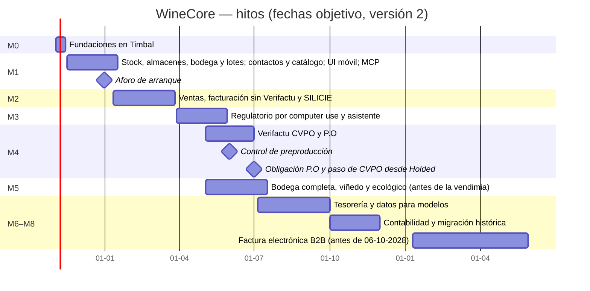

# 09 · Hoja de ruta

> Versión 2 · 31-10-2026 (correcciones de Pedro: **todo en Timbal**, **Verifactu fuera de la ruta crítica**, primero las operaciones del núcleo). Fechas objetivo; cada hito cierra con QA en todas sus pantallas a 390 y 1440 px (`11-tests.md` §13), demo en un entorno de pruebas y PR a `main` aprobado por Pedro. Subagentes: Grok por defecto y como mucho un Opus a la vez.

## 1. Vista general

## 2. Hitos

### M0 · Fundaciones en Timbal — 02-11 → 13-11-2026
- **Entrega**: monorepo con la estructura del SDR (`ui/`, `api/`, `workforce/`) en GitHub como fuente de verdad; CI (`ci.yml`) y despliegue en el proyecto Timbal 3942; esquema DuckDB en la Knowledge Base con la **prueba de atomicidad** (ADR 002); escritor único y guardas del núcleo con sus tests; acceso con Microsoft y lista blanca; roles; auditoría encadenada; series; documentos; módulos activables; *outbox* y avisos a CVBOT; esqueleto MCP (`system_whoami`); sistema de diseño y navegación móvil; datos sintéticos.
- **Depende de**: credencial de Timbal para el agente (cuenta dedicada **solo de la org 122**, Q-004); Q-028 (Knowledge Base); copia del SDR para su estructura y su UI (Q-034); Q-029 (si falta, los avisos a CVBOT quedan desactivados). GitHub conectado en Timbal es tarea de Pedro: si no está, se usa el remoto git interno de Timbal.
- **Criterio de salida**: un commit de `main` se despliega en el entorno Main (4165) con la misma SHA; `api/health` responde con la SHA y la versión del esquema; login con un usuario de la lista blanca y 403 con otro; resultados de la prueba de atomicidad documentados.

### M1 · Stock, almacenes, bodega y lotes — 16-11-2026 → 15-01-2027
- **Entrega**: contactos (importación de CVPO y P.O con deduplicación), catálogo aprobado y tarifas; ubicaciones y almacenes (incluidos los externos, Q-021); depósitos con QR; lotes y genealogía; operaciones de bodega (trasiego, ensamblaje, adiciones, envasado, etiquetado de jaulón, mermas, limpiezas, rectificación); libros físico y fiscal; **aforo de arranque del 31-12-2026**; existencias a fecha e informe de inspección; conciliación físico ↔ fiscal; bloqueo de periodos; bandeja de aprobaciones con passkey; MCP de lectura (existencias, lotes, depósitos) y borradores de operación con confirmación; UI móvil de bodega (operación, depósitos, aforo).
- **Depende de**: M0; Q-005 (se aplica su recomendación como supuesto); Q-013 (aforo); Q-020 (códigos de depósitos); Q-021.

### M2 · Ventas, facturación sin Verifactu y SILICIE — 11-01 → 26-03-2027
- **Entrega**: reglas de entidad facturadora (D3); pedidos; albaranes con lote (venta, consigna, traspaso, devolución) e incidencias; **facturación de P.O** (completas y rectificativas, IRPF, recargo, exportación, intracomunitaria, Canarias, PDF ES/EN, emisión en lote con aprobación); cobros y partidas abiertas; intercompañía mensual; **SILICIE**: mayores, asientos al día (incluidos los cambios depósito ↔ barrica) y fichero CSV oficial, con la presentación aún manual hasta M3; gastos con OCR y libros de IVA; revisión de albaranes pendientes de Holded; MCP de ventas y facturación.
- **CVPO**: hasta M4 sigue facturando en **Holded con Verifactu** (obligatorio desde el 01-01-2027); WineCore lleva sus pedidos, albaranes y cobros e importa sus facturas de Holded como externas (Q-033, supuesto).
- **Depende de**: M1; Q-009, Q-010, Q-016, Q-017, Q-033.

### M3 · Regulatorio por *computer use* y asistente — 29-03 → 28-05-2027
- **Entrega**: ejecutor local; presentación de SILICIE (importación de fichero), SISV (importación mensual), EMCS (e-DA y mensajes), AecocEDI (pedidos, factura, aviso de pago) e INFOVI; calendario de obligaciones; cuadre SISV ↔ SILICIE; asistente interno; resumen diario; vigilantes; pedidos web (si Q-018).
- **Depende de**: M2; Q-012, Q-018, Q-019, Q-024, Q-026, Q-030, Q-031.

### M4 · Verifactu (CVPO y P.O) — 03-05 → 30-06-2027 · control 01-06-2027
- **Entrega**: registros encadenados, envío por servicio web desde el entorno aislado `verifactu`, subsanaciones, declaración responsable, batería de preproducción VF-01…VF-22, PDF con QR.
- **Control del 01-06-2027**: batería al 100 % en preproducción. **01-07-2027**: P.O factura con Verifactu en WineCore (obligación legal) y CVPO pasa de Holded a WineCore.
- **Depende de**: Q-002 y Q-003 (supuestos), Q-006 (certificado, se decide al final), Q-007 (declaración responsable), Q-008.

### M5 · Bodega completa, viñedo y ecológico — 03-05 → 16-07-2027 (antes de la vendimia)
- **Entrega**: recepción de uva, prensado, fin de fermentación, lecturas con alertas, analíticas y catas, ensamblaje con fórmula; parcelas, tratamientos y cuaderno (CUE), labores, maduración, vendimia; certificados e informe ecológicos; trazabilidad completa botella → parcela. Va en paralelo a M4.

### M6 · Tesorería y datos para modelos — 05-07 → 30-09-2027
- Extractos y conciliación, remesas SEPA, previsión de tesorería, exportaciones para 303/390/347/349/115/130 (`modelos-aeat.md`).

### M7 · Contabilidad y migración histórica — 01-10 → 30-11-2027
- Plan de cuentas y asientos (Q-022); histórico de Holded y Shopify con cuadre; PDF vinculados; diario D7.

### M8 · Factura electrónica B2B — antes del 06-10-2028
- Recepción y emisión estructuradas (UBL) y estados (Q-032); decisión AecocEDI (ADR 006).

### Posterior (sin fecha)
Etiqueta electrónica, conocimiento de añadas, planificador de vendimia, costes por partida, TPV con simplificadas, OSS, paquetería, APPCC.

## 3. Calendario regulatorio que condiciona los hitos

| Fecha | Obligación | Quién lo hace | Hito |
|---|---|---|---|
| Ya (31-10-2026 es sábado → primer día hábil) | Comunicación de cierre de SILICIE 2025 | Administración actual | — (R24) |
| 10-12 y 20-12-2026 | Declaración de cosecha e INFOVI | Como hoy | M3 desde 2027 |
| 31-12-2026 | SILICIE: agosto–noviembre de 2026 | Como hoy | — |
| **01-01-2027** | **Verifactu CVPO** | **Holded** con Verifactu hasta M4 (Q-033) | M4 |
| Mensual, día 10 | SISV del mes anterior | Manual con el informe de WineCore → *computer use* | M2/M3 |
| **01-07-2027** | **Verifactu P.O** (y paso de CVPO) | WineCore | M4 |
| 20-08-2027 | INFOVI | WineCore | M3 |
| **31-08-2027** | SILICIE: diciembre de 2026 a julio de 2027 (incluida la apertura de 2027) | WineCore + ejecutor | M2/M3 |
| 02-11-2027 | Cierre del ejercicio SILICIE 2026 | WineCore + ejecutor | M3 |
| 06-10-2027 / 06-10-2028 | Factura electrónica B2B (ECI / P.O y CVPO) | WineCore | M8 |

**Vigilancia normativa**: Hacienda anunció el 05-10-2026 la intención de aplazar Verifactu a octubre de 2028; **no está en el BOE** a 31-10-2026. Si se publica, CVPO podría facturar en WineCore antes de M4 sin Verifactu.

## 4. Dependencias y riesgos de calendario
- M0 necesita la credencial de Timbal: sin ella se avanza en código y CI, pero no se despliega.
- M1 necesita el aforo del 31-12-2026: si no se hace ese día, en la primera semana de enero con fecha de corte declarada.
- M3 necesita el equipo del ejecutor (Q-026).
- M4 tiene una fecha legal inamovible (01-07-2027) y M5 una natural (la vendimia).
